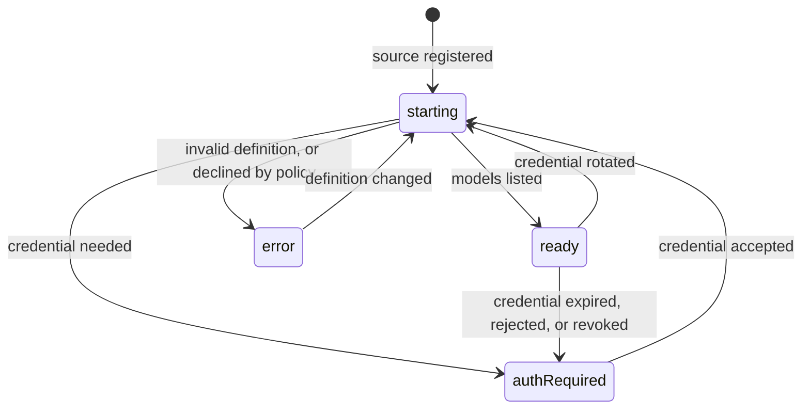
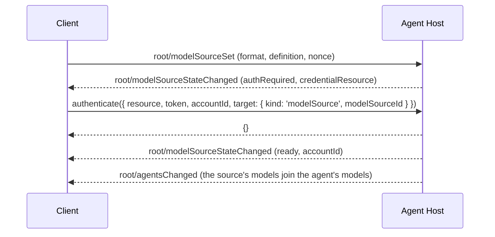

# Model Sources

A model source is where an agent provider's models come from, such as a service, a subscription, or an endpoint the user configured with their own key. Root state lists every source in [`RootState.modelSources`](/reference/root#modelsource), and each model names its source in [`SessionModelInfo.modelSourceId`](/reference/root#sessionmodelinfo). Clients use sources to label and group models, for example in a model picker.

AHP intentionally does **not** re-spec how an agent reaches a model endpoint. It carries:

- The list of sources, and which models each one serves.
- A way for clients to register a source the agent doesn't have, with a definition the agent reads.
- Each registered source's status.
- A path for the source's credential.

Reading the definition, validating endpoints, discovering models, and the wire protocol for inference all belong to the agent.

## Where model sources appear

Every source is an entry in `RootState.modelSources`, naming the agent `provider` it serves. There are two kinds:

1. **Built-in sources** that an agent provides itself, such as a first-party subscription. The host lists them without a `format` or `definition`, and their sign-in uses [`AgentInfo.protectedResources`](/specification/authentication#discovery).
2. **Registered sources** that a client registered, or that the host registered from its own configuration. They carry a `format`, a `definition`, and a `nonce`, and the host reports their status.

```typescript
const sources = state.modelSources?.filter(s => s.provider === agent.provider) ?? [];
const registered = sources.filter(s => s.definition !== undefined);
```

## Shape

```typescript
ModelSource {
  id: string                            // host-unique; the modelSourceId of its models
  provider: string                      // agent provider that serves its models
  displayName: string
  icons?: Icon[]
  format?: string                       // registered sources only
  definition?: Record<string, unknown>  // how the agent reaches the source; never a credential
  nonce?: string                        // version token for definition
  retention?: 'contributingClient' | 'host'

  // Host-reported, set together by root/modelSourceStateChanged
  state?: ModelSourceState              // starting | ready | authRequired | error
  credentialResource?: ProtectedResourceMetadata
  accountId?: string
}
```

## Registering a source

An agent that serves models from client-registered sources advertises [`AgentCapabilities.modelSourceRegistration`](/reference/root#modelsourceregistrationcapability) with the formats it reads, most preferred first. Each agent decides which formats it reads. `ModelSource.format` notes a few common names that some agents may read, such as `openaiCompatible` and `anthropic`. Other formats are named with a namespace, such as `example.com/model-source@1`.

A client registers a source with [`root/modelSourceSet`](/reference/root#rootmodelsourcesetaction), giving its `format`, a `definition` that tells the agent how to reach it, and a `nonce` that versions the definition, such as a hash of it. Every client can read a definition, so it MUST NOT contain a credential.

`Set` adds the source, or replaces the one with the same `id`:

- **Add.** No source has the `id`.
- **Re-register.** One has, with the same `provider`, `format`, and `nonce`. The source keeps its host-reported fields and takes everything else from the action, so re-registering doesn't disturb a working source.
- **Update.** Any of the three differs. The source is replaced, its host-reported fields stay absent until the host reports again, and the host drops its credential.

[`root/modelSourceRemoved`](/reference/root#rootmodelsourceremovedaction) removes a source for every client. The host rejects either action when it breaks the rules in [Server Validation of Client Actions](/specification/root-channel#server-validation-of-client-actions).

A client registers its sources when it starts or reconnects, and when the user changes one. It SHOULD derive `id` from a stable key in its own configuration, so every window and device with the same source shares one. It SHOULD NOT replace a source whose `nonce` differs from its own copy unless the user changed that source; otherwise two clients with different configurations replace each other's source indefinitely.

Each client that registers a source is a **contributing client**. The host tracks contributing clients itself, from `ActionEnvelope.origin`, so they aren't in state. Every connected client may change, supply credentials for, and select every source. A host that can verify principals MAY restrict a source to clients of the principal that registered it.

## Status

The host reports a registered source's status with [`root/modelSourceStateChanged`](/reference/root#rootmodelsourcestatechangedaction), which sets `state`, `credentialResource`, and `accountId` together. The reducer ignores an unknown `id`, so a late report can't bring back a removed source.



Once a source has been `ready`, its models stay in the agent's `models` through later `starting` and `authRequired` states, so rotating a key doesn't break a selection. They leave when the source is removed or enters `error`, or when an update changes its endpoint. A host SHOULD derive model IDs deterministically from the source and the endpoint's model identifiers, so a source registered again keeps its IDs.

## Credentials

A registered source that takes a credential carries `credentialResource`, RFC 9728 metadata for the endpoint the credential is for, in every state. When the source needs a credential, its state is `authRequired` with a `reason`, and a client answers with [`authenticate`](/reference/common#authenticate) and a `modelSource` target:



The token is whatever the source's definition calls for, such as an API key. The host publishes the request's `accountId` as the source's `accountId`, so a client that reloads, or one on another device, can tell whether the host holds its current key. A delivery replaces the credential the host holds. [Model source credentials](/specification/authentication#model-source-credentials) lists the host's rules.

| `reason` | Meaning | What a client may send |
| --- | --- | --- |
| `required` | The host holds no credential yet. | Its key. |
| `expired` | The credential's lifetime, or the lease a client set with `expiresIn`, lapsed. | A renewed credential. |
| `rejected` | The endpoint refused the credential. `accountId` still names it. | Only a key whose `accountId` differs. |
| `revoked` | A client revoked the credential. | Nothing, until a user asks. |

Clients MUST NOT cache a model source credential they delivered, or replay one, for example after a reconnect. A client delivers one only in answer to the source's current state, and MUST NOT send a stored secret unless the source's `provider` and `format` match its own copy and every endpoint in the source's `definition` that the key would reach is one its own copy sends the key to.

## Retention

A source's `retention` decides what happens when its last contributing client disconnects and doesn't return within a grace period the host chooses:

- `contributingClient`, the default: the host stops new work on the source, lets running turns finish, and then removes it.
- `host`: the source stays until a client removes it or host policy expires it.

The host SHOULD reject an automation that names a model from a `contributingClient`-retained source, because the automation would outlive the source.

## Unavailable sources

The host checks a selection whenever it uses one, and never runs work on a model other than the one selected. When a turn can't use its source, the host ends the turn with an error part whose `errorType` is `modelSourceUnavailable` and whose `resumable` is `true`. Once the source is ready again, a client can continue the turn with `chat/turnResume`. A request that selects such a model fails with [`ModelSourceUnavailable`](/reference/error-codes#ahp-application-codes) (`-32013`).

When a client removes a source or revokes its credential, the host ends running turns that use it.

## Next steps

- [Root Channel](/specification/root-channel#model-sources) — the rules every model source follows, and which registrations the host rejects.
- [Authentication](/specification/authentication#model-source-credentials) — the host's rules for model source credentials.
- [Root Reference](/reference/root#modelsource) — full type definitions for `ModelSource`, `ModelSourceState`, and the root actions.
