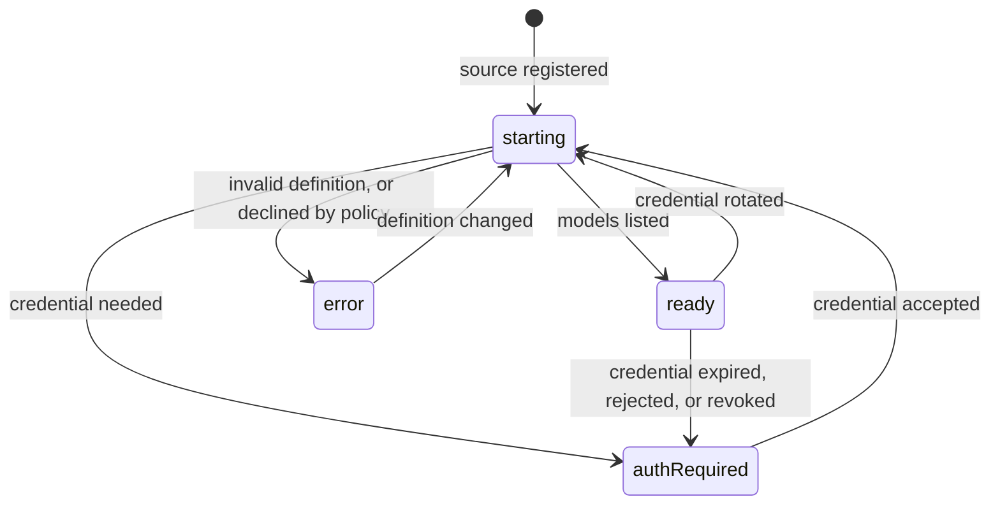
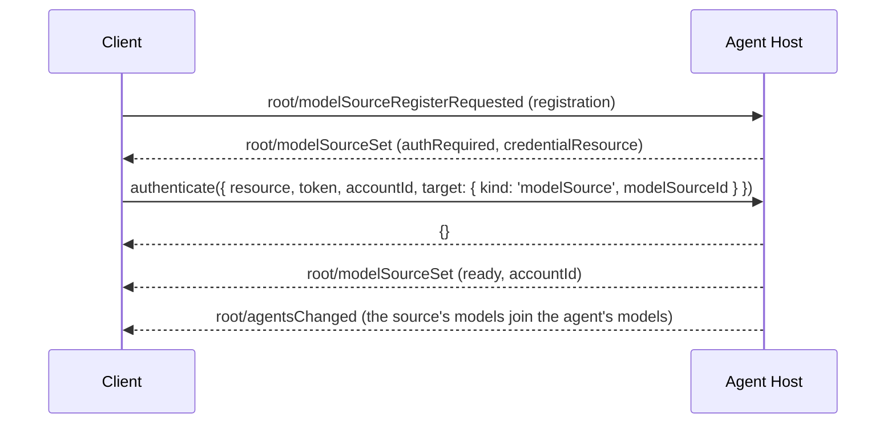

# Model Sources

A model source is where an agent provider's models come from, such as a service, a subscription, or an endpoint the user configured with their own key. Root state lists every source in [`RootState.modelSources`](/reference/root#modelsource), and each model names its source in [`SessionModelInfo.modelSourceId`](/reference/root#sessionmodelinfo). Clients use sources to label and group models, for example in a model picker.

AHP intentionally does **not** re-spec how an agent reaches a model endpoint. It carries:

- The list of sources, and which models each one serves.
- A way for clients to register a source the agent doesn't have, with a definition the agent reads.
- Each registered source's status.
- A path for the source's credential.

Reading the definition, validating endpoints, discovering models, and the wire protocol for inference all belong to the agent.

## Where model sources appear

Every source is an entry in `RootState.modelSources`, naming the agent `provider` it serves and its `state`. There are two kinds:

1. **Built-in sources** that an agent provides itself, such as a first-party subscription. The host lists them without a `registration`, and their sign-in uses [`AgentInfo.protectedResources`](/specification/authentication#discovery).
2. **Registered sources** that a client registered, or that the host registered from its own configuration. Their `registration` carries the definition the agent reads.

```typescript
const sources = state.modelSources?.filter(s => s.provider === agent.provider) ?? [];
const registered = sources.filter(s => s.registration !== undefined);
```

## Shape

```typescript
ModelSource {
  id: string                            // host-unique; the modelSourceId of its models
  provider: string                      // agent provider that serves its models
  displayName: string
  icons?: Icon[]
  registration?: {                      // absent on built-in sources
    format: string
    definition: Record<string, unknown> // how the agent reaches the source; never a credential
    retention?: 'contributingClient' | 'host'
  }
  state: ModelSourceState               // starting | ready | authRequired | error
  credentialResource?: ProtectedResourceMetadata
  accountId?: string
}
```

## Registering a source

An agent that serves models from client-registered sources advertises [`AgentCapabilities.modelSourceRegistration`](/reference/root#modelsourceregistrationcapability) with the formats it reads, most preferred first. Each agent decides which formats it reads. `ModelSourceRegistration.format` notes a few common names that some agents may read, such as `openaiCompatible` and `anthropic`. Other formats are named with a namespace, such as `example.com/model-source@1`.

Registration follows the same pattern as automations: the client asks, and the host publishes the result.

1. A client dispatches [`root/modelSourceRegisterRequested`](/reference/root#rootmodelsourceregisterrequestedaction) with the source's `modelSourceId`, `provider`, `displayName`, and a `registration` holding its `format` and a `definition` that tells the agent how to reach it. Every client can read a definition, so it MUST NOT contain a credential. The request doesn't change state.
2. The host validates the request and publishes the source with [`root/modelSourceSet`](/reference/root#rootmodelsourcesetaction), which adds it or replaces the one with the same `id`. When the registration is unchanged, the host keeps the source's status and credential. When the definition changes, it drops the credential and the source goes back to `starting`.

[`root/modelSourceRemoved`](/reference/root#rootmodelsourceremovedaction) removes a source for every client. The host rejects either client action when it breaks the rules in [Server Validation of Client Actions](/specification/root-channel#server-validation-of-client-actions).

A client registers its sources when it starts or reconnects, and when the user changes one. It SHOULD derive `id` from a stable key in its own configuration, so every window and device with the same source shares one. It SHOULD NOT replace a source whose definition differs from its own copy unless the user changed that source; otherwise two clients with different configurations replace each other's source indefinitely.

Each client that requests a registration is a **contributing client**. The host tracks contributing clients itself, from `ActionEnvelope.origin`, so they aren't in state. Every connected client may change, supply credentials for, and select every source. A host that can verify principals MAY restrict a source to clients of the principal that registered it.

## Status

Only the host dispatches `root/modelSourceSet`, and it uses it for every change to a source, including its `state`, `credentialResource`, and `accountId`.



Once a source has been `ready`, its models stay in the agent's `models` through later `starting` and `authRequired` states, so rotating a key doesn't break a selection. They leave when the source is removed or enters `error`, or when an update changes its endpoint. A host SHOULD derive model IDs deterministically from the source and the endpoint's model identifiers, so a source registered again keeps its IDs.

## Credentials

A registered source that takes a credential carries `credentialResource`, RFC 9728 metadata for the endpoint the credential is for, in every state. When the source needs a credential, its state is `authRequired` with a `reason`, and a client answers with [`authenticate`](/reference/common#authenticate) and a `modelSource` target:



The token is whatever the source's definition calls for, such as an API key. The host publishes the request's `accountId` as the source's `accountId`, so a client that reloads, or one on another device, can tell whether the host holds its current key. A delivery replaces the credential the host holds. [Model source credentials](/specification/authentication#model-source-credentials) lists the host's rules.

| `reason` | Meaning | What a client may send |
| --- | --- | --- |
| `required` | The host holds no credential yet. | Its key. |
| `expired` | The credential's lifetime, or the lease a client set with `expiresIn`, lapsed. | A renewed credential. |
| `rejected` | The endpoint refused the credential. `accountId` still names it. | Only a key whose `accountId` differs. |
| `revoked` | A client revoked the credential. | Nothing, until a user asks. |

Clients MUST NOT cache a model source credential they delivered, or replay one, for example after a reconnect. A client delivers one only in answer to the source's current state, and MUST NOT send a stored secret unless the source's `provider` and `registration.format` match its own copy and every endpoint in its `registration.definition` that the key would reach is one its own copy sends the key to.

## Retention

A registered source's `registration.retention` decides what happens when its last contributing client disconnects and doesn't return within a grace period the host chooses:

- `contributingClient`, the default: the host stops new work on the source, lets running turns finish, and then removes it.
- `host`: the source stays until a client removes it or host policy expires it.

The host SHOULD reject an automation that names a model from a `contributingClient`-retained source, because the automation would outlive the source.

## Unavailable sources

The host checks a selection whenever it uses one, and never runs work on a model other than the one selected. Requests and turns that need an unavailable source fail with [`ModelSourceUnavailable`](/reference/error-codes#ahp-application-codes) (`-32013`). A turn ends with an error part whose `error.errorCode` is that code and whose `resumable` is `true`, so once the source is ready again, a client can continue the turn with `chat/turnResume`.

When a client removes a source or revokes its credential, the host ends running turns that use it.

## Next steps

- [Root Channel](/specification/root-channel#model-sources) — the rules every model source follows, and which registrations the host rejects.
- [Authentication](/specification/authentication#model-source-credentials) — the host's rules for model source credentials.
- [Root Reference](/reference/root#modelsource) — full type definitions for `ModelSource`, `ModelSourceState`, and the root actions.
