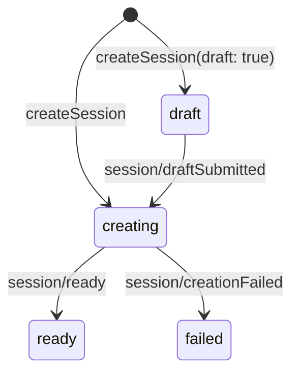
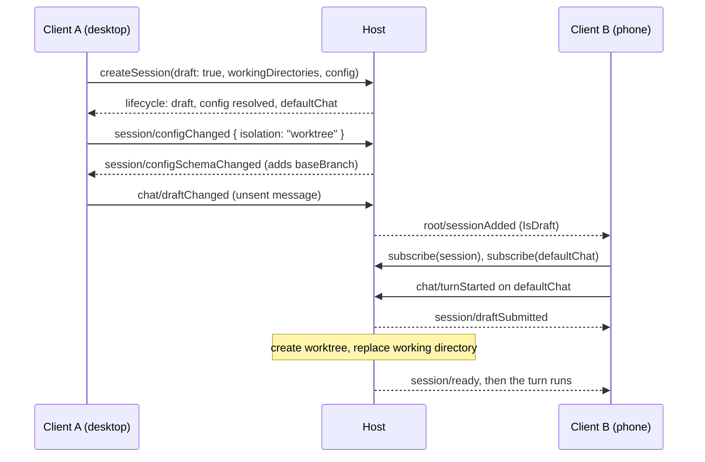

# Draft Sessions — Feature Overview

> A conceptual walkthrough of draft sessions for design discussion, followed by
> a map of the protocol surface. Like the [multiroot](./multiroot-sessions.md)
> and [multi-chat](./multi-chat.md) overviews, it explains **what** the
> capability is and **why** it exists before it gets to the wire shape. The
> normative text is in
> [Session Channel: Draft sessions](../specification/session-channel.md#draft-sessions).

---

## 1. The problem

AHP has no state for "the user intends to start a session here, with these
settings, and this is what they are typing". A session either exists, and has
already been prepared, or it does not exist at all. That gap shows up in three
places:

- **Drafts don't travel.** An unsent first message lives only in the client that
  is composing it. `ChatState.draft` already syncs unsent input, but only inside
  a session that exists.
- **Composers create sessions outside the spec.** To give the new-session input
  completions, skills, custom agents, and live config pickers, VS Code creates a
  real session when the composer opens and holds it in `creating` until the
  first send. The host then hides it from the catalogue with an "idle
  provisional" heuristic, even though the spec says `root/sessionAdded` is
  always broadcast. Changing an input that cannot change after creation forces
  the client to replace the session and rebind its UI to the new one.
- **Preparation happens too early.** Picking a worktree, or (with repository
  preparation) a repository to clone, is a decision the user can still change
  while composing. With a session created eagerly, the host either prepares too
  early or the client keeps the real choice local and swaps in a placeholder
  until the first send.

The config pickers have a related cost: `resolveSessionConfig` is a stateless
loop in which the client re-sends everything it has collected after every
change, and `sessionConfigCompletions` does the same for each lookup.

**The feature in one sentence:** add a `draft` phase to the session lifecycle,
in which the session exists as shared, editable state but the host has prepared
nothing for it.

---

## 2. The mental model

- **A draft is a session.** It has a URI, a default chat, config state,
  customizations, and active clients. Everything that already targets a session
  or chat (completions, customizations, config, the chat's message `draft`)
  works against it unchanged.
- **A draft has no side effects.** The host may warm up the agent provider's
  runtime, but it must not clone, create worktrees or branches, or write into the
  working directories.
- **A draft's inputs stay editable.** Config values and working directories can
  change freely; `sessionMutable` and primary-slot restrictions apply only after
  submission. The agent provider is fixed.
- **Submission is the point of no return.** Sending the first message moves the
  session to `creating`, and the
  host prepares it from its final inputs.

---

## 3. Walkthrough

The user starts on the desktop and finishes on the phone. Nothing on disk
changes until the phone sends the message.

---

## 4. Protocol surface

| Surface | Change |
|---|---|
| `SessionLifecycle.Draft` | New lifecycle phase before `creating`. |
| `SessionStatus.IsDraft` | Bit set while the session is a draft, so session lists can tell drafts apart without subscribing. |
| `CreateSessionParams.draft` | Creates the session as a draft. |
| `session/draftSubmitted` | Host-dispatched when it accepts the first turn on a draft's default chat. Moves `draft` to `creating` and clears `IsDraft`. An invalid draft is reported by rejecting the `chat/turnStarted`. |
| `session/configSchemaChanged` | Host-dispatched. Replaces the config schema and optionally its values, so the host can re-resolve a draft's config in state. |
| `session/configChanged` | Any schema property may change while drafting. |
| `session/workingDirectory*` | Capability and primary-slot restrictions are lifted while drafting. |
| `sessionConfigCompletions` | `channel` may be a session URI, in which case the host reads context from that session's state. |
| `InitializeResult.draftSessions` | Host capability. |
| `ClientCapabilities.draftSessions` | Client opt-in. Hosts only show drafts to clients that declare it. |

All new surface is marked **1.0 - Early development**.

---

## 5. What this replaces in VS Code

| Today | With draft sessions |
|---|---|
| A provisional session held in `creating` until the first send | A draft session |
| Host suppresses `root/sessionAdded` and filters "idle provisional" sessions | `IsDraft` plus the client capability; hosts may defer announcing empty drafts |
| `tryRebind`: map the untitled UI resource to the real one, and recreate the backend when immutable inputs change | The draft URI is the session URI; inputs stay editable |
| Prewarming with folder isolation, then sending the picked worktree isolation on first send | Isolation is ordinary draft config; the worktree is created at submission |
| `resolveSessionConfig` loop alongside the provisional session's config state | One source of truth: the draft's `config`, kept resolved by the host |
| Unsent first message is local to one window | `ChatState.draft` on the draft's default chat |

---

## 6. Composing with repository preparation

Repository-backed creation ([#451](https://github.com/microsoft/agent-host-protocol/pull/451))
lets a client name a repository instead of a local directory and have the host
clone it during `creating`. That composes with drafts without changes to this
proposal: a draft holds the requested repositories as editable state, the
config and customization queries resolve against them without cloning, and the
clone happens at submission.

What drafts add is a place to keep the *request*. #451 deliberately does not echo
requested repositories into session state, because without drafts there is no
pre-preparation state to put them in. With drafts, a requested-sources field on
`SessionState` (editable only while drafting) is how another client sees and
edits what the draft will prepare. Ideally the repository input shape lands as
experimental, so it can be reshaped into a single list of sources alongside
local directories.

---

## 7. Alternatives considered

- **A separate `ahp-draft:` channel and drafts catalogue.** Cleaner for "nothing
  exists yet", but it duplicates config state, customizations, active clients,
  completion targets, and `ChatState.draft`, and needs a rebind step when the
  draft becomes a session. A draft session reuses all of that.
- **A `commitSession` command, or a client-dispatchable submit action.**
  Submitting happens only by starting a turn. The host still needs
  `session/draftSubmitted` to record the session-channel transition, because the
  chat reducer cannot change session state, but clients never dispatch it. One
  submission path keeps validation errors in one place (a rejected
  `chat/turnStarted`). Letting clients dispatch it later is additive.
- **Isolation as a protocol field.** Isolation and base branch stay in
  agent-provider config for now. Drafts remove the reason VS Code had to keep
  them local (they can no longer trigger preparation early), so promoting them
  to typed protocol state can be decided separately.

---

## 8. Open questions

- **Preparation failure.** A draft that fails during `creating` becomes `failed`
  like any session, and its unsent message is in a failed session. Should the
  host instead return it to `draft` with the error, so the user can fix the input
  and retry?
- **Draft lifetime.** Is garbage collection of empty drafts purely host policy,
  or does it need an explicit expiry clients can display?
- **Changing agent provider.** Should a draft allow switching provider, at the
  cost of re-resolving everything?
- **Automations.** `AutomationSessionTemplate` is nearly the inputs of a draft.
  Could "schedule this draft" become a one-time automation that targets it, and
  could automation editing use drafts instead of `resolveSessionConfig`?
- **Deprecating `resolveSessionConfig`.** Once drafts are stable, should the
  stateless loop be marked legacy?
- **Preparing without sending.** Is there demand to prepare a draft (for example,
  open its worktree) before the first message? If so, making
  `session/draftSubmitted` client-dispatchable would cover it.
