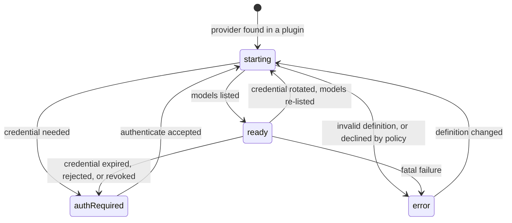
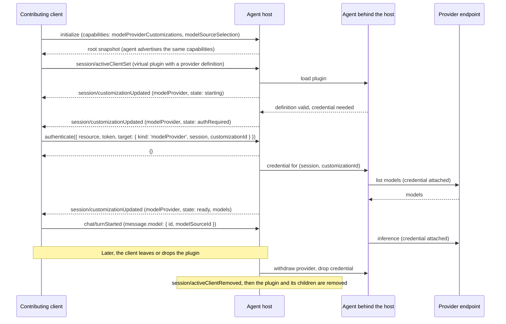

# Model Provider Customizations

> A proposal to let a client contribute bring-your-own-key (BYOK) model providers to a session as plugin customizations. It tracks [#619](https://github.com/microsoft/agent-host-protocol/issues/619) and builds on the model sources proposed in [#543](https://github.com/microsoft/agent-host-protocol/pull/543), which has not merged yet. Docs only: nothing here changes `types/`.

## Status

Proposal. The type sketches below show the intended shape. They are not part of the protocol until a follow-up change adds them to `types/`, regenerates the clients, and updates the guides and specification.

### Terminology

- A **model provider** in this document is the new customization: a provider definition inside a plugin that, once ready, offers models to a session. Prose always says "model provider" in full.
- An **agent provider** is the existing `provider` field: the agent harness behind a session (`AgentInfo.provider`, `SessionModelInfo.provider`). This proposal does not change it.
- A **model source** is #543's term for an independently selectable source of model access, identified by `modelSourceId`. A ready model provider is a session-scoped model source.

---

## 1. Problem

A client can own the user's BYOK model configuration: endpoints, wire formats, curated model lists, and API keys. A client can already send plugin content to a session through `SessionActiveClient.customizations`, so a provider definition could travel inside a plugin today. The protocol has no way to make that provider usable. There are three gaps.

- **No credential path.** [`authenticate`](/specification/authentication#token-delivery) only accepts tokens for resources the host itself advertised: `AgentInfo.protectedResources`, or a live MCP authentication challenge. The client can't give the host a provider's key.
- **No provider in session state.** No customization type represents a model provider, so the host can't report whether a provider loaded, needs a key, or failed.
- **No session-scoped models.** Models are advertised per agent in root state (`AgentInfo.models`), and #543's model sources are per agent too (`AgentInfo.modelSources`). Models that exist only because a client contributed a provider have nowhere to appear or be selected.

For example, a client such as VS Code lets users configure their own OpenAI, Anthropic, Azure, Gemini, OpenRouter, or custom OpenAI-compatible endpoints. When a session runs on a remote host (over SSH, in WSL, or through a tunnel), those models can't be offered: the key stays with the client, and the remote machine may have no secure credential storage of its own.

---

## 2. Principle: keep AHP thin

The host's agent and the plugin that declares a provider do the heavy lifting. They own:

- the provider definition format and how to read it;
- endpoint validation and network policy;
- model discovery and capability derivation (context windows, vision support, and so on);
- the wire protocol for inference;
- credential storage on the client side, and how a credential is applied to a request.

AHP carries only four things:

1. **Declaration.** A provider arrives inside a plugin, like any other customization.
2. **Status.** The host reports whether each provider is starting, ready, needs a credential, or failed.
3. **Credential.** The client supplies a secret, scoped to that one provider in that one session.
4. **Selection.** The provider's models are selectable through #543's source-qualified `ModelSelection`.

AHP does not define provider configuration schemas, model metadata derivation, discovery, or wire protocols.

---

## 3. Existing patterns this builds on

- **Client plugins.** An active client publishes `ClientPluginCustomization` entries through `SessionActiveClient.customizations` with `session/activeClientSet`. The host expands each plugin into children in `SessionState.customizations` and sets `clientId` on the container. Clients may synthesize virtual plugins in memory. When the client leaves, the host removes its plugins. See [Customizations](/guide/customizations#client-published-plugins).
- **MCP servers.** `McpServerCustomization` is a child customization with a host-published lifecycle (`state: McpServerState`), including `McpServerAuthRequiredState`. The client answers with `authenticate` and `target: { kind: 'mcpServer', session, customizationId }`, so the token applies only to that server in that session. The [authentication spec](/specification/authentication#why-keyed-by-resource-and-optional-target) notes that `target.kind` is extensible for exactly this kind of addition. See [MCP Servers](/guide/mcp#authentication).
- **Model sources ([#543](https://github.com/microsoft/agent-host-protocol/pull/543)).** `ModelSourceInfo { id, displayName }`, `SessionModelInfo.modelSourceId`, `ModelSelection.modelSourceId`, and the paired `modelSourceSelection` capabilities on the client and the agent. A qualified selection is an exact `(modelSourceId, id)` pair that hosts preserve or explicitly fail, and never silently move to another source.

---

## 4. Proposed surface

Everything here is additive and optional. There are no new actions, commands, notifications, error codes, or channels.

### 4.1 A `ModelProvider` customization type

A model provider is a child customization, like an MCP server. It appears in the `children` of the plugin that declared it.

```ts
// types/channels-session/state.ts

/** @nonexhaustive */
export const enum CustomizationType {
  // …existing…
  ModelProvider = 'modelProvider',
}

export type ChildCustomizationType =
  // …existing…
  | CustomizationType.ModelProvider;

export type ChildCustomization =
  // …existing…
  | ModelProviderCustomization;

/**
 * A model provider the host found in a plugin. The provider's definition
 * lives in the plugin's own content, in a format the host's agent
 * understands. The host publishes only display-ready state, never the
 * definition itself or any credential.
 *
 * @category Customization Types
 * @stability 1.0
 * @preserveUnknownMembers
 */
export interface ModelProviderCustomization extends CustomizationBase {
  type: CustomizationType.ModelProvider;
  /**
   * Explicit enablement decisions, with the same contract as
   * `McpServerCustomization.enablement`. A disabled provider's models are
   * not selectable.
   */
  enablement?: CustomizationEnablement[];
  /** Current lifecycle state of the provider. */
  state: ModelProviderState;
}
```

`CustomizationBase` supplies `id`, `uri`, `name`, `icons`, `range`, and `_meta`. The host mints `id`, as it does for every child. The customization's `name` is the provider's display name and plays the role that `ModelSourceInfo.displayName` plays in #543.

The contributing client finds its own definition from the child's position inside the plugin it published (the container carries its `clientId`) and from the child's `uri`, plus `range` for an inline declaration.

### 4.2 Provider status

The state mirrors `McpServerState`: a lifecycle union discriminated by `kind`, with a `*Status` enum and `*State` variants.

```ts
// types/channels-session/state.ts

/**
 * Discriminant for the ModelProviderState union.
 *
 * @category Model Provider State
 * @nonexhaustive
 */
export const enum ModelProviderStatus {
  /** The host's agent is reading and validating the definition. */
  Starting = 'starting',
  /** The provider is usable and its models are selectable. */
  Ready = 'ready',
  /** The provider needs a credential before it can be used. */
  AuthRequired = 'authRequired',
  /** The provider failed or the host declined it. */
  Error = 'error',
}

/** @preserveUnknownMembers */
export interface ModelProviderStartingState {
  kind: ModelProviderStatus.Starting;
}

/** @preserveUnknownMembers */
export interface ModelProviderReadyState {
  kind: ModelProviderStatus.Ready;
  /**
   * Models this provider offers in this session, as listed or discovered
   * by the host's agent. Every entry's `modelSourceId` MUST equal this
   * customization's `id`. An empty array means the provider is ready but
   * offers no models.
   */
  models: SessionModelInfo[];
}

/**
 * What a model provider needs in order to become ready. Deliberately
 * carries no credential.
 *
 * @preserveUnknownMembers
 */
export interface ModelProviderAuthRequirement {
  /** Why a credential is needed. */
  reason: AuthRequiredReason;
  /**
   * RFC 9728 metadata for the provider's endpoint. `resource.resource` is
   * the value the client passes back as `authenticate({ resource })`, and
   * `resource.resource_name` labels the prompt (for example
   * "OpenRouter API key"). A provider that accepts OAuth access tokens
   * advertises `authorization_servers` and `scopes_supported`; a provider
   * that takes a user-supplied secret omits them.
   */
  resource: ProtectedResourceMetadata;
  /** Human-readable hint, for example the endpoint's error description. */
  description?: string;
}

/** @preserveUnknownMembers */
export interface ModelProviderAuthRequiredState extends ModelProviderAuthRequirement {
  kind: ModelProviderStatus.AuthRequired;
}

/** @preserveUnknownMembers */
export interface ModelProviderErrorState {
  kind: ModelProviderStatus.Error;
  /** Error details. MUST NOT contain the credential. */
  error: ErrorInfo;
}

/** @category Model Provider State */
export type ModelProviderState =
  | ModelProviderStartingState
  | ModelProviderReadyState
  | ModelProviderAuthRequiredState
  | ModelProviderErrorState;
```



The host can remove the customization from any state (see [Lifecycle](#_6-lifecycle)). There is no `stopped` state: a provider that is no longer offered is removed, and a disabled provider keeps its state while its models are not selectable.

State changes travel the way other child changes do today: the host re-dispatches `session/customizationUpdated` for the containing plugin with the updated `children`.

### 4.3 Credential delivery through `authenticate`

The client delivers a provider's credential with the existing `authenticate` command and a new `target` variant.

```ts
// types/common/commands.ts

/** @nonexhaustive */
export const enum AuthenticateTargetKind {
  McpServer = 'mcpServer',
  ModelProvider = 'modelProvider',
}

/**
 * A model provider identified by host-published session and customization
 * state.
 *
 * @category Commands
 * @stability 1.0
 * @preserveUnknownMembers
 */
export interface ModelProviderAuthenticateTarget {
  kind: AuthenticateTargetKind.ModelProvider;
  /** Session URI whose `SessionState.customizations` contains the provider. */
  session: URI;
  /** The provider's session-unique `ModelProviderCustomization.id`. */
  customizationId: string;
}

export type AuthenticateTarget =
  | McpServerAuthenticateTarget
  | ModelProviderAuthenticateTarget;
```

```jsonc
// Client → Host (the command still uses the root channel)
{
  "jsonrpc": "2.0",
  "id": 7,
  "method": "authenticate",
  "params": {
    "channel": "ahp-root://",
    "resource": "https://api.example.com/v1",
    "token": "<secret>",
    "target": {
      "kind": "modelProvider",
      "session": "ahp-session:/session-1",
      "customizationId": "model-provider-1"
    }
  }
}
```

The `token` is an opaque secret. The host's agent applies it as the provider definition specifies: an `Authorization: Bearer` header, an `x-api-key` or `api-key` header, and so on. The client only supplies the secret.

When `target.kind` is `modelProvider`, the host:

- MUST apply the credential only to that provider in that session. It never applies it to sibling providers, MCP servers, other sessions, or agent-level resources, even when they share `resource`.
- MUST require `resource` to equal the `resource.resource` it most recently advertised for that provider.
- MUST reject an unknown session or customization, or a customization that is not a model provider, with `InvalidParams` (`-32602`), as it does for MCP targets.
- SHOULD reject a credential from a connection whose `clientId` isn't the provider's contributing client with `PermissionDenied` (`-32009`). The secret and the definition come from the same place.
- MUST treat an empty `token` as revocation: it drops the credential and moves the provider to `authRequired` with `reason: required`.

`expiresIn` keeps its current meaning and applies to short-lived tokens such as Microsoft Entra ID access tokens. API keys omit it. `scopes` is only meaningful for OAuth-issued tokens.

### 4.4 Models and selection

Models come from the host. When a provider is `ready`, the host publishes its models in `ModelProviderReadyState.models`, as listed or discovered by its agent. Clients never send model catalogs over AHP. A user's curated model list or per-model overrides belong in the provider definition inside the plugin, where the agent applies them.

Each published model follows #543's rules, with these specifics:

- `modelSourceId` MUST be the provider customization's `id`. Every provider model is qualified.
- `provider` stays the session's agent provider (the harness), as #543 requires. It never names the model provider.
- `vendor` MAY name the service that serves the model, for example `OpenRouter`.
- `id` is the raw model identifier the endpoint uses. It MAY repeat an identifier the agent itself offers.

Selection reuses #543's `ModelSelection` unchanged:

```json
{ "id": "example-model", "modelSourceId": "model-provider-1" }
```

It travels on every path #543 lists: `Message.model` on turns, drafts, and pending messages. The host validates the exact pair against the chat's session. The provider must exist, be enabled, be `ready`, and list the model. Otherwise the host rejects the selection through #543's failure paths (`InvalidParams` for requests, `rejectionReason` for dispatched actions).

Because session-scoped sources are new to #543, this proposal adds three rules:

- **Disjoint namespaces.** The host MUST NOT mint a model provider customization `id` equal to any `id` in the session agent's `AgentInfo.modelSources`. The host owns both namespaces and keeps them apart.
- **Bare IDs never reach a provider.** A selection without `modelSourceId` resolves only against the agent's own catalog, so a contributed provider can never capture a legacy, unqualified selection, even when it offers the same raw ID.
- **Session only.** A provider model can be selected only in the session that contains the provider. Its source ID is session-unique and the provider exists only while its client is active, so an automation template can't name one. A host validating an automation's selection against the agent's catalog rejects it, which is the intended outcome.

### 4.5 Capabilities

```ts
// types/common/commands.ts
/**
 * Presence-only capability for model provider customizations.
 *
 * @stability 1.0
 */
export interface ModelProviderCustomizationsCapability {}

// types/channels-root/state.ts
export interface AgentCapabilities {
  // …existing…
  /**
   * The agent can read model provider definitions from session plugins and
   * serve their models. Requires `modelSourceSelection`.
   */
  modelProviderCustomizations?: ModelProviderCustomizationsCapability;
}

// types/common/commands.ts
export interface ClientCapabilities {
  // …existing…
  /**
   * The client understands `ModelProviderCustomization` state and can
   * deliver credentials with a `modelProvider` authenticate target.
   * Requires `modelSourceSelection`.
   */
  modelProviderCustomizations?: ModelProviderCustomizationsCapability;
}
```

- A peer that advertises `modelProviderCustomizations` MUST also advertise #543's `modelSourceSelection`, since every provider model is qualified.
- The host surfaces `ModelProviderCustomization` children only for sessions whose agent advertises the capability.
- The host expands provider components only from plugins published by a client that declared the capability. It ignores them in other clients' plugins, because only the contributor can answer `authRequired`.
- Other subscribers may still see the child in session state. Clients that don't understand it preserve it as an unknown variant and ignore it.

### 4.6 Change table

What a follow-up implementation would touch:

| Symbol | File | Kind |
| --- | --- | --- |
| `CustomizationType.ModelProvider` | `channels-session/state.ts` | added (enum value) |
| `ModelProviderCustomization` | `channels-session/state.ts` | added (child customization) |
| `ChildCustomizationType`, `ChildCustomization` | `channels-session/state.ts` | widened |
| `ModelProviderStatus`, four `ModelProvider*State` variants, `ModelProviderState` | `channels-session/state.ts` | added (lifecycle union) |
| `ModelProviderAuthRequirement` | `channels-session/state.ts` | added |
| `AuthenticateTargetKind.ModelProvider`, `ModelProviderAuthenticateTarget` | `common/commands.ts` | added |
| `AuthenticateTarget` | `common/commands.ts` | widened |
| `AuthenticateParams.target` and `resource` docs | `common/commands.ts` | generalized beyond MCP servers |
| `ModelProviderCustomizationsCapability` | `common/commands.ts` | added |
| `AgentCapabilities.modelProviderCustomizations` | `channels-root/state.ts` | added (capability) |
| `ClientCapabilities.modelProviderCustomizations` | `common/commands.ts` | added (capability) |
| `session/customizationToggled` reducer | `channels-session/reducer.ts` | route `ModelProvider` to the `enablement` branch, with fixtures |
| Generator registration | `scripts/generate-{csharp,go,kotlin,rust,swift}.ts` | new enums, structs, and union variants |
| Customizations guide, authentication spec, naming dictionary | `docs/`, `.github/instructions/` | updated |

---

## 5. Flow



1. The client publishes a plugin containing a model provider definition through `session/activeClientSet`. The plugin may be virtual.
2. The host expands it into a `ModelProviderCustomization` child in `starting`. Its agent reads and validates the definition.
3. If a credential is needed, the host sets `state: authRequired`. The contributing client calls `authenticate` with a `modelProvider` target.
4. The agent lists models, and the host sets `state: ready` with `models`.
5. Any client in the session that supports `modelSourceSelection` can select one of those models with `ModelSelection { id, modelSourceId }`.
6. When the contributing client leaves the session or removes the plugin, the host withdraws the provider and its models and drops the credential (see [Lifecycle](#_6-lifecycle)).

---

## 6. Lifecycle

### Withdrawal

The host withdraws a provider when:

- the contributing client is removed from `SessionState.activeClients`, under the existing rules (it unsubscribes, it disconnects past the host's grace period, or it reconnects without resubscribing);
- the client re-publishes its active-client entry without the plugin;
- the plugin's content changes so it no longer declares the provider;
- the session is disposed.

On withdrawal, the host removes the child, drops the credential, and the provider's models leave the session's selectable catalog.

### Selections after withdrawal

#543 forbids treating a qualified selection as a preference, so the host does not silently fall back to another model:

- Drafts and history keep the exact selection, because #543 requires them to keep their identity. They are not evidence of availability. Clients show such a selection as unavailable and let the user choose again.
- A queued or steering message that names a withdrawn pair fails when the host would consume it, through the existing chat lifecycle.
- An active turn fails through the existing turn lifecycle the next time it needs the withdrawn provider.
- The host MUST NOT retry on another source or on the agent's default model.

### Disabling

`session/customizationToggled` works on a model provider like any other customization. While a provider is disabled, its models are not selectable, and queued work that names them fails the same way. The host MAY keep the credential while the customization exists, so re-enabling doesn't require a new credential.

### Rotation, expiry, and revocation

- **Rotation.** A new `authenticate` with the same target replaces the credential. The host MAY pass through `starting` while its agent re-lists models.
- **Expiry and rejection.** When a credential expires or the endpoint rejects it, the host moves the provider to `authRequired` with `reason: expired`. The client MUST NOT replay the same secret: it renews the token or asks the user for a new key. Clients holding short-lived tokens SHOULD deliver a fresh one before `expiresIn` elapses.
- **Revocation.** An empty `token` drops the credential, and the provider returns to `authRequired` with `reason: required`.
- **Mid-turn.** If a request issued during a turn triggers `authRequired`, the host SHOULD raise `SessionStatus.InputNeeded` on the session, as it does for MCP servers. It either holds the turn until the provider is ready again or fails it. It never switches sources.

### Reconnect and restart

- Provider status lives in session state, so a reconnecting client reads `authRequired` from its snapshot and answers it. Nothing depends on a replayed notification.
- After a host restart, credentials are gone, because they were never persisted. A restored provider returns in `authRequired`, or is absent until its client publishes the plugin again.

---

## 7. Credential rules

1. **Never in state, actions, or notifications.** All of these are broadcast to subscribers. That includes `_meta`, `ErrorInfo`, and `ModelProviderAuthRequirement`. The provider definition a client publishes MUST NOT embed the secret: it travels only in `authenticate`.
2. **Memory only.** The host holds it only in memory. It is never persisted and never placed in environment variables, command lines, logs, or telemetry. It is redacted from tool output and error messages.
3. **Scoped to `(session, customizationId)`.** It is never shared with sibling providers, MCP servers, other sessions, or the agent's own protected resources.
4. **Attached only to that provider's requests**, as its definition specifies. It is never sent to another origin, including on redirect, and never exposed to the model, tools, terminals, or hooks.
5. **Supplied by the contributing client.** Other clients may render the provider's status but SHOULD NOT prompt for its credential.
6. **Re-requested through state.** The host asks again by setting `state: authRequired`. State survives reconnects; `auth/required` notifications are not replayed.
7. **`expiresIn` for short-lived tokens.** A credential delivered without `expiresIn` stays valid until the endpoint rejects it or the client revokes it.
8. **Checked by the client.** Before sending a secret, the contributing client SHOULD check that `resource.resource` matches the endpoint in its own definition.
9. **Dropped** when the provider is withdrawn, when the session is disposed, and when the host restarts.

---

## 8. Out of scope for AHP

- Provider definition formats, endpoint validation and network policy, model discovery, capability derivation, wire protocols, and credential storage. These belong to the host's agent and the plugin.
- Client-sent model catalogs. Models always come from the host.
- Using provider models from automations, or from any session other than the one containing the provider.
- Usage, billing, or per-call provenance. #543 already scopes selection as distinct from per-call provenance.
- Host-held provider keys. That is host-owned authentication ([#404](https://github.com/microsoft/agent-host-protocol/pull/404)).

Hosts apply policy appropriate to the source. A provider the user configured in their own client is user configuration, while a provider from a third-party plugin may warrant stricter rules.

---

## 9. Open questions

- **Standard provider definition.** Should the provider definition be standardized as a plugin component, for example in [Open Plugins](https://open-plugins.com/), so providers are portable across hosts? Or should it stay agent-specific?
- **Session-scoped sources in #543.** #543 scopes `modelSourceId` to `AgentInfo.modelSources` and requires one catalog per agent to be unique by `(modelSourceId, id)`. This proposal needs #543 to accept sources that come from session customizations, with the disjoint-namespace and bare-ID rules in [§4.4](#_4-4-models-and-selection). Two related #543 questions:
  - Its transfer rule should decide what happens when a chat whose draft or pending message names a provider model moves to another session.
  - #543 declares its capabilities as `Record<string, never>`, while this proposal uses a named empty interface as the naming dictionary asks. The two should end up consistent.
- **`authenticate` beyond Bearer tokens.** `authenticate` is specified with RFC 6750 Bearer semantics. The `modelProvider` target needs wording for opaque secrets that the agent applies per the provider definition. It also needs a rule for endpoints that aren't `https` URLs, which RFC 9728 `resource` values must be.
- **Host-owned authentication and account identity.** How does this interact with [#404](https://github.com/microsoft/agent-host-protocol/pull/404) and [#459](https://github.com/microsoft/agent-host-protocol/pull/459)?
  - If a host holds its own provider keys (#404), its account consumers may need a model provider variant.
  - An API key has no authority-qualified account (#459). An Entra ID token does, so it's open whether `auth/revoked` should reach a provider credential delivered with an `account`.
- **Host-owned plugins.** Should plugins from `AgentInfo.customizations`, rather than client-contributed ones, be able to surface model providers the same way? The type allows it. But the "contributing client supplies the credential" rule has no contributor to point at, so these providers would need either any capable client or host-owned authentication.
- **Declining client providers.** A host may refuse client-contributed providers by policy. This proposal surfaces that as `error` with an explanatory `ErrorInfo`, so the user sees why. Is a dedicated error type or status worth adding?
- **Naming.** #543 renamed its provisional "model provider" concept to "model source" to avoid confusion with the agent provider `provider` field. This proposal keeps `ModelProvider` because the plugin component is a provider definition, and it only becomes a model source once ready. `ModelSourceCustomization` is the obvious alternative if reviewers prefer one term.
- **Catalog across a re-auth.** Models live only in `ready`, so an expired credential briefly withdraws them from selection. Should the last catalog survive `authRequired`, for example as a field on the customization, so pickers don't flicker during a refresh?
- **A narrow state action.** MCP servers have `session/mcpServerStateChanged` for frequent transitions. Provider transitions should be rare enough that re-dispatching the plugin with `session/customizationUpdated` is fine, but a narrow action could follow if that proves wrong.

---

## 10. Compatibility

- **Additive.** `CustomizationType` and `AuthenticateTargetKind` are `@nonexhaustive`, and generated clients preserve unknown `ChildCustomization` and `AuthenticateTarget` variants as raw values. All new fields are optional.
- **Capability-gated.** A host whose agent doesn't advertise `modelProviderCustomizations` doesn't surface provider components, and clients keep using host models. A host ignores provider components from clients that didn't declare the capability. A minimal client can ignore `ModelProviderCustomization` entirely.
- **No protocol version bump.** It follows the versioning policy's [capabilities-first](/specification/versioning#capabilities-first-then-required) rule. New declarations would carry `@stability 1.0` inside the otherwise stable session channel.
- **Depends on #543.** Selection reuses its `ModelSelection.modelSourceId` and its `modelSourceSelection` capabilities, so this lands after #543, or together with it.

---

## 11. Alternatives considered

- **A dedicated `SessionActiveClient.modelSources` field with host-published copies.** This was the first draft of #619: the client lists providers and models in its active-client entry, and the host republishes copies. It was rejected for four reasons:
  - AHP would have to define a provider configuration schema (endpoint, wire format, model metadata), which is exactly what should stay behind the host.
  - It duplicates the plugin channel that already carries client contributions.
  - It makes the client the source of truth for model metadata it can't validate against the endpoint.
  - Active-client state is broadcast to every subscriber, which invites configuration, and sooner or later keys, into shared state.
- **Host-to-client credential fetch per request.** The host would ask the contributing client for the credential on each inference request, so the key never rests on the host. It was rejected for now for four reasons:
  - AHP has no host-to-client request primitive yet; that is [#470](https://github.com/microsoft/agent-host-protocol/issues/470), with [#162](https://github.com/microsoft/agent-host-protocol/issues/162) proposing a similar request family for filesystems.
  - It adds a round trip to every request.
  - It fails as soon as the client disconnects mid-turn.
  - Memory-only, `(session, customizationId)`-scoped storage already bounds exposure.

  It could return as an opt-in for stricter hosts once #470 lands.
- **Dynamic entries in `AgentInfo.models` and `AgentInfo.protectedResources`.** Root state is host-wide and per agent, so one client's providers would leak to every client on the host, and to every session using that agent. Session state is the right scope.

---

## 12. Doctrine design tests

Applying the [doctrine's design tests](/guide/doctrine#design-tests):

- **Can a minimal client ignore this and still render a coherent session?** Yes. The new child is an unknown variant to such a client, provider models never enter its picker, and turns use the agent's models.
- **Is the durable, user-visible result represented in state?** Yes. Provider status, the authentication requirement, and the model catalog all live in `SessionState.customizations`. The credential is deliberately not state, because it is a secret.
- **Does the host remain the authority?** Yes. The host mints IDs, decides status, lists models, validates every selection, and decides policy. Clients send a plugin and a secret, never a catalog.
- **Does this expose an agent implementation detail?** No. The definition format, wire protocol, discovery, and how a key is attached stay behind the host. AHP sees a name, a status, and models.
- **Does it fit an existing channel?** Yes. The provider lives in session customizations, and the credential uses root `authenticate`. No new channel.
- **Can clients discover support through capabilities?** Yes. Through agent and client `modelProviderCustomizations`, on top of #543's `modelSourceSelection`.
- **Is provider-specific metadata an enhancement rather than a requirement?** Yes. `_meta` on the customization and on each model stays optional.

It also respects the doctrine's anti-goal of "a required model provider, model router, or credential flow": the whole surface is optional, and a host may decline it.
