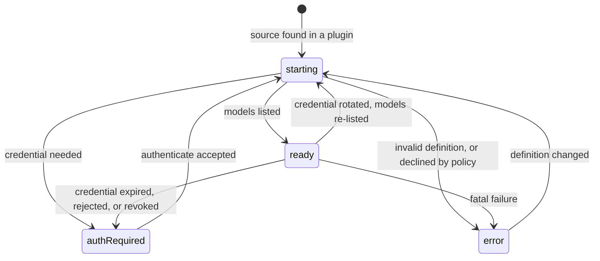
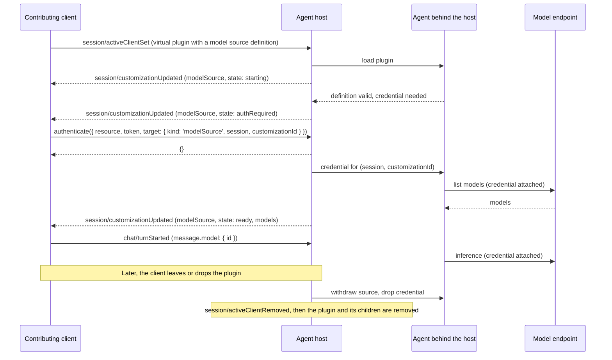

# Model Source Customizations

> A proposal to let a client contribute bring-your-own-key (BYOK) model sources to a session as plugin customizations. It tracks [#619](https://github.com/microsoft/agent-host-protocol/issues/619) and builds on the model sources proposed in [#543](https://github.com/microsoft/agent-host-protocol/pull/543), which has not merged yet. Docs only: nothing here changes `types/`.

## Status

Proposal. The type sketches below show the intended shape. They are not part of the protocol until a follow-up change adds them to `types/`, regenerates the clients, and updates the guides and specification.

This proposal assumes the direction #543 is taking after review:

- Model IDs are unique within a catalog.
- `SessionModelInfo.modelSourceId` groups a model under a `ModelSourceInfo`.
- A selection is just a model `id`.
- There are no model source capabilities.

If #543 lands differently, the selection sections here change with it.

### Terminology

- A **model source** is #543's term for an independently selectable source of model access. It is described by `ModelSourceInfo`, referenced by `SessionModelInfo.modelSourceId`, and advertised per agent in root state.
- A **model source customization** is the new child customization: a model source that a plugin contributes to one session.
- A **model source definition** is the content inside the plugin that declares it: the endpoint, the wire format, and any curated model list, in a format the host's agent understands.
- An **agent provider** is the existing `provider` field (`AgentInfo.provider`, `SessionModelInfo.provider`). This proposal doesn't change it, and it doesn't use "provider" for anything new.

#619 and the first draft of this proposal called the new customization a "model provider". #543 had already renamed its own provisional model provider concept to "model source" to keep "provider" for the agent provider, so this proposal follows it.

---

## 1. Problem

A client can own the user's BYOK model configuration: endpoints, wire formats, curated model lists, and API keys. A client can already send plugin content to a session through `SessionActiveClient.customizations`, so a model source definition could travel inside a plugin today. The protocol has no way to make that source usable. There are three gaps.

- **No credential path.** [`authenticate`](/specification/authentication#token-delivery) only accepts tokens for resources the host itself advertised: `AgentInfo.protectedResources`, or a live MCP authentication challenge. The client can't give the host the source's key.
- **No model source in session state.** No customization type represents a model source, so the host can't report whether one loaded, needs a key, or failed.
- **No session-scoped models.** Models are advertised per agent in root state (`AgentInfo.models`), and #543's model sources are per agent too (`AgentInfo.modelSources`). Models that exist only because a client contributed a source have nowhere to appear or be selected.

For example, a client such as VS Code lets users configure their own OpenAI, Anthropic, Azure, Gemini, OpenRouter, or custom OpenAI-compatible endpoints. When a session runs on a remote host (over SSH, in WSL, or through a tunnel), those models can't be offered: the key stays with the client, and the remote machine may have no secure credential storage of its own.

---

## 2. Principle: keep AHP thin

The host's agent and the plugin that declares a model source do the heavy lifting. They own:

- the model source definition format and how to read it;
- endpoint validation and network policy;
- model discovery and capability derivation (context windows, vision support, and so on);
- the wire protocol for inference;
- the mapping from AHP model IDs to the endpoint's own model identifiers;
- credential storage on the client side, and how a credential is applied to a request.

AHP carries only four things:

1. **Declaration.** A model source arrives inside a plugin, like any other customization.
2. **Status.** The host reports whether each source is starting, ready, needs a credential, or failed.
3. **Credential.** The client supplies a secret, scoped to that one source in that one session.
4. **Selection.** The source's models are selectable like any other model.

AHP does not define model source definition formats, model metadata derivation, discovery, or wire protocols.

---

## 3. Existing patterns this builds on

- **Client plugins.** An active client publishes `ClientPluginCustomization` entries through `SessionActiveClient.customizations` with `session/activeClientSet`. The host expands each plugin into children in `SessionState.customizations` and sets `clientId` on the container. Clients may synthesize virtual plugins in memory. When the client leaves, the host removes its plugins. See [Customizations](/guide/customizations#client-published-plugins).
- **MCP servers.** `McpServerCustomization` is a child customization with a host-published lifecycle (`state: McpServerState`), including `McpServerAuthRequiredState`. The client answers with `authenticate` and `target: { kind: 'mcpServer', session, customizationId }`, so the token applies only to that server in that session. The [authentication spec](/specification/authentication#why-keyed-by-resource-and-optional-target) notes that `target.kind` is extensible for exactly this kind of addition. See [MCP Servers](/guide/mcp#authentication).
- **Model sources ([#543](https://github.com/microsoft/agent-host-protocol/pull/543)).** `ModelSourceInfo { id, displayName }` and `AgentInfo.modelSources` describe the sources an agent offers, and `SessionModelInfo.modelSourceId` groups each model under one. Because model IDs stay unique, a selection remains `ModelSelection { id }`, and clients that don't know about sources still work.

---

## 4. Proposed surface

Everything here is additive and optional. There are no new actions, commands, notifications, error codes, channels, or capabilities.

### 4.1 A `ModelSource` customization type

A model source customization is a child customization, like an MCP server. It appears in the `children` of the plugin that declared it.

```ts
// types/channels-session/state.ts

/** @nonexhaustive */
export const enum CustomizationType {
  // …existing…
  ModelSource = 'modelSource',
}

export type ChildCustomizationType =
  // …existing…
  | CustomizationType.ModelSource;

export type ChildCustomization =
  // …existing…
  | ModelSourceCustomization;

/**
 * A model source the host found in a plugin. Its definition lives in the
 * plugin's own content, in a format the host's agent understands. The
 * host publishes only display-ready state, never the definition itself or
 * any credential.
 *
 * @category Customization Types
 * @stability 1.0
 * @preserveUnknownMembers
 */
export interface ModelSourceCustomization extends CustomizationBase {
  type: CustomizationType.ModelSource;
  /**
   * Explicit enablement decisions, with the same contract as
   * `McpServerCustomization.enablement`. A disabled source's models are
   * not selectable.
   */
  enablement?: CustomizationEnablement[];
  /** Current lifecycle state of the source. */
  state: ModelSourceState;
}
```

`CustomizationBase` supplies `id`, `uri`, `name`, `icons`, `range`, and `_meta`. The host mints `id`, as it does for every child. The customization's `id` and `name` play the roles of `ModelSourceInfo.id` and `ModelSourceInfo.displayName`: a ready source's models reference the `id` in `modelSourceId`, and pickers label the group with `name`.

The contributing client finds its own definition from the child's position inside the plugin it published (the container carries its `clientId`) and from the child's `uri`, plus `range` for an inline declaration.

### 4.2 Source status

The state mirrors `McpServerState`: a lifecycle union discriminated by `kind`, with a `*Status` enum and `*State` variants.

```ts
// types/channels-session/state.ts

/**
 * Discriminant for the ModelSourceState union.
 *
 * @category Model Source State
 * @nonexhaustive
 */
export const enum ModelSourceStatus {
  /** The host's agent is reading and validating the definition. */
  Starting = 'starting',
  /** The source is usable and its models are selectable. */
  Ready = 'ready',
  /** The source needs a credential before it can be used. */
  AuthRequired = 'authRequired',
  /** The source failed or the host declined it. */
  Error = 'error',
}

/** @preserveUnknownMembers */
export interface ModelSourceStartingState {
  kind: ModelSourceStatus.Starting;
}

/** @preserveUnknownMembers */
export interface ModelSourceReadyState {
  kind: ModelSourceStatus.Ready;
  /**
   * Models this source offers in this session, as listed or discovered by
   * the host's agent. Every entry's `modelSourceId` MUST equal this
   * customization's `id`. Every `id` MUST be unique among the models the
   * session offers, and MUST NOT be an ID the session reserved for a
   * different source or upstream model. An empty array means the source
   * is ready but offers no models.
   */
  models: SessionModelInfo[];
}

/**
 * What a model source needs in order to become ready. Deliberately
 * carries no credential.
 *
 * @preserveUnknownMembers
 */
export interface ModelSourceAuthRequirement {
  /** Why a credential is needed. */
  reason: AuthRequiredReason;
  /**
   * RFC 9728 metadata for the source's endpoint. `resource.resource` is
   * the value the client passes back as `authenticate({ resource })`, and
   * `resource.resource_name` labels the prompt (for example
   * "OpenRouter API key"). A source that accepts OAuth access tokens
   * advertises `authorization_servers` and `scopes_supported`; a source
   * that takes a user-supplied secret omits them.
   */
  resource: ProtectedResourceMetadata;
  /** Human-readable hint, for example the endpoint's error description. */
  description?: string;
}

/** @preserveUnknownMembers */
export interface ModelSourceAuthRequiredState extends ModelSourceAuthRequirement {
  kind: ModelSourceStatus.AuthRequired;
}

/** @preserveUnknownMembers */
export interface ModelSourceErrorState {
  kind: ModelSourceStatus.Error;
  /** Error details. MUST NOT contain the credential. */
  error: ErrorInfo;
}

/** @category Model Source State */
export type ModelSourceState =
  | ModelSourceStartingState
  | ModelSourceReadyState
  | ModelSourceAuthRequiredState
  | ModelSourceErrorState;
```



The host can remove the customization from any state (see [Lifecycle](#_6-lifecycle)). There is no `stopped` state: a source that is no longer offered is removed, and a disabled source keeps its state while its models are not selectable.

State changes travel the way other child changes do today: the host re-dispatches `session/customizationUpdated` for the containing plugin with the updated `children`.

### 4.3 Credential delivery through `authenticate`

The client delivers a source's credential with the existing `authenticate` command and a new `target` variant.

```ts
// types/common/commands.ts

/** @nonexhaustive */
export const enum AuthenticateTargetKind {
  McpServer = 'mcpServer',
  ModelSource = 'modelSource',
}

/**
 * A model source customization identified by host-published session and
 * customization state.
 *
 * @category Commands
 * @stability 1.0
 * @preserveUnknownMembers
 */
export interface ModelSourceAuthenticateTarget {
  kind: AuthenticateTargetKind.ModelSource;
  /** Session URI whose `SessionState.customizations` contains the source. */
  session: URI;
  /** The source's session-unique `ModelSourceCustomization.id`. */
  customizationId: string;
}

export type AuthenticateTarget =
  | McpServerAuthenticateTarget
  | ModelSourceAuthenticateTarget;
```

```jsonc
// Client → Host (the command still uses the root channel)
{
  "jsonrpc": "2.0",
  "id": 7,
  "method": "authenticate",
  "params": {
    "channel": "ahp-root://",
    "resource": "https://api.example.com/v1",
    "token": "<secret>",
    "target": {
      "kind": "modelSource",
      "session": "ahp-session:/session-1",
      "customizationId": "model-source-1"
    }
  }
}
```

The `token` is an opaque secret. The host's agent applies it as the model source definition specifies: an `Authorization: Bearer` header, an `x-api-key` or `api-key` header, and so on. The client only supplies the secret.

When `target.kind` is `modelSource`, the host:

- MUST apply the credential only to that source in that session. It never applies it to sibling sources, MCP servers, other sessions, or agent-level resources, even when they share `resource`.
- MUST require `resource` to equal the `resource.resource` it most recently advertised for that source.
- MUST reject an unknown session or customization, or a customization that is not a model source, with `InvalidParams` (`-32602`), as it does for MCP targets.
- SHOULD reject a credential from a connection whose `clientId` isn't the source's contributing client with `PermissionDenied` (`-32009`). The secret and the definition come from the same place.
- MUST treat an empty `token` as revocation: it drops the credential and moves the source to `authRequired` with `reason: required`.

`expiresIn` keeps its current meaning and applies to short-lived tokens such as Microsoft Entra ID access tokens. API keys omit it. `scopes` is only meaningful for OAuth-issued tokens.

### 4.4 Models and selection

Models come from the host. When a source is `ready`, the host publishes its models in `ModelSourceReadyState.models`, as listed or discovered by its agent. Clients never send model catalogs over AHP. A user's curated model list or per-model overrides belong in the model source definition inside the plugin, where the agent applies them.

Each published model follows #543's catalog rules, with these specifics:

- `id` MUST be unique among the session's models: the agent's `AgentInfo.models` and every ready model source customization in the session. The host mints it and maps it to the endpoint's own model identifier, so two sources can serve the same upstream model without colliding. Once published, the `id` stays reserved for that source and upstream model (see **Reserved model IDs** below).
- `modelSourceId` MUST be the customization's `id`.
- `provider` stays the session's agent provider. It never names the model source.
- `vendor` MAY name the service that serves the model, for example `OpenRouter`.

Selection doesn't change. A client picks a source's model the way it picks any model, by `id`, with optional `config`:

```json
{ "id": "model-source-1:example-model" }
```

Model IDs are opaque; the example only shows that the host, not the endpoint, chooses them. The selection travels on every path a selection already uses: `Message.model` on turns, drafts, and pending messages. The host resolves the ID against the chat's session. A source's model is selectable only while the source exists, is enabled, is `ready`, and lists it. Otherwise the host rejects the selection through the existing failure paths: `InvalidParams` for requests, and `rejectionReason` for dispatched actions.

Because session-scoped sources are new to #543, this proposal adds four rules:

- **Disjoint source IDs.** The host MUST NOT mint a model source customization `id` equal to any `id` in the session agent's `AgentInfo.modelSources`, so a `modelSourceId` always names one group.
- **Reserved model IDs.** Uniqueness within the current catalog isn't enough, because drafts, pending messages, and history keep a selection after its source goes away. Once the host publishes a model `id` for a source, that `id` is bound to that source and its upstream model for the rest of the session. The binding holds while the source is disabled or in `authRequired`, after it is withdrawn, and across a host restart that restores the session. The host:
  - MUST NOT resolve the `id` to anything else: not another source, not another upstream model, and not one of the agent's own models;
  - MAY publish the `id` again only when the same source, as its agent identifies it from the definition, comes back offering the same upstream model, for example after the contributing client reconnects;
  - otherwise fails a selection that names the `id`, as [§6](#_6-lifecycle) describes.

  A host can meet this by minting IDs it never reuses within a session, rather than deriving them from the endpoint's model name alone.
- **Stable model IDs.** The host SHOULD keep a source's model IDs stable for as long as the source exists, including across credential rotation, so drafts and pending messages keep resolving.
- **Session only.** A source's model can be selected only in the session that contains the source. The source exists only while its client is active, so an automation template can't name one. A host validating an automation's selection against the agent's catalog rejects it, which is the intended outcome.

### 4.5 No capabilities

Following #543's direction after review, this proposal adds no capability flags. Support is discoverable from state:

- An agent that can't read model source definitions doesn't surface `ModelSourceCustomization` children. A client that published a definition and never sees the child knows the session can't use it.
- A client that doesn't understand the child keeps it as an unknown variant and ignores it. Its models live inside the child's state, so they never reach that client's picker.
- Only the contributing client answers `authRequired`, and it understands the child because it published the definition.

### 4.6 Change table

What a follow-up implementation would touch:

| Symbol | File | Kind |
| --- | --- | --- |
| `CustomizationType.ModelSource` | `channels-session/state.ts` | added (enum value) |
| `ModelSourceCustomization` | `channels-session/state.ts` | added (child customization) |
| `ChildCustomizationType`, `ChildCustomization` | `channels-session/state.ts` | widened |
| `ModelSourceStatus`, four `ModelSource*State` variants, `ModelSourceState` | `channels-session/state.ts` | added (lifecycle union) |
| `ModelSourceAuthRequirement` | `channels-session/state.ts` | added |
| `AuthenticateTargetKind.ModelSource`, `ModelSourceAuthenticateTarget` | `common/commands.ts` | added |
| `AuthenticateTarget` | `common/commands.ts` | widened |
| `AuthenticateParams.target` and `resource` docs | `common/commands.ts` | generalized beyond MCP servers |
| `SessionModelInfo.modelSourceId` and model ID uniqueness docs | `channels-root/state.ts` | extended to session sources |
| `session/customizationToggled` reducer | `channels-session/reducer.ts` | route `ModelSource` to the `enablement` branch, with fixtures |
| Generator registration | `scripts/generate-{csharp,go,kotlin,rust,swift}.ts` | new enums, structs, and union variants |
| Customizations guide, root channel and authentication specs, naming dictionary | `docs/`, `.github/instructions/` | updated |

---

## 5. Flow



1. The client publishes a plugin containing a model source definition through `session/activeClientSet`. The plugin may be virtual.
2. The host expands it into a `ModelSourceCustomization` child in `starting`. Its agent reads and validates the definition.
3. If a credential is needed, the host sets `state: authRequired`. The contributing client calls `authenticate` with a `modelSource` target.
4. The agent lists models, and the host sets `state: ready` with `models`.
5. Any client in the session can select one of those models by `id`.
6. When the contributing client leaves the session or removes the plugin, the host withdraws the source and its models and drops the credential (see [Lifecycle](#_6-lifecycle)).

---

## 6. Lifecycle

### Withdrawal

The host withdraws a source when:

- the contributing client is removed from `SessionState.activeClients`, under the existing rules (it unsubscribes, it disconnects past the host's grace period, or it reconnects without resubscribing);
- the client re-publishes its active-client entry without the plugin;
- the plugin's content changes so it no longer declares the source;
- the session is disposed.

On withdrawal, the host removes the child, drops the credential, and the source's models leave the session's selectable catalog.

### Selections after withdrawal

A selection that names a withdrawn model fails. The host MUST NOT run the work on a different model. The user picked a specific service with their own key, and quietly sending the prompt somewhere else would change where their data goes and who pays for it.

- Drafts and history keep the `id`. Because the `id` stays reserved (see [§4.4](#_4-4-models-and-selection)), it can't later resolve to a different source. Clients show such a selection as unavailable and let the user choose again.
- A queued or steering message that names a withdrawn model fails when the host would consume it, through the existing chat lifecycle.
- An active turn fails through the existing turn lifecycle the next time it needs the withdrawn source.

### Disabling

`session/customizationToggled` works on a model source like any other customization. While a source is disabled, its models are not selectable, and queued work that names them fails the same way. The host MAY keep the credential while the customization exists, so re-enabling doesn't require a new credential.

### Rotation, expiry, and revocation

- **Rotation.** A new `authenticate` with the same target replaces the credential. The host MAY pass through `starting` while its agent re-lists models, keeping model IDs stable.
- **Expiry and rejection.** When a credential expires or the endpoint rejects it, the host moves the source to `authRequired` with `reason: expired`. The client MUST NOT replay the same secret: it renews the token or asks the user for a new key. Clients holding short-lived tokens SHOULD deliver a fresh one before `expiresIn` elapses.
- **Revocation.** An empty `token` drops the credential, and the source returns to `authRequired` with `reason: required`.
- **Mid-turn.** If a request issued during a turn triggers `authRequired`, the host SHOULD raise `SessionStatus.InputNeeded` on the session, as it does for MCP servers. It either holds the turn until the source is ready again or fails it. It never switches models.

### Reconnect and restart

- Source status lives in session state, so a reconnecting client reads `authRequired` from its snapshot and answers it. Nothing depends on a replayed notification.
- After a host restart, credentials are gone, because they were never persisted. A restored source returns in `authRequired`, or is absent until its client publishes the plugin again. Its model IDs stay reserved either way, so the host keeps those reservations with the session's other durable state. They identify a source and model, not a secret.

---

## 7. Credential rules

1. **Never in state, actions, or notifications.** All of these are broadcast to subscribers. That includes `_meta`, `ErrorInfo`, and `ModelSourceAuthRequirement`. The model source definition a client publishes MUST NOT embed the secret: it travels only in `authenticate`.
2. **Memory only.** The host holds it only in memory. It is never persisted and never placed in environment variables, command lines, logs, or telemetry. It is redacted from tool output and error messages.
3. **Scoped to `(session, customizationId)`.** It is never shared with sibling sources, MCP servers, other sessions, or the agent's own protected resources.
4. **Attached only to that source's requests**, as its definition specifies. It is never sent to another origin, including on redirect, and never exposed to the model, tools, terminals, or hooks.
5. **Supplied by the contributing client.** Other clients may render the source's status but SHOULD NOT prompt for its credential.
6. **Re-requested through state.** The host asks again by setting `state: authRequired`. State survives reconnects; `auth/required` notifications are not replayed.
7. **`expiresIn` for short-lived tokens.** A credential delivered without `expiresIn` stays valid until the endpoint rejects it or the client revokes it.
8. **Checked by the client.** Before sending a secret, the contributing client SHOULD check that `resource.resource` matches the endpoint in its own definition.
9. **Dropped** when the source is withdrawn, when the session is disposed, and when the host restarts.

---

## 8. Out of scope for AHP

- Model source definition formats, endpoint validation and network policy, model discovery, capability derivation, wire protocols, and credential storage. These belong to the host's agent and the plugin.
- Client-sent model catalogs. Models always come from the host.
- Using a source's models from automations, or from any session other than the one containing the source.
- Usage, billing, or per-call provenance.
- Keys the host holds itself. That is host-owned authentication ([#404](https://github.com/microsoft/agent-host-protocol/pull/404)).

Hosts apply policy appropriate to the source. A model source the user configured in their own client is user configuration, while one from a third-party plugin may warrant stricter rules.

---

## 9. Open questions

- **Standard definition.** Should the model source definition be standardized as a plugin component, for example in [Open Plugins](https://open-plugins.com/), so sources are portable across hosts? Or should it stay agent-specific?
- **Session-scoped sources in #543.** #543 scopes `modelSourceId` to `AgentInfo.modelSources` and model ID uniqueness to one agent's catalog. This proposal needs both to extend to the session's model source customizations, with the rules in [§4.4](#_4-4-models-and-selection). #543's chat transfer rules should also decide what happens when a chat whose draft or pending message names a source's model moves to another session.
- **`authenticate` beyond Bearer tokens.** `authenticate` is specified with RFC 6750 Bearer semantics. The `modelSource` target needs wording for opaque secrets that the agent applies per the definition. It also needs a rule for endpoints that aren't `https` URLs, which RFC 9728 `resource` values must be.
- **Host-owned authentication and account identity.** How does this interact with [#404](https://github.com/microsoft/agent-host-protocol/pull/404) and [#459](https://github.com/microsoft/agent-host-protocol/pull/459)?
  - If a host holds its own keys (#404), its account consumers may need a model source variant.
  - An API key has no authority-qualified account (#459). An Entra ID token does, so it's open whether `auth/revoked` should reach a source credential delivered with an `account`.
- **Host-owned plugins.** Should plugins from `AgentInfo.customizations`, rather than client-contributed ones, be able to surface model sources the same way? The type allows it. But the "contributing client supplies the credential" rule has no contributor to point at, so these sources would need either any client that understands them or host-owned authentication.
- **A client capability.** Without one, the host can't tell whether a client understands a definition inside a plugin it publishes. A client that synthesizes the plugin does. One that forwards a third-party plugin from disk might not, which would leave a child in `authRequired` that nobody answers. Is that worth a `ClientCapabilities` flag?
- **Declining client sources.** A host may refuse client-contributed sources by policy. This proposal surfaces that as `error` with an explanatory `ErrorInfo`, so the user sees why. Is a dedicated error type or status worth adding?
- **Catalog across a re-auth.** Models live only in `ready`, so an expired credential briefly withdraws them from selection. Should the last catalog survive `authRequired`, for example as a field on the customization, so pickers don't flicker during a refresh?
- **A narrow state action.** MCP servers have `session/mcpServerStateChanged` for frequent transitions. Source transitions should be rare enough that re-dispatching the plugin with `session/customizationUpdated` is fine, but a narrow action could follow if that proves wrong.

---

## 10. Compatibility

- **Additive.** `CustomizationType` and `AuthenticateTargetKind` are `@nonexhaustive`, and generated clients preserve unknown `ChildCustomization` and `AuthenticateTarget` variants as raw values. All new fields are optional.
- **Ignorable.** A host whose agent can't read model source definitions doesn't surface them, and clients keep using the agent's models. A client that doesn't understand `ModelSourceCustomization` ignores it, and never sees its models.
- **No protocol version bump.** Older peers ignore what they don't understand, per the [compatibility guarantee](/specification/versioning#compatibility-guarantee). New declarations would carry `@stability 1.0` inside the otherwise stable session channel.
- **Depends on #543.** It reuses `ModelSourceInfo`'s roles and `SessionModelInfo.modelSourceId`, so this lands after #543, or together with it.

---

## 11. Alternatives considered

- **A dedicated `SessionActiveClient.modelSources` field with host-published copies.** This was the first draft of #619: the client lists sources and models in its active-client entry, and the host republishes copies. It was rejected for four reasons:
  - AHP would have to define a source configuration schema (endpoint, wire format, model metadata), which is exactly what should stay behind the host.
  - It duplicates the plugin channel that already carries client contributions.
  - It makes the client the source of truth for model metadata it can't validate against the endpoint.
  - Active-client state is broadcast to every subscriber, which invites configuration, and sooner or later keys, into shared state.
- **Host-to-client credential fetch per request.** The host would ask the contributing client for the credential on each inference request, so the key never rests on the host. It was rejected for now for four reasons:
  - AHP has no host-to-client request primitive yet; that is [#470](https://github.com/microsoft/agent-host-protocol/issues/470), with [#162](https://github.com/microsoft/agent-host-protocol/issues/162) proposing a similar request family for filesystems.
  - It adds a round trip to every request.
  - It fails as soon as the client disconnects mid-turn.
  - Memory-only, `(session, customizationId)`-scoped storage already bounds exposure.

  It could return as an opt-in for stricter hosts once #470 lands.
- **Dynamic entries in `AgentInfo.models` and `AgentInfo.modelSources`.** Root state is host-wide and per agent, so one client's sources would leak to every client on the host, and to every session using that agent. Session state is the right scope.

---

## 12. Doctrine design tests

Applying the [doctrine's design tests](/guide/doctrine#design-tests):

- **Can a minimal client ignore this and still render a coherent session?** Yes. The new child is an unknown variant to such a client, a source's models never enter its picker, and turns use the agent's models.
- **Is the durable, user-visible result represented in state?** Yes. Source status, the authentication requirement, and the model catalog all live in `SessionState.customizations`. The credential is deliberately not state, because it is a secret.
- **Does the host remain the authority?** Yes. The host mints IDs, decides status, lists models, validates every selection, and decides policy. Clients send a plugin and a secret, never a catalog.
- **Does this expose an agent implementation detail?** No. The definition format, wire protocol, discovery, model ID mapping, and how a key is attached stay behind the host. AHP sees a name, a status, and models.
- **Does it fit an existing channel?** Yes. The source lives in session customizations, and the credential uses root `authenticate`. No new channel.
- **Can clients discover support through capabilities or optional state?** Yes, through optional state. A model source child appears only when the host's agent supports it, and its models appear only once it's ready.
- **Is provider-specific metadata an enhancement rather than a requirement?** Yes. `_meta` on the customization and on each model stays optional.

It also respects the doctrine's anti-goal of "a required model provider, model router, or credential flow": the whole surface is optional, and a host may decline it.
