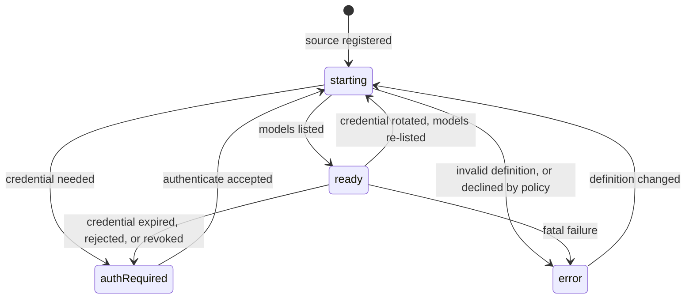
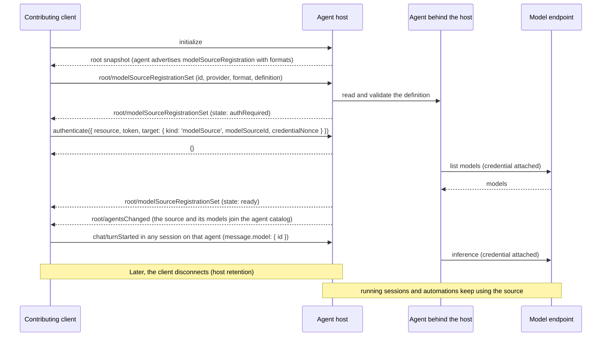

# Model Source Registry

> A proposal to let clients register bring-your-own-key (BYOK) model sources with an agent host, so the host can serve those models to its sessions and automations. It tracks [#619](https://github.com/microsoft/agent-host-protocol/issues/619) and builds on the model sources in [#543](https://github.com/microsoft/agent-host-protocol/pull/543), which has not merged yet. Docs only: nothing here changes `types/`.

## Status

Proposal. The type sketches below show the intended shape. They are not part of the protocol until a follow-up change adds them to `types/`, regenerates the clients, and updates the guides and specification.

An earlier revision proposed model sources as session-scoped plugin customizations. Review pointed out that BYOK configuration belongs to the user rather than to one session, and that automations and long-running headless sessions need model sources that outlive a client's session. This revision moves them to a host-wide registry. [§11](#_11-alternatives-considered) explains the trade-off.

It assumes the direction #543 is taking after review:

- Model IDs are unique within an agent's catalog.
- `SessionModelInfo.modelSourceId` groups a model under a `ModelSourceInfo` in `AgentInfo.modelSources`.
- A selection is just a model `id`.

### Terminology

- A **model source** is #543's term for an independently selectable source of model access, described by `ModelSourceInfo` in an agent's catalog.
- A **registration** is a model source a client or the host added to the host's registry, with its definition and status.
- A **model source definition** is the content of a registration that says how to reach the source: the endpoint, the wire format, and any curated model list, in a format the agent understands.
- The **contributing client** is the client that registered a source. A registration's `clientId` names it.
- An **agent provider** is the existing `provider` field (`AgentInfo.provider`). Nothing new is called a "provider".

---

## 1. Problem

A client can own the user's BYOK model configuration: endpoints, wire formats, curated model lists, and API keys. The protocol has no way to hand that configuration to an agent host:

- **No way to register a source.** Models are advertised by the host in `AgentInfo.models`, and #543's model sources are host-declared too. A client can't add one.
- **No credential path.** [`authenticate`](/specification/authentication#token-delivery) only accepts tokens for resources the host itself advertised: `AgentInfo.protectedResources`, or a live MCP authentication challenge. The client can't give the host a source's key.
- **No status.** Nothing reports whether a source loaded, needs a key, or failed.

For example, a client such as VS Code lets users configure their own OpenAI, Anthropic, Azure, Gemini, OpenRouter, or custom OpenAI-compatible endpoints. When the agent host runs elsewhere (over SSH, in WSL, through a tunnel, or as a long-lived remote service), those models can't be offered: the configuration and the key stay with the client.

The host may also run work no client is watching: sessions that span hours or days, and automations. Model sources have to be able to outlive one client's connection.

---

## 2. Principle: keep AHP thin

The agent behind the host does the heavy lifting. It owns:

- the model source definition format and how to read it;
- endpoint validation and network policy;
- model discovery and capability derivation (context windows, vision support, and so on);
- the wire protocol for inference;
- the mapping from AHP model IDs to the endpoint's own model identifiers;
- how a credential is applied to a request.

AHP carries only four things:

1. **Registration.** A client adds, updates, or removes a model source definition.
2. **Status.** The host reports whether each source is starting, ready, needs a credential, or failed.
3. **Credential.** A client supplies a secret, scoped to one registered source.
4. **Selection.** The source's models appear in the agent's catalog and are selected like any other model.

AHP names a definition's format but does not define it.

---

## 3. Existing patterns this builds on

- **Model sources ([#543](https://github.com/microsoft/agent-host-protocol/pull/543)).** `ModelSourceInfo { id, displayName }` and `AgentInfo.modelSources` describe an agent's sources, and `SessionModelInfo.modelSourceId` groups each model under one. A registered source joins that catalog, so selection, new-session pickers, and automations need nothing new.
- **Client-dispatched root actions.** `root/configChanged` already lets clients change host-wide state that the host validates and applies.
- **Keyed collections.** The registry follows the `Set` and `Removed` convention used for `activeClients`, `customizations`, and other keyed lists.
- **MCP server authentication.** An MCP server publishes `McpServerAuthRequiredState`, and the client answers with `authenticate` and a `target` naming that server. The [authentication spec](/specification/authentication#why-keyed-by-resource-and-optional-target) notes that `target.kind` is extensible for exactly this kind of addition.
- **Container provenance.** A client-published plugin carries the publisher's `clientId` and a host-reported `load` state that is absent until the host reports one. A registration works the same way.

---

## 4. Proposed surface

Everything here is additive and optional. It adds one root state field, two client-dispatchable root actions, one `authenticate` target, and one agent capability. There are no new commands, notifications, error codes, or channels.

### 4.1 The registry

```ts
// types/channels-root/state.ts

export interface RootState {
  // …existing…
  /** Model sources registered on this host. Keyed by `id`. */
  modelSourceRegistrations?: ModelSourceRegistration[];
}

/**
 * A model source registered on this host by a client, or by the host
 * itself. Its definition is in a format the agent named by `provider`
 * reads. It never contains a credential.
 *
 * @category Root State
 * @stability 1.0
 * @preserveUnknownMembers
 */
export interface ModelSourceRegistration {
  /**
   * Host-unique ID, chosen by whoever registers the source. Also the
   * source's `ModelSourceInfo.id` in the agent's catalog, and the
   * `modelSourceId` of its models.
   */
  id: string;
  /** Agent provider whose agent reads the definition and serves the models. */
  provider: string;
  /** Display name, published as `ModelSourceInfo.displayName`. */
  name: string;
  /** Icons for UI display. */
  icons?: Icon[];
  /** Definition format, one of the agent's `ModelSourceRegistrationCapability.formats`. */
  format: string;
  /**
   * How to reach the source: endpoint, wire format, models, and so on, in
   * `format`. MUST NOT contain a credential.
   */
  definition: Record<string, unknown>;
  /** The contributing client. Absent for a source the host registered itself. */
  clientId?: string;
  /** Who may select the source's models. Absent means `contributingClient`. */
  sharing?: ModelSourceSharingPolicy;
  /** What happens when the contributing client leaves. Absent means `contributingClient`. */
  retention?: ModelSourceRetentionPolicy;
  /** Host-reported status. Absent means the host hasn't reported one yet. */
  state?: ModelSourceState;
  /**
   * Host-issued token that a client echoes when it delivers the credential.
   * The host changes it whenever it drops the credential because the
   * registration changed, and never reuses one for the same `id`. Absent
   * until the host reports a `state`. See §4.4.
   */
  credentialNonce?: string;
  _meta?: Record<string, unknown>;
}
```

`definition` is intentionally open data: its shape belongs to the agent that reads it. It lives in root state so a client can compare it with its own configuration and register again only when something changed.

A host may register sources itself, for example from configuration on a remote machine. Those registrations have no `clientId`, and both policies behave as `host`.

### 4.2 Status

The status mirrors `McpServerState`: a lifecycle union discriminated by `kind`, with a `*Status` enum and `*State` variants.

```ts
// types/channels-root/state.ts

/**
 * Discriminant for the ModelSourceState union.
 *
 * @category Root State
 * @nonexhaustive
 */
export const enum ModelSourceStatus {
  /** The agent is reading and validating the definition. */
  Starting = 'starting',
  /** The source is usable, and its models are in the agent's catalog. */
  Ready = 'ready',
  /** The source needs a credential before it can be used. */
  AuthRequired = 'authRequired',
  /** The source failed, or the host declined it. */
  Error = 'error',
}

/** @preserveUnknownMembers */
export interface ModelSourceStartingState {
  kind: ModelSourceStatus.Starting;
}

/** @preserveUnknownMembers */
export interface ModelSourceReadyState {
  kind: ModelSourceStatus.Ready;
}

/**
 * What a model source needs in order to become ready. Deliberately
 * carries no credential.
 *
 * @preserveUnknownMembers
 */
export interface ModelSourceAuthRequirement {
  /** Why a credential is needed. */
  reason: AuthRequiredReason;
  /**
   * RFC 9728 metadata for the source's endpoint. `resource.resource` is
   * the endpoint URL as the definition names it, in any scheme the agent
   * supports (for example `http://localhost:11434/v1`). It's the value a
   * client passes back as `authenticate({ resource })`, and nothing fetches
   * it. `resource.resource_name` labels the prompt (for example
   * "OpenRouter API key"). A source that accepts OAuth access tokens
   * advertises `authorization_servers` and `scopes_supported`. A source
   * that takes a user-supplied secret omits them.
   */
  resource: ProtectedResourceMetadata;
  /** Human-readable hint the host writes, for example "The endpoint rejected the API key." */
  description?: string;
}

/** @preserveUnknownMembers */
export interface ModelSourceAuthRequiredState extends ModelSourceAuthRequirement {
  kind: ModelSourceStatus.AuthRequired;
}

/** @preserveUnknownMembers */
export interface ModelSourceErrorState {
  kind: ModelSourceStatus.Error;
  /** Error details the host writes. MUST NOT contain the credential. */
  error: ErrorInfo;
}

/** @category Root State */
export type ModelSourceState =
  | ModelSourceStartingState
  | ModelSourceReadyState
  | ModelSourceAuthRequiredState
  | ModelSourceErrorState;
```



The host can remove a registration from any state (see [§6](#_6-lifecycle)).

### 4.3 Registering and removing

```ts
// types/channels-root/actions.ts

/**
 * Adds a model source registration, or replaces the one with the same `id`.
 *
 * @clientDispatchable
 */
export interface RootModelSourceRegistrationSetAction {
  type: ActionType.RootModelSourceRegistrationSet; // 'root/modelSourceRegistrationSet'
  registration: ModelSourceRegistration;
}

/**
 * Removes a model source registration. A no-op when none matches.
 *
 * @clientDispatchable
 */
export interface RootModelSourceRegistrationRemovedAction {
  type: ActionType.RootModelSourceRegistrationRemoved; // 'root/modelSourceRegistrationRemoved'
  id: string;
}
```

The reducers follow the keyed-collection convention: `Set` appends or replaces by `id`, and `Removed` deletes by `id` or returns the state unchanged.

A client registers by dispatching `Set` with `clientId` set to its own ID, and with no `state` or `credentialNonce`. The host then reports status by dispatching `Set` itself with the same registration, a `state`, and a `credentialNonce`. A client SHOULD NOT dispatch `Set` for a registration that hasn't changed, because doing so clears its reported state.

The host builds each status `Set` from the registration as it currently stands. It discards an agent result for a definition the registration no longer has, and never dispatches a status `Set` for a removed registration, so a late result can't undo a client's change or bring back a removed source.

A client may change or remove a registration when it's the contributing client, or when the registration has `host` sharing, which lets another of the user's clients take it over (see [§6](#_6-lifecycle)). It may not change one that belongs to another client with `contributingClient` sharing, or one the host registered, unless host policy allows it.

The host rejects a client-dispatched `Set`, through `ActionEnvelope.rejectionReason`, when:

- the agent named by `provider` doesn't advertise `modelSourceRegistration`, or doesn't list `format`;
- `clientId` isn't the dispatching client's ID, or `state` or `credentialNonce` is present;
- `id` equals a `ModelSourceInfo.id` that the agent declares itself. The catalog entry the host publishes for this same registration doesn't count, so a ready registration can still be updated;
- a registration with this `id` already exists, and the dispatching client may not change it;
- the host won't honor the requested `sharing` or `retention`. The client can register again with a narrower policy.

A client-dispatched `Removed` carries only an `id`, so the host checks it against the stored registration. When no registration has that `id`, the action is a no-op, as the keyed-collection convention requires. Otherwise the host rejects it only when the dispatching client may not change that registration. The registration's state, policies, and catalog entry don't affect removal.

When a `Set` changes an existing registration's `provider`, `format`, `definition`, or `clientId`, the host drops its credential, issues a new `credentialNonce`, and the source goes back through `starting`. A changed definition must never receive a key that was supplied for a different one.

### 4.4 Credential delivery through `authenticate`

A client delivers a source's credential with the existing `authenticate` command and a new `target` variant. The command stays on the root channel, and no session is involved.

```ts
// types/common/commands.ts

/** @nonexhaustive */
export const enum AuthenticateTargetKind {
  McpServer = 'mcpServer',
  ModelSource = 'modelSource',
}

/**
 * A registered model source.
 *
 * @category Commands
 * @stability 1.0
 */
export interface ModelSourceAuthenticateTarget {
  kind: AuthenticateTargetKind.ModelSource;
  /** The registration's `id`. */
  modelSourceId: string;
  /**
   * The registration's current `credentialNonce`, as published in root
   * state. The host rejects a stale one with `Conflict` (-32011).
   */
  credentialNonce: string;
}

export type AuthenticateTarget =
  | McpServerAuthenticateTarget
  | ModelSourceAuthenticateTarget;
```

```jsonc
// Client → Host
{
  "jsonrpc": "2.0",
  "id": 7,
  "method": "authenticate",
  "params": {
    "channel": "ahp-root://",
    "resource": "https://api.example.com/v1",
    "token": "<secret>",
    "target": {
      "kind": "modelSource",
      "modelSourceId": "2f6c0e1a-model-source",
      "credentialNonce": "9b41d7"
    }
  }
}
```

The `token` is an opaque secret. The agent applies it as the definition specifies: an `Authorization: Bearer` header, an `x-api-key` or `api-key` header, and so on.

Clients MUST include a `modelSource` target when they deliver a registered source's credential. A token without a target can't be scoped to one registration (see [§7](#_7-credential-rules)), so it never satisfies a model source's challenge. The host rejects an untargeted `resource` that matches only model source challenges with `InvalidParams` (`-32602`). Untargeted tokens keep working for MCP servers and agent-level resources.

`credentialNonce` keeps a delayed `authenticate` from reaching a definition it wasn't meant for. If a client replaces a registration's definition but keeps the endpoint, a key sent for the old definition would still match the `id` and `resource`. The host issues a new nonce whenever it drops the credential because the registration changed ([§4.3](#_4-3-registering-and-removing)), including when a removed registration is registered again under the same `id`. It keeps the nonce across rotation, expiry, and revocation, because the definition still matches. Random values meet the rule that a nonce is never reused for the same `id`.

Like `McpServerAuthenticateTarget`, the target doesn't carry `@preserveUnknownMembers`: the client builds it for one request, so there are no unknown members to keep.

`resource.resource` doesn't need to be an `https` URL, unlike other RFC 9728 resource identifiers. RFC 9728 requires `https` because an OAuth client fetches metadata from that URL. Here the client only echoes the value, so a local server such as `http://localhost:11434/v1` works. Whether the agent sends a credential over plain `http` is the host's network policy.

When `target.kind` is `modelSource`, the host:

- MUST apply the credential only to that registration. It never applies it to other registrations, MCP servers, or agent-level resources, even when they share `resource`.
- MUST require `resource` to equal the `resource.resource` it most recently advertised for that registration.
- MUST reject an unknown `modelSourceId` with `InvalidParams` (`-32602`).
- MUST reject a `credentialNonce` other than the one it most recently issued for that registration with `Conflict` (`-32011`). The client re-reads root state and, if the source still needs a credential, sends it again with the current nonce.
- MUST reject a credential, including an empty `token` that would revoke one, from a client that may not supply one with `PermissionDenied` (`-32009`). The contributing client may always supply one. For a registration with `host` sharing, or one the host registered, any client the host allows may supply one, for example another device of the same user that has the same source configured.
- MUST treat an empty `token` as revocation: it drops the credential, and the source returns to `authRequired` with `reason: expired`, so no client sends the revoked secret again.

`expiresIn` keeps its current meaning and applies to short-lived tokens such as Microsoft Entra ID access tokens. API keys omit it.

### 4.5 Models and selection

When a registration is `ready`, the host adds it to the catalog of the agent named by `provider`, through `root/agentsChanged`:

- a `ModelSourceInfo` in `AgentInfo.modelSources`, with the registration's `id` and its `name` as `displayName`;
- its models in `AgentInfo.models`, each with `modelSourceId` set to the registration's `id`.

The host lists a registration's models only while it's `ready`. It MAY list the `ModelSourceInfo` in other states, since #543 allows a source with no models.

Each model follows #543's catalog rules:

- `id` MUST be unique within the agent's catalog. The host mints it and maps it to the endpoint's own model identifier, so two registrations can serve the same upstream model without colliding.
- `provider` stays the agent provider.
- `vendor` MAY name the service that serves the model, for example `OpenRouter`.

**Reserved model IDs.** Drafts, pending messages, history, and automation definitions keep a selection after its source goes away, and a chat keeps them when it moves to another session. Once the host publishes a model `id` for a registration, that `id` is bound to that registration and its upstream model for as long as the host keeps state. That includes after the registration is removed and across a host restart. The host MUST NOT resolve the `id` to anything else. It MAY publish the `id` again only when the same registration (the same `id`) comes back offering the same upstream model. A model's upstream identity is the endpoint the agent sends its requests to plus that endpoint's model identifier. A change to `provider` or `format`, or a `definition` change that moves the endpoint, makes it a different upstream model, so the host mints new IDs, even when another client has taken the registration over. A host can meet this by minting IDs it never reuses, for example with a random component, rather than deriving them from the endpoint's model name.

**Selection** doesn't change: a client picks a model by `id`, with optional `config`, on every path a selection already uses. The host checks that the model is listed, that the chat is backed by the registration's agent provider, and that the registration's sharing policy allows the selection (see [§4.6](#_4-6-sharing-and-retention)). It checks whenever it uses a selection, including when a client continues a turn with `chat/turnResume`. Otherwise it rejects the selection through the existing failure paths: `InvalidParams` for requests, and `rejectionReason` for dispatched actions.

**Sessions** need nothing new. Any session whose agent is the registration's `provider` can use its models, subject to sharing. There is no per-session list of registrations.

**Automations** may name a registration's model when the registration has `host` sharing and `host` retention, or was registered by the host. The host SHOULD reject an automation create or update that names any other registration's model, because the automation would outlive or exceed what the contributing client allowed. If the source isn't `ready` when a run starts, the run fails through the existing automation run lifecycle, and the registration's `authRequired` state tells the next client to connect what's needed.

### 4.6 Sharing and retention

Two choices belong to the contributing client. The defaults are the narrowest, so a client that sets neither behaves like a client that only uses its own models while it's connected.

```ts
// types/channels-root/state.ts

/**
 * Who may select a registered model source's models.
 *
 * @category Root State
 * @nonexhaustive
 */
export const enum ModelSourceSharingPolicy {
  /** Only turns and pending messages the contributing client dispatches. */
  ContributingClient = 'contributingClient',
  /** Any client, and work the host starts itself, such as automations. */
  Host = 'host',
}

/**
 * How long a registered model source lasts once its contributing client leaves.
 *
 * @category Root State
 * @nonexhaustive
 */
export const enum ModelSourceRetentionPolicy {
  /** Removed when the contributing client leaves, once running turns finish. */
  ContributingClient = 'contributingClient',
  /** Kept until a client removes it or host policy expires it. */
  Host = 'host',
}
```

- **Sharing** answers the concern that one client's key shouldn't be spent by another without consent. With `contributingClient`, the host rejects other clients' selections. With `host`, a user can continue on another device, and automations can use the source.
- **Retention** answers the headless case. With `host`, the registration and its in-memory key stay after the client disconnects, so long-running sessions and automations keep working while the host runs.

The host never widens a policy. It rejects a registration whose policy it won't honor ([§4.3](#_4-3-registering-and-removing)), and it MAY expire `host`-retained registrations by its own policy.

Every client sees every registration, because root state is shared. Clients SHOULD offer in their pickers only the models they may select, using `sharing` and `clientId`.

### 4.7 Discovering support

A client needs to know whether an agent accepts registrations, and in what format, before it registers. Unlike the per-agent markers #543 dropped, this capability carries information a client can't get any other way.

```ts
// types/channels-root/state.ts

export interface AgentCapabilities {
  // …existing…
  /** The agent serves models from registered model sources. */
  modelSourceRegistration?: ModelSourceRegistrationCapability;
}

/**
 * @category Root State
 * @stability 1.0
 * @preserveUnknownMembers
 */
export interface ModelSourceRegistrationCapability {
  /**
   * Definition formats the agent reads, most preferred first. Format names
   * are defined by agent implementations and SHOULD be namespaced, for
   * example `example.com/model-source@1`, so different agents' formats
   * don't collide.
   */
  formats: string[];
}
```

A client that knows none of an agent's formats doesn't register with it. A format that becomes a shared standard can get a well-known name, and every agent that reads it can list it.

### 4.8 Change table

What a follow-up implementation would touch:

| Symbol | File | Kind |
| --- | --- | --- |
| `RootState.modelSourceRegistrations`, `ModelSourceRegistration` (including the host-issued `credentialNonce`) | `channels-root/state.ts` | added |
| `ModelSourceStatus`, four `ModelSource*State` variants, `ModelSourceState`, `ModelSourceAuthRequirement` | `channels-root/state.ts` | added (lifecycle union) |
| `ModelSourceSharingPolicy`, `ModelSourceRetentionPolicy` | `channels-root/state.ts` | added |
| `AgentCapabilities.modelSourceRegistration`, `ModelSourceRegistrationCapability` | `channels-root/state.ts` | added (capability) |
| `root/modelSourceRegistrationSet`, `root/modelSourceRegistrationRemoved` | `channels-root/actions.ts`, `common/actions.ts`, `version/registry.ts` | added (client-dispatchable, introduced in the development version) |
| Root reducer | `channels-root/reducer.ts` | upsert and remove, with fixtures for every branch |
| Client reducers | `clients/{go,rust,kotlin,swift,dotnet}/` | apply the two root actions, so they pass the shared fixtures |
| `AuthenticateTargetKind.ModelSource`, `ModelSourceAuthenticateTarget` (with `modelSourceId` and `credentialNonce`), `AuthenticateTarget` | `common/commands.ts` | added, widened |
| `AuthenticateParams.target` and `resource` docs | `common/commands.ts` | generalized beyond MCP servers, including opaque secrets that aren't Bearer tokens |
| `ModelSourceInfo`, `SessionModelInfo.modelSourceId` docs | `channels-root/state.ts` | registered sources and reserved IDs |
| Generator registration | `scripts/generate-{csharp,go,kotlin,rust,swift}.ts` | new enums, structs, and union variants |
| Root channel and authentication specs, naming dictionary | `docs/`, `.github/instructions/` | updated |

---

## 5. Flow



1. The client reads the agent's `modelSourceRegistration` capability and picks a format it can write.
2. It dispatches `root/modelSourceRegistrationSet`. The host's agent reads and validates the definition, and the host reports `starting`.
3. If a credential is needed, the host reports `authRequired` with a `credentialNonce`. The client calls `authenticate` with a `modelSource` target that echoes it.
4. The agent lists models. The host reports `ready` and adds the source and its models to the agent's catalog.
5. Any client the sharing policy allows can select those models in any session on that agent, and so can automations if the source is shared with the host.
6. When the contributing client disconnects, the retention policy decides whether the source stays (see [§6](#_6-lifecycle)).

---

## 6. Lifecycle

### When the contributing client leaves

A client leaves when its connection closes and it doesn't reconnect with the same `clientId` within the host's grace period. A client that reconnects in time keeps its registrations.

- **`contributingClient` retention (the default).** The host stops new work on the source as soon as the client leaves and withdraws its models from the catalog: a new turn or a pending message that names one of its models fails. Turns already running on it SHOULD finish, and the host MAY bound how long it waits. Any client can still cancel such a turn with the existing cancellation actions. The host then removes the registration and drops its credential.
- **`host` retention.** The registration stays, with its credential in memory, until a client removes it, host policy expires it, or the host restarts (see below). While the contributing client is away, the source keeps serving the clients and automations its sharing policy allows. If its credential expires or is rejected, the source goes to `authRequired`, and work that needs it fails until a client that may supply the credential answers.

A client that comes back with the same `clientId` finds its registrations in root state and only dispatches `Set` for the ones it changed. A client that comes back with a new `clientId` registers again under the same `id`. For a `host`-shared registration, that takes it over: `clientId` changes, the credential is dropped, and the new contributing client supplies it.

### Selections after removal

A selection that names a removed source's model fails. The host MUST NOT run the work on a different model. The user picked a specific service with their own key, and quietly sending the prompt somewhere else would change where their data goes and who pays for it.

- Drafts, history, and automation definitions keep the `id`. Because the `id` stays reserved, it can't later resolve to a different source. Clients show such a selection as unavailable.
- A pending message that names a removed model fails when the host would consume it, through the existing chat lifecycle.
- A turn that is using a source when a client explicitly removes it fails through the existing turn lifecycle the next time it needs the source.

### Rotation, expiry, and revocation

- **Rotation.** A new `authenticate` with the same target replaces the credential. The host MAY pass through `starting` while the agent re-lists models, keeping model IDs stable.
- **Expiry and rejection.** When a credential expires or the endpoint rejects it, the source goes to `authRequired` with `reason: expired`. A client MUST NOT replay the same secret: it renews the token or asks the user for a new key. Clients holding short-lived tokens SHOULD deliver a fresh one before `expiresIn` elapses.
- **Revocation.** An empty `token` drops the credential, and the source returns to `authRequired` with `reason: expired`. Under the expiry rule, no client sends the revoked secret again, including other devices that have it stored.
- **Mid-turn.** If the credential fails during a turn that uses the source, the host SHOULD end the turn with a resumable error (`chat/error` with `part.resumable: true`). Once the source is ready again, a client can continue the same turn with `chat/turnResume`, and the host checks the turn's selection again first, including the sharing policy. The host never switches models. It doesn't hold the turn open: `SessionStatus.InputNeeded` comes from `inputNeeded` entries and blocked tool calls, and none of them covers a model source, so a held turn would look like it's still running.

### Host restart

Credentials are gone after a restart, because they were never persisted. `contributingClient`-retained registrations are gone too, and their clients register again when they reconnect. A host that persists its own state SHOULD keep `host`-retained registrations, which come back through `starting`, and reach `authRequired` only if they need a credential. Model ID reservations are kept with the host's state either way. They identify a source and a model, not a secret.

---

## 7. Credential rules

1. **Never in state, actions, or notifications.** All of these are broadcast to subscribers. That includes `definition`, `_meta`, `ErrorInfo`, and `ModelSourceAuthRequirement`. A secret travels only in `authenticate`. The host writes `description` and `ErrorInfo` itself, and SHOULD NOT copy upstream response bodies or headers into them: an endpoint's error text can echo part of a key, and every client can read root state.
2. **Memory only.** The host holds it only in memory. It is never persisted and never placed in environment variables, command lines, logs, telemetry, or error messages. The host SHOULD also redact it from tool output before storing that output or sending it to the model. That's best effort: rule 4 keeps the host from handing the secret to tools, but the same secret can also live where the agent can read it, such as a `.env` file or the user's shell environment, and a host can only redact values it knows.
3. **Scoped to one registration and one `credentialNonce`.** It is never shared with other registrations, MCP servers, or the agent's own protected resources, and a key sent for an earlier definition never reaches a later one.
4. **Attached only to that source's requests**, as its definition specifies. It is never sent to another origin, including on redirect, and never exposed to the model, tools, terminals, or hooks.
5. **Dropped** when the registration is removed, when its `provider`, `format`, `definition`, or contributing client changes, and when the host restarts.
6. **Re-requested through state.** The host asks again by setting `authRequired`. State survives reconnects; `auth/required` notifications are not replayed.
7. **Answered without the user when possible.** A client that has the source configured answers `authRequired` from its own secure storage. Clients SHOULD NOT prompt the user for a key they don't have.
8. **Checked by the client.** A client MUST NOT send a stored secret unless the registration's `provider`, `format`, and `definition` match its own copy. `credentialNonce` stops a delayed reply, but not a device whose copy of the definition is out of date or a registration another client has taken over.

---

## 8. Out of scope for AHP

- The content of definition formats, endpoint validation and network policy, model discovery, capability derivation, and wire protocols. These belong to the agent.
- Client-side credential storage, and keys the host stores itself. That is host-owned authentication ([#404](https://github.com/microsoft/agent-host-protocol/pull/404)); see the open questions.
- Restricting a registration to particular sessions.
- Usage, billing, or per-call provenance.

Hosts apply policy appropriate to the source, for example by declining registrations from clients they don't trust, or narrowing which formats they accept.

---

## 9. Open questions

- **Standard definition format.** Should a common format be standardized, for example in [Open Plugins](https://open-plugins.com/), so one registration works with any agent? The `format` names leave room for it.
- **Holding a turn for a credential.** A turn whose credential fails ends with a resumable error (see [§6](#rotation-expiry-and-revocation)). Should a host instead be able to hold the turn visibly, with a `modelSourceAuthentication` input request in `SessionState.inputNeeded`? It would carry a `ModelSourceAuthRequirement`, the way MCP's tool authentication request carries an `McpAuthRequirement`.
- **Keys that survive a restart.** `host` retention keeps a key only in memory. Keeping it across restarts needs the host to store it, which #404 doesn't cover yet: its flows are OAuth only, and its account consumers are agents and MCP servers. An API key also has no authority-qualified account for [#459](https://github.com/microsoft/agent-host-protocol/pull/459)'s revocation.
- **Client identity.** Ownership uses `clientId`, which identifies a connection's client and can change, for example after a reinstall. Should ownership use a stable, verified client identity instead?
- **Visibility.** Every client on a host sees every registration, including its definition. That suits single-user hosts. Shared hosts might want the host to hide registrations from clients that may not use them, which would be a new pattern for root state.
- **Duplicates.** Two devices that sync the same configuration can register under the same `id` and share one registration. Devices that don't sync get two registrations for the same service. Should a host merge them?
- **Catalog across a re-auth.** Models are listed only while a source is `ready`, so a credential refresh briefly removes them. Should the host keep listing them during `authRequired`?
- **Re-registering unchanged sources.** A client-dispatched `Set` clears the reported state, so clients compare before they register again. Would a revision field be clearer?

---

## 10. Compatibility

- **Additive.** `RootState.modelSourceRegistrations` and the new capability are optional fields. `AuthenticateTargetKind` is `@nonexhaustive`, and generated clients preserve unknown `AuthenticateTarget` variants.
- **New actions follow the usual rules.** The two root actions are introduced in the development protocol version, like any new action, so hosts don't send them to clients that negotiated an older version. No extra version bump is needed.
- **Ignorable.** A client that doesn't know the registry still sees registered sources' models in `AgentInfo.models` and can select them by `id`. It can't tell which ones its sharing policy excludes, so it may offer a model the host then rejects.
- **Capability-gated.** Clients register only with agents that advertise `modelSourceRegistration`.
- **Depends on #543.** Registered sources join #543's `AgentInfo.modelSources` catalog, so this lands after #543, or together with it.

---

## 11. Alternatives considered

- **Session-scoped plugin customizations.** The previous revision of this proposal: a client publishes a model source inside a plugin in its `SessionActiveClient` entry, and the host expands it into a child customization of that session, following the MCP server lifecycle. It was replaced for five reasons:
  - Automations can't use a source that exists only inside one session.
  - Long-running and headless sessions lose the source when the client's session membership ends, apart from in-memory retention.
  - New-session pickers can't show the models until a session exists and the source has loaded.
  - Every session repeats the same definition and the same key.
  - Per-session enablement and per-session model sets, which the customization lifecycle provides, don't match how BYOK is configured.
- **A `SessionActiveClient.modelSources` field with host-published copies.** The first draft of #619. It makes the client the source of truth for model metadata it can't validate, and has the same session-scope problems.
- **Host configuration.** Model sources could be values in `RootConfigState`, changed with `root/configChanged`. Config has no per-entry ownership, status, or credential target, so each would need adding anyway.
- **Hiding registrations per connection.** Root state is one shared, replayable state, so the host enforces who may select a model rather than projecting different registries to different clients.
- **Host-to-client credential fetch per request.** The host would ask the contributing client for the key on each request, so it never rests on the host. AHP has no host-to-client request primitive yet ([#470](https://github.com/microsoft/agent-host-protocol/issues/470), with [#162](https://github.com/microsoft/agent-host-protocol/issues/162) proposing a similar request family). It also adds a round trip per request and can't serve headless work.

---

## 12. Doctrine design tests

Applying the [doctrine's design tests](/guide/doctrine#design-tests):

- **Can a minimal client ignore this and still render a coherent session?** Yes. It sees ordinary models in the agent's catalog, and turns use whichever model it picks.
- **Is the durable, user-visible result represented in state?** Yes. Registrations, their status, and their models live in root state. The credential is deliberately not state, because it is a secret.
- **Does the host remain the authority?** Yes. The host validates registrations, decides status and policy, mints model IDs, and checks every selection. Clients send a definition and a secret, never a catalog.
- **Does this expose an agent implementation detail?** Only the format name. The definition's content, discovery, wire protocol, model ID mapping, and how a key is attached stay with the agent.
- **Does it fit an existing channel?** Yes. The registry is root state, and the credential uses root `authenticate`. No new channel.
- **Can clients discover support through capabilities or optional state?** Yes, through the agent's `modelSourceRegistration` capability and its formats.
- **Is provider-specific metadata an enhancement rather than a requirement?** Yes. `_meta` on registrations and models stays optional.

It also respects the doctrine's anti-goal of "a required model provider, model router, or credential flow": the whole surface is optional, and a host may decline any registration.
