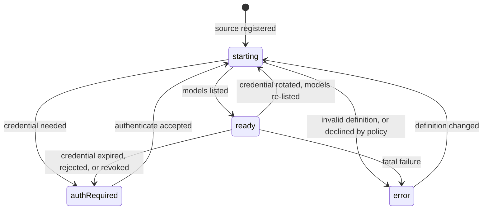
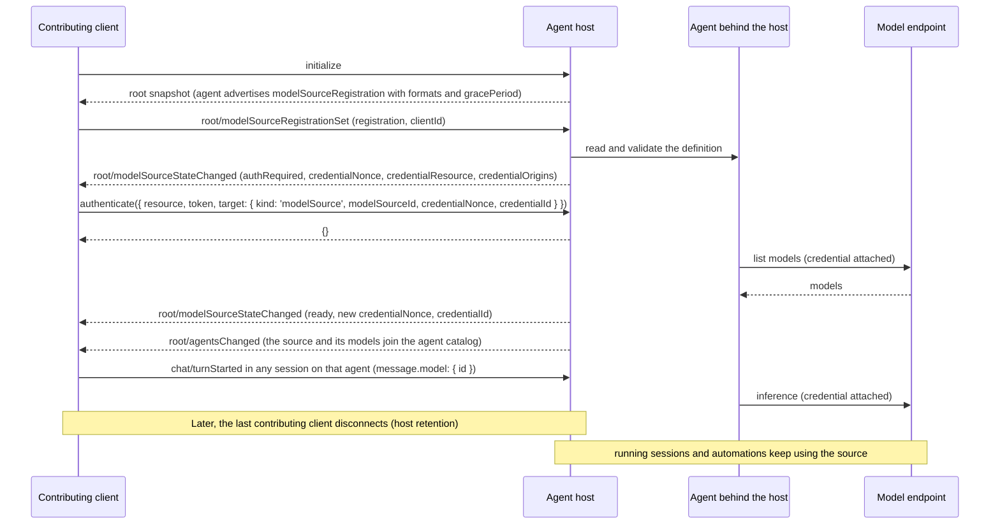

# Model Source Registry

> A proposal to let clients register bring-your-own-key (BYOK) model sources with an agent host, so the host can serve those models to its sessions and automations. It tracks [#619](https://github.com/microsoft/agent-host-protocol/issues/619) and builds on the model sources in [#543](https://github.com/microsoft/agent-host-protocol/pull/543), which has not merged yet. Docs only: nothing here changes `types/`.

## Status

Proposal. The type sketches below show the intended shape. They are not part of the protocol until a follow-up change adds them to `types/`, regenerates the clients, and updates the guides and specification.

An earlier revision proposed model sources as session-scoped plugin customizations. Review pointed out that BYOK configuration belongs to the user rather than to one session, and that automations and long-running headless sessions need model sources that outlive a client's session. This revision moves them to a host-wide registry. [§11](#_11-alternatives-considered) explains the trade-off.

It assumes the direction #543 is taking after review:

- Model IDs are unique within an agent's catalog.
- `SessionModelInfo.modelSourceId` groups a model under a `ModelSourceInfo` in `AgentInfo.modelSources`.
- A selection is just a model `id`.

### Terminology

- A **model source** is #543's term for an independently selectable source of model access, described by `ModelSourceInfo` in an agent's catalog.
- A **registration** is a model source a client or the host added to the host's registry, with its definition and status.
- A **model source definition** is the content of a registration that says how to reach the source: the endpoint, the wire format, and any curated model list, in a format the agent understands.
- A **contributing client** is a client that registered a source and still wants it. Several clients, such as two windows or two devices, can contribute the same source. A registration's `contributingClientIds` lists them.
- A **principal** is the user or account a host has verified a client acts for. AHP doesn't define how a host verifies one.
- An **agent provider** is the existing `provider` field (`AgentInfo.provider`). Nothing new is called a "provider".

---

## 1. Problem

A client can own the user's BYOK model configuration: endpoints, wire formats, curated model lists, and API keys. The protocol has no way to hand that configuration to an agent host:

- **No way to register a source.** Models are advertised by the host in `AgentInfo.models`, and #543's model sources are host-declared too. A client can't add one.
- **No credential path.** [`authenticate`](/specification/authentication#token-delivery) only accepts tokens for resources the host itself advertised: `AgentInfo.protectedResources`, or a live MCP authentication challenge. The client can't give the host a source's key.
- **No status.** Nothing reports whether a source loaded, needs a key, or failed.

For example, a client such as VS Code lets users configure their own OpenAI, Anthropic, Azure, Gemini, OpenRouter, or custom OpenAI-compatible endpoints. When the agent host runs elsewhere (over SSH, in WSL, through a tunnel, or as a long-lived remote service), those models can't be offered: the configuration and the key stay with the client.

The host may also run work no client is watching: sessions that span hours or days, and automations. Model sources have to be able to outlive one client's connection.

---

## 2. Principle: keep AHP thin

The agent behind the host does the heavy lifting. It owns:

- the model source definition format and how to read it;
- endpoint validation and network policy;
- model discovery and capability derivation (context windows, vision support, and so on);
- the wire protocol for inference;
- the mapping from AHP model IDs to the endpoint's own model identifiers;
- how a credential is applied to a request.

AHP carries only four things:

1. **Registration.** A client contributes a model source definition, or withdraws its contribution.
2. **Status.** The host reports whether each source is starting, ready, needs a credential, or failed.
3. **Credential.** A client supplies a secret, scoped to one registered source.
4. **Selection.** The source's models appear in the agent's catalog and are selected like any other model.

AHP names a definition's format but never defines, standardizes, or names one: `format` and `definition` are opaque to AHP and belong to the agent.

---

## 3. Existing patterns this builds on

- **Model sources ([#543](https://github.com/microsoft/agent-host-protocol/pull/543)).** `ModelSourceInfo { id, displayName }` and `AgentInfo.modelSources` describe an agent's sources, and `SessionModelInfo.modelSourceId` groups each model under one. A registered source joins that catalog, so selection, new-session pickers, and automations need nothing new.
- **Client-dispatched root actions.** `root/configChanged` already lets clients change host-wide state that the host validates and applies.
- **Keyed collections.** The registry follows the `Set` and `Removed` convention used for `activeClients`, `customizations`, and other keyed lists.
- **MCP server authentication.** An MCP server publishes `McpServerAuthRequiredState`, and the client answers with `authenticate` and a `target` naming that server. The [authentication spec](/specification/authentication#why-keyed-by-resource-and-optional-target) notes that `target.kind` is extensible for exactly this kind of addition.
- **MCP server status.** The host reports a server's lifecycle with `session/mcpServerStateChanged`, a narrow action that updates only the server's state. A registration's status works the same way.
- **No per-client ownership.** Any client in a session can start, stop, or enable an MCP server and answer its authentication challenge. AHP checks a `clientId` only to route a client tool's result back from the client that runs it. Registrations follow the same model by default: every connected client can use and change them. A host that can verify principals MAY restrict them ([§4.7](#_4-7-discovering-support)).
- **Container provenance.** A client-published plugin carries the publisher's `clientId` and a host-reported `load` state that is absent until the host reports one. A registration lists its contributing clients the same way, and its host-reported fields are absent until the host reports them.

---

## 4. Proposed surface

Everything here is additive and optional. It adds one root state field, four root actions (three of them client-dispatchable), one `authenticate` target, one agent capability, and one well-known `ErrorInfo.errorType`. There are no new commands, notifications, error codes, or channels.

### 4.1 The registry

```ts
// types/channels-root/state.ts

export interface RootState {
  // …existing…
  /** Model sources registered on this host. Keyed by `id`. */
  modelSourceRegistrations?: ModelSourceRegistration[];
}

/**
 * A model source registered on this host by one or more clients, or by the
 * host itself. Its definition is in a format the agent named by `provider`
 * reads. It never contains a credential.
 *
 * @category Root State
 * @stability 1.0
 * @preserveUnknownMembers
 */
export interface ModelSourceRegistration {
  /**
   * Host-unique ID, chosen by whoever registers the source. Also the
   * source's `ModelSourceInfo.id` in the agent's catalog, and the
   * `modelSourceId` of its models.
   */
  id: string;
  /** Agent provider whose agent reads the definition and serves the models. */
  provider: string;
  /** Human-readable name, published as `ModelSourceInfo.displayName`. */
  displayName: string;
  /** Icons for UI display. */
  icons?: Icon[];
  /** Definition format, one of the agent's `ModelSourceRegistrationCapability.formats`. */
  format: string;
  /**
   * How to reach the source: endpoint, wire format, models, and so on, in
   * `format`. MUST NOT contain a credential.
   */
  definition: Record<string, unknown>;
  /**
   * The clients that contribute this registration, in the order they
   * joined. The reducer maintains it. Absent when no client contributes it:
   * a source the host registered itself, or a `host`-retained one whose
   * contributors have all left.
   */
  contributingClientIds?: string[];
  /** What happens when the last contributing client leaves. Absent means `contributingClient`. */
  retention?: ModelSourceRetentionPolicy;

  // Host-reported fields, set together with `root/modelSourceStateChanged`.
  // Absent until the host reports, and after a `Set` replaces the
  // registration until the host reports again.

  /** Host-reported status. */
  state?: ModelSourceState;
  /**
   * Host-issued token that a client echoes when it delivers the credential,
   * and that tags every agent operation on the registration. See §4.4.
   */
  credentialNonce?: string;
  /**
   * RFC 9728 metadata for the endpoint the credential is for. Present
   * whenever the source takes a credential, in every state, so any client
   * can deliver, rotate, or revoke one. Absent for a source that needs no
   * credential.
   */
  credentialResource?: ProtectedResourceMetadata;
  /**
   * Every origin the host sends the credential to, such as
   * `https://api.example.com`. Present whenever `credentialResource` is.
   */
  credentialOrigins?: URI[];
  /**
   * The client-supplied ID of the credential the host most recently
   * accepted. While the state is `starting` or `ready`, the host holds it.
   * While it's `authRequired`, `reason` says what happened to it. Absent
   * until the host accepts a credential.
   */
  credentialId?: string;
  _meta?: Record<string, unknown>;
}
```

`definition` is intentionally open data. AHP doesn't define, standardize, or name any definition format: `format` and `definition` are opaque to AHP and belong to the agent that reads them. The definition lives in root state so a client can compare it with its own configuration.

`credentialResource.resource` is the endpoint URL as the definition names it, and the value a client passes back as `authenticate({ resource })`. `credentialResource.resource_name` labels the prompt, for example "OpenRouter API key". A source that accepts OAuth access tokens advertises `authorization_servers` and `scopes_supported`. A source that takes a user-supplied secret omits them. A source whose models use several endpoints lists every origin in `credentialOrigins`, so a client can check them all before it sends a key ([§7](#_7-credential-rules)).

A host may register sources itself, for example from configuration on a remote machine. Those registrations have no contributing clients, and their retention behaves as `host`.

### 4.2 Status

The status mirrors `McpServerState`: a lifecycle union discriminated by `kind`, with a `*Status` enum and `*State` variants.

```ts
// types/channels-root/state.ts

/**
 * Discriminant for the ModelSourceState union.
 *
 * @category Root State
 * @nonexhaustive
 */
export const enum ModelSourceStatus {
  /** The agent is reading and validating the definition. */
  Starting = 'starting',
  /** The source is usable, and its models are in the agent's catalog. */
  Ready = 'ready',
  /** The source needs a credential before it can be used. */
  AuthRequired = 'authRequired',
  /** The source failed, or the host declined it. */
  Error = 'error',
}

/**
 * Why a model source needs a credential.
 *
 * @category Root State
 * @nonexhaustive
 */
export const enum ModelSourceAuthRequiredReason {
  /** The host holds no credential yet. */
  Required = 'required',
  /** The credential's lifetime or lease lapsed. Renewing it is fine. */
  Expired = 'expired',
  /** The endpoint refused the credential. Clients don't send one with the same `credentialId` again. */
  Rejected = 'rejected',
  /** A client revoked the credential. Clients don't send one again without a user's action. */
  Revoked = 'revoked',
}

/** @preserveUnknownMembers */
export interface ModelSourceStartingState {
  kind: ModelSourceStatus.Starting;
}

/** @preserveUnknownMembers */
export interface ModelSourceReadyState {
  kind: ModelSourceStatus.Ready;
}

/**
 * Why a model source needs a credential before it can be ready. Deliberately
 * carries no credential. The endpoint the credential is for is the
 * registration's `credentialResource`.
 *
 * @preserveUnknownMembers
 */
export interface ModelSourceAuthRequirement {
  /** Why a credential is needed. */
  reason: ModelSourceAuthRequiredReason;
  /** Human-readable hint the host writes, for example "The endpoint rejected the API key." */
  description?: string;
}

/** @preserveUnknownMembers */
export interface ModelSourceAuthRequiredState extends ModelSourceAuthRequirement {
  kind: ModelSourceStatus.AuthRequired;
}

/** @preserveUnknownMembers */
export interface ModelSourceErrorState {
  kind: ModelSourceStatus.Error;
  /** Error details the host writes. MUST NOT contain the credential. */
  error: ErrorInfo;
}

/** @category Root State */
export type ModelSourceState =
  | ModelSourceStartingState
  | ModelSourceReadyState
  | ModelSourceAuthRequiredState
  | ModelSourceErrorState;
```

The reasons are specific to model sources. The shared `AuthRequiredReason` folds rejection and revocation into `expired`, so a client that renews automatically could undo a user's revocation, or keep resending a key the endpoint refused.



The host can remove a registration from any state (see [§6](#_6-lifecycle)).

The host reports status with its own narrow action, as it does for MCP servers with `session/mcpServerStateChanged`. It never reports status by dispatching the registration back.

```ts
// types/channels-root/actions.ts

/**
 * Updates a registration's host-reported fields together. A no-op when no
 * registration has `id`. Only the host dispatches it.
 */
export interface RootModelSourceStateChangedAction {
  type: ActionType.RootModelSourceStateChanged; // 'root/modelSourceStateChanged'
  id: string;
  state: ModelSourceState;
  credentialNonce: string;
  /** Replaces the registration's `credentialResource`. Absent clears it. */
  credentialResource?: ProtectedResourceMetadata;
  /** Replaces the registration's `credentialOrigins`. Absent clears it. */
  credentialOrigins?: URI[];
  /** Replaces the registration's `credentialId`. Absent clears it. */
  credentialId?: string;
}
```

Because the reducer ignores an unknown `id`, a status report that arrives after a registration is removed can't bring it back. Because it changes only the host-reported fields, it can't overwrite a client's newer definition. The host also tags every agent operation on the registration, such as validation, model discovery, and inference, with its current `credentialNonce`, and discards any result whose nonce is no longer current ([§4.4](#_4-4-credential-delivery-through-authenticate)). A slow result from before a definition change, a re-registration, or a key change therefore can't mark the current registration `ready`, even when the definition has changed back to the same value.

### 4.3 Contributing, withdrawing, and removing

Several clients, such as two windows or two devices, can want the same source. Each one contributes it, and each one withdraws only its own contribution.

```ts
// types/channels-root/actions.ts

/**
 * Contributes a model source registration for `clientId`: adds it, joins
 * an existing one with the same routing, or replaces one whose routing
 * changed.
 *
 * @clientDispatchable
 */
export interface RootModelSourceRegistrationSetAction {
  type: ActionType.RootModelSourceRegistrationSet; // 'root/modelSourceRegistrationSet'
  registration: ModelSourceRegistration;
  /** The contributing client. Absent when the host registers the source itself. */
  clientId?: string;
}

/**
 * Withdraws `clientId`'s contribution. A no-op when no registration has
 * `id`, or `clientId` doesn't contribute it.
 *
 * @clientDispatchable
 */
export interface RootModelSourceContributorRemovedAction {
  type: ActionType.RootModelSourceContributorRemoved; // 'root/modelSourceContributorRemoved'
  id: string;
  clientId: string;
}

/**
 * Removes a model source registration for every contributor. A no-op when
 * none matches.
 *
 * @clientDispatchable
 */
export interface RootModelSourceRegistrationRemovedAction {
  type: ActionType.RootModelSourceRegistrationRemoved; // 'root/modelSourceRegistrationRemoved'
  id: string;
}
```

A registration's routing is its `provider`, `format`, and `definition`, with definitions compared as JSON values, ignoring object key order. The reducers apply the actions as follows:

- **Add.** When no registration has the `id`, `Set` appends the registration, with `contributingClientIds` set to `[clientId]`, or absent when there's no `clientId`.
- **Join.** When one has, and its routing is unchanged, `Set` keeps the existing host-reported fields (`state`, `credentialNonce`, `credentialResource`, `credentialOrigins`, and `credentialId`), adds `clientId` to `contributingClientIds` if it isn't there, and takes `displayName`, `icons`, `retention`, and `_meta` from the action. Joining doesn't disturb the status, nonce, or credential.
- **Replace.** When the routing changed, `Set` replaces the registration, with `contributingClientIds` set to `[clientId]`. The other contributors wanted a different definition, so they're no longer contributors. The host-reported fields are absent until the host reports again.
- **Withdraw.** `root/modelSourceContributorRemoved` removes `clientId` from `contributingClientIds`, leaving the field absent when no contributor remains. It never removes the registration. The host does that with `Removed`.
- **Remove.** `Removed` deletes the registration by `id`, or returns the state unchanged.

A client contributes by dispatching `Set` with its own `clientId`, and without `contributingClientIds` or any host-reported field. It dispatches `Set` when it starts with the source configured and isn't already a contributor, for example a second window, or a window that reloaded with a new `clientId`. When contributors disagree on `displayName`, `icons`, `retention`, or `_meta`, the last `Set` wins.

A client SHOULD derive `id` from a stable key in its own configuration, so every device and window that has the same source configured shares one registration. A client SHOULD NOT replace a registration whose routing differs from its own copy unless the user changed the source in its configuration. Otherwise, two clients with different configurations would replace each other's registration indefinitely.

When the user removes the source from a client's configuration, the client withdraws its own contribution. It dispatches `Removed` only to remove the source for every contributor, for example from a host-wide management view.

The host rejects a client-dispatched `Set`, through `ActionEnvelope.rejectionReason`, when:

- the agent named by `provider` doesn't advertise `modelSourceRegistration`, or doesn't list `format`;
- `clientId` is absent or isn't the dispatching client's ID;
- the registration includes `contributingClientIds` or any host-reported field;
- `id` equals a `ModelSourceInfo.id` that the agent declares itself. The catalog entry the host publishes for this same registration doesn't count, so a ready registration can still be joined or changed;
- the host won't honor the requested `retention`. The client can register again with `contributingClient` retention;
- the registration is one the host registered itself;
- the host restricts registrations by principal, and the existing registration belongs to another principal ([§4.7](#_4-7-discovering-support)).

The host rejects a client-dispatched `root/modelSourceContributorRemoved` whose `clientId` isn't the dispatching client's ID. A host MAY reject a client's `Removed` for a registration it registered itself, or one that belongs to another principal.

When a client's own withdrawal leaves a registration with no contributors, the host removes it with `Removed`, whatever its retention: the last client that wanted it has withdrawn. When a contributor leaves instead, retention decides ([§6](#_6-lifecycle)).

When a `Set` replaces a registration's routing, the host drops its credential, issues a new `credentialNonce`, and the source goes back through `starting`. A changed definition must never receive a key that was supplied for a different one. A join, or a change to `displayName`, `icons`, `retention`, or `_meta`, keeps the credential and the nonce.

### 4.4 Credential delivery through `authenticate`

A client delivers a source's credential with the existing `authenticate` command and a new `target` variant. The command stays on the root channel, and no session is involved.

```ts
// types/common/commands.ts

/** @nonexhaustive */
export const enum AuthenticateTargetKind {
  McpServer = 'mcpServer',
  ModelSource = 'modelSource',
}

/**
 * A registered model source.
 *
 * @category Commands
 * @stability 1.0
 */
export interface ModelSourceAuthenticateTarget {
  kind: AuthenticateTargetKind.ModelSource;
  /** The registration's `id`. */
  modelSourceId: string;
  /**
   * The registration's current `credentialNonce`, as published in root
   * state. The host rejects a stale one with `Conflict` (-32011).
   */
  credentialNonce: string;
  /**
   * A client-chosen, non-secret ID for the credential, such as a hash of
   * where the client stores the key. The host publishes it as the
   * registration's `credentialId`. MUST NOT be derived from the secret.
   */
  credentialId?: string;
}

export type AuthenticateTarget =
  | McpServerAuthenticateTarget
  | ModelSourceAuthenticateTarget;
```

```jsonc
// Client → Host
{
  "jsonrpc": "2.0",
  "id": 7,
  "method": "authenticate",
  "params": {
    "channel": "ahp-root://",
    "resource": "https://api.example.com/v1",
    "token": "<secret>",
    "target": {
      "kind": "modelSource",
      "modelSourceId": "2f6c0e1a-model-source",
      "credentialNonce": "9b41d7",
      "credentialId": "keychain-5c2a"
    }
  }
}
```

The `token` is an opaque secret. The agent applies it as the definition specifies: an `Authorization: Bearer` header, an `x-api-key` or `api-key` header, and so on.

Clients MUST include a `modelSource` target when they deliver a registered source's credential. A token without a target can't be scoped to one registration (see [§7](#_7-credential-rules)), so it never satisfies a model source's challenge. The host rejects an untargeted `resource` that matches only model source challenges with `InvalidParams` (`-32602`). Untargeted tokens keep working for MCP servers and agent-level resources.

Clients SHOULD include `credentialId` when they deliver a credential, and omit it when they revoke one. It lets a client that reloads, or one on another device, tell whether the host holds its current key.

`credentialNonce` fences every credential change, and works as the registration's generation. The host issues a new nonce whenever a registration is added, including one registered again under a removed `id`, and whenever its routing changes, whether or not it held a credential. It also issues one whenever it installs or drops a credential: on delivery, rotation, expiry, rejection, and revocation. An `authenticate` built before any of those changes is stale, so:

- a key meant for an old definition never reaches a new one, even when the endpoint didn't change;
- a rotation that crosses a revocation can't undo the revocation;
- when two clients answer the same `authRequired`, the first wins, and the second gets `Conflict`, re-reads state, and finds the source ready.

The host tags every agent operation on the registration with the current nonce and discards any result, success or failure, that carries an older one. A late failure can't drop a key that has since replaced it, and a late success can't mark a changed or re-registered source `ready`, even after an edit that changes the definition back. Random values meet the rule that a nonce is never reused for the same `id`.

The credential fields stay in root state for as long as the source takes a credential, not only while it's `authRequired`. Any client, including one that connected after the source became ready, can build an `authenticate` request at any time: to rotate a short-lived token before it expires, or to revoke a key with an empty token.

**When a client delivers.** A client delivers a credential only in answer to the registration's current state, reading it from its own secure storage or token provider each time. It MUST NOT cache a credential it delivered, or replay one, for example after a reconnect. It delivers one when:

- the state is `authRequired` with reason `required`;
- the reason is `expired`, with a renewed credential: a fresh token, or the same static key with a new lease;
- the reason is `rejected`, only a credential whose `credentialId` differs from the registration's;
- the state is `starting` or `ready`, and the registration's `credentialId` names a key this client has since replaced, for example one it delivered before the user changed it. A client whose key simply differs leaves the host's credential alone, so two devices with different working keys don't replace each other's in turn;
- a lease it set is about to expire.

After `revoked`, a client delivers a credential only when a user asks it to. Before it sends any secret, a client checks the registration against its own copy ([§7](#_7-credential-rules)).

Like `McpServerAuthenticateTarget`, the target doesn't carry `@preserveUnknownMembers`: the client builds it for one request, so there are no unknown members to keep.

`credentialResource.resource` doesn't need to be an `https` URL, unlike other RFC 9728 resource identifiers. RFC 9728 requires `https` because an OAuth client fetches metadata from that URL. Here the client only echoes the value, so a local server such as `http://localhost:11434/v1` works. Where the host actually sends the credential is governed by its egress policy ([§7](#_7-credential-rules)).

When `target.kind` is `modelSource`, the host:

- MUST apply the credential only to that registration. It never applies it to other registrations, MCP servers, or agent-level resources, even when they share `resource`.
- MUST require `resource` to equal the registration's current `credentialResource.resource`.
- MUST reject an unknown `modelSourceId` with `InvalidParams` (`-32602`).
- MUST reject a `credentialNonce` other than the one it most recently issued for that registration with `Conflict` (`-32011`). The client re-reads root state and, if the source still needs a credential, sends it again with the current nonce.
- MUST publish the target's `credentialId` as the registration's `credentialId` when it accepts a credential.
- MUST treat an empty `token` as revocation: it stops using the credential at once, drops it, and reports `authRequired` with `reason: revoked`.

Any client may deliver or revoke a registration's credential, as any client may answer an MCP server's challenge, unless the host restricts credentials by principal ([§4.7](#_4-7-discovering-support)). It then rejects a credential from another principal's client with `PermissionDenied` (`-32009`).

`expiresIn` keeps its meaning for short-lived tokens such as Microsoft Entra ID access tokens. With a static key, it's a lease: the host drops the key when the lease elapses and reports `expired`, and a client renews the lease by sending the key again. An API key without a lease omits it.

### 4.5 Models and selection

When a registration is `ready`, the host adds it to the catalog of the agent named by `provider`, through `root/agentsChanged`:

- a `ModelSourceInfo` in `AgentInfo.modelSources`, with the registration's `id` and `displayName`;
- its models in `AgentInfo.models`, each with `modelSourceId` set to the registration's `id`.

`modelSourceId` alone doesn't mark a registered source: #543 also uses it to group an agent's own models. Registration provenance is the signal: a source is registered when `modelSourceRegistrations` has an entry with that `id` whose `provider` is the agent.

The host adds a registration's models when it first becomes `ready`, and keeps them listed through later `starting` and `authRequired` states, so a key rotation or expiry doesn't change the catalog or break a selection. It withdraws them when the registration is removed, when its last contributing client leaves under `contributingClient` retention, when it enters `error`, or when a routing change mints new model IDs (see Reserved model IDs below). A turn that uses a listed model while the source has no usable credential ends with the `modelSourceUnavailable` error ([§6](#turns-on-an-unavailable-source)). The host MAY list the `ModelSourceInfo` in any state, since #543 allows a source with no models.

Each model follows #543's catalog rules:

- `id` MUST be unique within the agent's catalog. The host mints it and maps it to the endpoint's own model identifier, so two registrations can serve the same upstream model without colliding.
- `provider` stays the agent provider.
- `vendor` MAY name the service that serves the model, for example `OpenRouter`.

**Reserved model IDs.** Drafts, pending messages, history, and automation definitions keep a selection after its source goes away, and a chat keeps them when it moves to another session. Once the host publishes a model `id` for a registration, that `id` is bound to that registration and its upstream model for as long as the host keeps state. That includes after the registration is removed and across a host restart. The host MUST NOT resolve the `id` to anything else. It MAY publish the `id` again only when the same registration (the same `id`) comes back offering the same upstream model. A model's upstream identity is the endpoint the agent sends its requests to plus that endpoint's model identifier. A change to `provider` or `format`, or a `definition` change that moves the endpoint, makes it a different upstream model, so the host mints new IDs, even when a different client made the change.

A host SHOULD derive each model's `id` deterministically from the registration (its `id`, `provider`, and `format`), the endpoint, and the endpoint's model identifier, for example with a hash. The same model then gets the same `id` when its source is registered again or the host restarts, without a stored table, and a moved endpoint gets a new one. Random IDs would break saved selections whenever a source is registered again, unless the host persists a table of them.

**Selection** doesn't change: a client picks a model by `id`, with optional `config`, on every path a selection already uses. The host checks that the model is listed, that the chat is backed by the registration's agent provider, and, when it restricts registrations by principal, that the turn's client acts for the registration's principal. It checks whenever it uses a selection, including when a client continues a turn with `chat/turnResume`. Otherwise it rejects the selection through the existing failure paths: `InvalidParams` for requests, and `rejectionReason` for dispatched actions.

**Sessions** need nothing new. Any session whose agent is the registration's `provider` can use its models, whichever client started the turn. There is no per-session list of registrations.

**Automations** may name a registration's model when the registration has `host` retention, or was registered by the host. The host SHOULD reject an automation create or update that names a model from a `contributingClient`-retained registration, because the automation would outlive the source. If the source isn't `ready` when a run starts, the run fails through the existing automation run lifecycle, and the registration's `authRequired` state tells the next client to connect what's needed.

### 4.6 Retention

The contributing clients choose what happens to a registration when the last of them leaves. The default is the narrower choice, so clients that don't set it behave like clients that only use their models while one of them is connected.

```ts
// types/channels-root/state.ts

/**
 * How long a registered model source lasts once its last contributing
 * client leaves.
 *
 * @category Root State
 * @nonexhaustive
 */
export const enum ModelSourceRetentionPolicy {
  /** Removed when the last contributing client leaves, once running turns finish. */
  ContributingClient = 'contributingClient',
  /** Kept until it's removed, its last contributor withdraws, or host policy expires it. */
  Host = 'host',
}
```

The two values mirror how MCP servers already behave. A `contributingClient` registration goes away with its clients, like a client-published plugin. A `host` registration stays, like a host-declared server, so long-running sessions and automations keep working, with the key in memory, while the host runs. Explicit withdrawal is different from leaving: when the last contributor withdraws, the source goes away whatever its retention, so `host` retention doesn't leave sources nobody wants.

The host rejects `host` retention when it won't honor it ([§4.3](#_4-3-contributing-withdrawing-and-removing)), and it MAY expire `host`-retained registrations by its own policy.

### 4.7 Discovering support

A client needs to know whether an agent accepts registrations, in what format, how long the host tolerates a disconnect, and whether the registry is shared across principals. Unlike the per-agent markers #543 dropped, this capability carries information a client can't get any other way.

```ts
// types/channels-root/state.ts

export interface AgentCapabilities {
  // …existing…
  /** The agent serves models from registered model sources. */
  modelSourceRegistration?: ModelSourceRegistrationCapability;
}

/**
 * @category Root State
 * @stability 1.0
 * @preserveUnknownMembers
 */
export interface ModelSourceRegistrationCapability {
  /**
   * Definition formats the agent reads, most preferred first. Format names
   * are defined by agent implementations and SHOULD be namespaced, for
   * example `example.com/model-source@1`, so different agents' formats
   * don't collide.
   */
  formats: string[];
  /**
   * How long, in milliseconds, the host keeps a disconnected client's
   * contributions before it treats the client as having left.
   *
   * @integer
   * @minimum 0
   */
  gracePeriod?: number;
  /** Whether clients acting for different principals share the registry. Absent means `shared`. */
  principalPolicy?: ModelSourcePrincipalPolicy;
}

/**
 * @category Root State
 * @nonexhaustive
 */
export const enum ModelSourcePrincipalPolicy {
  /** Every connected client may change, supply credentials for, and select every registration. */
  Shared = 'shared',
  /**
   * The host verifies principals, and limits changes, credentials, and
   * selection of each registration to clients of the principal that
   * registered it.
   */
  Isolated = 'isolated',
}
```

A client that knows none of an agent's formats doesn't register with it. AHP doesn't define, standardize, or name any format.

**Principals.** AHP doesn't verify which client is which, so by default every connected client is trusted equally, as with MCP servers. Where a host can verify principals, it MAY restrict changes, credentials, and use of a registration to clients of the principal that registered it, and advertises `isolated`. Root state still lists every registration to every client, so a definition is never private. A host whose connections carry credentials scoped to one client, such as a relay that forwards each client's own sign-in, SHOULD NOT let one client's registration be used by another: it uses `isolated`, or doesn't advertise `modelSourceRegistration`.

### 4.8 Change table

What a follow-up implementation would touch:

| Symbol | File | Kind |
| --- | --- | --- |
| `RootState.modelSourceRegistrations`, `ModelSourceRegistration` (including `contributingClientIds` and the host-reported `credentialNonce`, `credentialResource`, `credentialOrigins`, and `credentialId`) | `channels-root/state.ts` | added |
| `ModelSourceStatus`, four `ModelSource*State` variants, `ModelSourceState`, `ModelSourceAuthRequirement`, `ModelSourceAuthRequiredReason` | `channels-root/state.ts` | added (lifecycle union) |
| `ModelSourceRetentionPolicy` | `channels-root/state.ts` | added |
| `AgentCapabilities.modelSourceRegistration`, `ModelSourceRegistrationCapability`, `ModelSourcePrincipalPolicy` | `channels-root/state.ts` | added (capability) |
| `root/modelSourceRegistrationSet`, `root/modelSourceContributorRemoved`, `root/modelSourceRegistrationRemoved` | `channels-root/actions.ts`, `common/actions.ts`, `version/registry.ts` | added (client-dispatchable, introduced in the development version) |
| `root/modelSourceStateChanged` | `channels-root/actions.ts`, `common/actions.ts`, `version/registry.ts` | added (host-only, introduced in the development version) |
| Root reducer | `channels-root/reducer.ts` | add, join, replace, withdraw, remove, and status change, with fixtures for every branch |
| Client reducers | `clients/{go,rust,kotlin,swift,dotnet}/` | apply the four root actions, so they pass the shared fixtures |
| `AuthenticateTargetKind.ModelSource`, `ModelSourceAuthenticateTarget` (with `modelSourceId`, `credentialNonce`, and `credentialId`), `AuthenticateTarget` | `common/commands.ts` | added, widened |
| `AuthenticateParams.target` and `resource` docs | `common/commands.ts` | generalized beyond MCP servers, including opaque secrets that aren't Bearer tokens |
| `ErrorInfo.errorType` docs | `common/state.ts` | the well-known `modelSourceUnavailable` value |
| `ModelSourceInfo`, `SessionModelInfo.modelSourceId` docs | `channels-root/state.ts` | registered sources, provenance, and reserved IDs |
| Generator registration | `scripts/generate-{csharp,go,kotlin,rust,swift}.ts` | new enums, structs, and union variants |
| Root channel and authentication specs, naming dictionary | `docs/`, `.github/instructions/` | updated |

---

## 5. Flow



1. The client reads the agent's `modelSourceRegistration` capability and picks a format it can write.
2. It dispatches `root/modelSourceRegistrationSet` with its own `clientId`. The host's agent reads and validates the definition, and the host reports `starting` with `root/modelSourceStateChanged`.
3. If a credential is needed, the host reports `authRequired` with a `credentialNonce`, the `credentialResource` the key is for, and every origin it would send the key to. The client checks those against its own copy and calls `authenticate` with that `resource` and a `modelSource` target that echoes the nonce and names its key with `credentialId`.
4. The agent lists models. The host reports `ready`, with a new nonce because a key was installed, and the `credentialId` it now holds. It adds the source and its models to the agent's catalog.
5. Another window or device that has the same source configured dispatches the same `Set` and joins as a contributor, without disturbing the status, nonce, or credential. It sees the `credentialId` and doesn't send its key again.
6. Any client can select those models in any session on that agent, and so can automations if the source has `host` retention.
7. When the last contributing client leaves, the retention policy decides whether the source stays (see [§6](#_6-lifecycle)).

---

## 6. Lifecycle

### When a contributing client leaves

A contributing client leaves when its connection closes and it doesn't reconnect with the same `clientId` within the host's grace period, which the host advertises as `gracePeriod`. The host then dispatches `root/modelSourceContributorRemoved` for it. While other contributors remain, nothing else changes. When the last contributor leaves:

- **`contributingClient` retention (the default).** The host stops new work on the source and withdraws its models from the catalog: a new turn or a pending message that names one of its models fails. Turns already running on it SHOULD finish, and the host MAY bound how long it waits. Any client can still cancel such a turn with the existing cancellation actions. The host then removes the registration and drops its credential.
- **`host` retention.** The registration stays, with its credential in memory and no contributors, until a client removes it, a client that joins later withdraws, host policy expires it, or the host restarts (see below). It keeps serving every client and automation. If its credential expires or is rejected, the source goes to `authRequired`, and work that needs it fails until a client answers.

A client that comes back with the same `clientId` within the grace period is still listed, and dispatches `Set` only for the sources it changed. A client that comes back with a new `clientId` and the same configuration joins with `Set`, which keeps the status, nonce, and credential.

### Withdrawal, removal, and revocation stop work at once

When a client's withdrawal leaves a registration with no contributors, when any client dispatches `Removed`, or when a client revokes the credential, the host stops using the credential immediately. It ends every running turn that uses the source with the `modelSourceUnavailable` error (see below), rather than letting it finish. Withdrawal and removal then remove the registration. Revocation keeps it, in `authRequired` with `reason: revoked`.

### Selections after removal

A selection that names a removed source's model fails. The host MUST NOT run the work on a different model. The user picked a specific service with their own key, and quietly sending the prompt somewhere else would change where their data goes and who pays for it.

- Drafts, history, and automation definitions keep the `id`. Because the `id` stays reserved, it can't later resolve to a different source. Clients show such a selection as unavailable.
- A pending message that names a removed model fails when the host would consume it, through the existing chat lifecycle.

### Rotation, expiry, rejection, and revocation

- **Rotation.** A new `authenticate` with the current nonce replaces the credential, and the host issues a new nonce and publishes the new `credentialId`. The host MAY pass through `starting` while the agent re-lists models, keeping the models listed and their IDs stable.
- **Expiry.** When a credential's lifetime or lease lapses, the host drops it, and the source goes to `authRequired` with `reason: expired` and a new nonce. A client may renew it: a fresh token, or the same static key with a new lease. Clients holding short-lived tokens or leases SHOULD renew before `expiresIn` elapses.
- **Rejection.** When the endpoint refuses a credential, the source goes to `authRequired` with `reason: rejected` and a new nonce, and `credentialId` still names the refused key. No client sends a credential with that `credentialId` again. A client whose key differs may send it, or ask the user for a new one.
- **Revocation.** An empty `token` drops the credential at once, and the source goes to `authRequired` with `reason: revoked` and a new nonce. No client delivers a credential again without a user's action, including other devices that have the key stored, and the new nonce rejects a delivery that was already in flight.

### Turns on an unavailable source

When a turn can't use its source, because the credential is missing, expired, rejected, or revoked, or because the source was withdrawn or removed, the host ends the turn with `chat/error`. The error part's `error.errorType` is `modelSourceUnavailable`, and `resumable` is `true`. A client tells why from the registration of the turn's model: its `state`, or its absence. Once the source is ready again, a client can continue the same turn with `chat/turnResume`, and the host checks the turn's selection again first. The host never switches models. It doesn't hold the turn open: `SessionStatus.InputNeeded` comes from `inputNeeded` entries and blocked tool calls, and none of them covers a model source, so a held turn would look like it's still running.

### Host restart

Credentials are gone after a restart, because they were never persisted. `contributingClient`-retained registrations are gone too, and their clients register again when they reconnect. A host that persists its own state SHOULD keep `host`-retained registrations, which come back through `starting`, and reach `authRequired` with `reason: required` only if they need a credential. Model IDs derived deterministically ([§4.5](#_4-5-models-and-selection)) come back unchanged without a stored table.

---

## 7. Credential rules

1. **Never in state, actions, or notifications.** All of these are broadcast to subscribers. That includes `definition`, `_meta`, `ErrorInfo`, `credentialResource`, `credentialOrigins`, `credentialId`, and `ModelSourceAuthRequirement`. A secret travels only in `authenticate`, and `credentialId` is never derived from it. The host writes `description` and `ErrorInfo` itself, and SHOULD NOT copy upstream response bodies or headers into them: an endpoint's error text can echo part of a key, and every client can read root state.
2. **Memory only.** The host holds it only in memory. It is never persisted and never placed in environment variables, command lines, logs, telemetry, or error messages. The host SHOULD also redact it from tool output before storing that output or sending it to the model. That's best effort: rule 4 keeps the host from handing the secret to tools, but the same secret can also live where the agent can read it, such as a `.env` file or the user's shell environment, and a host can only redact values it knows.
3. **Scoped to one registration and one `credentialNonce`.** It is never shared with other registrations, MCP servers, or the agent's own protected resources, and a key sent for an earlier definition never reaches a later one.
4. **Sent only where the host says.** The host attaches it only to that source's requests, as its definition specifies, and only to origins in `credentialOrigins`. It is never sent to another origin, including on redirect, and never exposed to the model, tools, terminals, or hooks.
5. **Dropped** when the registration is removed, when its routing changes, when it's revoked, when its lease lapses, and when the host restarts.
6. **Re-requested through state.** The host asks again by setting `authRequired`. State survives reconnects; `auth/required` notifications are not replayed.
7. **Delivered only in answer to state.** Clients MUST NOT cache a model source credential they delivered, or replay one, for example on reconnect. They deliver one only in answer to the registration's current state ([§4.4](#_4-4-credential-delivery-through-authenticate)), reading it from their own secure storage or token provider. Clients SHOULD NOT prompt the user for a key they don't have.
8. **Checked by the client.** A client MUST NOT send a stored secret unless the registration's `provider`, `format`, and `definition` match its own copy, and every origin in `credentialOrigins` is one its own copy of the definition sends the key to. `credentialNonce` stops a delayed reply, but not a device whose copy of the definition is out of date or a registration another client has changed.
9. **Reached from the host.** Endpoints in a definition, including loopback and private addresses, are resolved and reached from the host machine: `localhost` in a source registered with a remote host is that host, not the client's machine. Hosts SHOULD apply an egress policy to registered endpoints: deny link-local and cloud metadata addresses, and require `https` for any credentialed endpoint that isn't a loopback address, unless the host has opted in to plain `http`.

---

## 8. Out of scope for AHP

- Defining, standardizing, or naming any definition format. `format` and `definition` stay opaque and belong to the agent.
- Endpoint validation beyond rule 9's egress policy, model discovery, capability derivation, and wire protocols. These belong to the agent.
- Client-side credential storage, and keys the host stores itself. That is host-owned authentication ([#404](https://github.com/microsoft/agent-host-protocol/pull/404)); see the open questions.
- How a host verifies principals.
- Restricting a registration to particular sessions.
- Usage, billing, or per-call provenance.

Hosts apply policy appropriate to the source, for example by declining registrations from clients they don't trust, or narrowing which formats they accept.

---

## 9. Open questions

- **Holding a turn for a credential.** A turn whose credential fails ends with the resumable `modelSourceUnavailable` error (see [§6](#turns-on-an-unavailable-source)). Should a host instead be able to hold the turn visibly, with a `modelSourceAuthentication` input request in `SessionState.inputNeeded`? It would carry a `ModelSourceAuthRequirement`, the way MCP's tool authentication request carries an `McpAuthRequirement`.
- **Keys that survive a restart.** `host` retention keeps a key only in memory. Keeping it across restarts needs the host to store it, which #404 doesn't cover yet: its flows are OAuth only, and its account consumers are agents and MCP servers. An API key also has no authority-qualified account for [#459](https://github.com/microsoft/agent-host-protocol/pull/459)'s revocation.
- **Hiding registrations from other principals.** `isolated` lets a host restrict who changes, supplies credentials for, and uses a registration, but root state still shows every definition to every client. Should a host be able to hide registrations from clients of other principals? That would be a new pattern for root state.
- **Duplicates.** Clients that derive different `id`s for the same service get two registrations. Should a host merge them?

---

## 10. Compatibility

- **Additive.** `RootState.modelSourceRegistrations` and the new capability are optional fields. `AuthenticateTargetKind` is `@nonexhaustive`, and generated clients preserve unknown `AuthenticateTarget` variants.
- **New actions follow the usual rules.** The four root actions are introduced in the development protocol version, like any new action, so hosts don't send them to clients that negotiated an older version. No extra version bump is needed.
- **Ignorable.** A client that doesn't know the registry still sees registered sources' models in `AgentInfo.models` and can select them by `id`, like any other model.
- **Capability-gated.** Clients register only with agents that advertise `modelSourceRegistration`.
- **Depends on #543.** Registered sources join #543's `AgentInfo.modelSources` catalog, so this lands after #543, or together with it.

---

## 11. Alternatives considered

- **Session-scoped plugin customizations.** The previous revision of this proposal: a client publishes a model source inside a plugin in its `SessionActiveClient` entry, and the host expands it into a child customization of that session, following the MCP server lifecycle. It was replaced for five reasons:
  - Automations can't use a source that exists only inside one session.
  - Long-running and headless sessions lose the source when the client's session membership ends, apart from in-memory retention.
  - New-session pickers can't show the models until a session exists and the source has loaded.
  - Every session repeats the same definition and the same key.
  - Per-session enablement and per-session model sets, which the customization lifecycle provides, don't match how BYOK is configured.
- **A `SessionActiveClient.modelSources` field with host-published copies.** The first draft of #619. It makes the client the source of truth for model metadata it can't validate, and has the same session-scope problems.
- **Host configuration.** Model sources could be values in `RootConfigState`, changed with `root/configChanged`. Config has no per-entry provenance, status, or credential target, so each would need adding anyway.
- **Per-client sharing and ownership.** An earlier draft let the contributing client limit who could use a source and who could change it, so one client couldn't spend another's key. AHP can't verify which client is which, any connected client can already run tools as the host's user, and MCP servers have no such limits. The rules added complexity without protection, so they were dropped. A host that can verify principals advertises `isolated` instead ([§4.7](#_4-7-discovering-support)).
- **One `clientId`, last writer wins.** An earlier draft recorded only the client that last wrote a registration. A second window's identical `Set` took the source over, and the source went away when that window left, even though the first window still wanted it. `host` retention instead left sources behind that nobody cleaned up. A list of contributing clients lets each client add and withdraw only its own contribution.
- **Hiding registrations per connection.** Root state is one shared, replayable state, and this proposal trusts every connected client, so it doesn't project different registries to different clients.
- **Reporting status by rewriting the registration.** An earlier draft had the host dispatch the whole registration back with `state` added. A late status write could then bring back a removed registration or overwrite a newer definition, which took several extra rules to prevent. A narrow status action, as MCP uses, prevents both by construction.
- **Host-to-client credential fetch per request.** The host would ask the contributing client for the key on each request, so it never rests on the host. AHP has host-to-client requests, such as the `resource*` family, but a fetch per model request adds a client round trip to every request and can't serve headless work once the client leaves.

---

## 12. Doctrine design tests

Applying the [doctrine's design tests](/guide/doctrine#design-tests):

- **Can a minimal client ignore this and still render a coherent session?** Yes. It sees ordinary models in the agent's catalog, and turns use whichever model it picks.
- **Is the durable, user-visible result represented in state?** Yes. Registrations, their status, and their models live in root state. The credential is deliberately not state, because it is a secret.
- **Does the host remain the authority?** Yes. The host validates registrations, decides status and policy, mints model IDs, and checks every selection. Clients send a definition and a secret, never a catalog.
- **Does this expose an agent implementation detail?** Only the format name. The definition's content, discovery, wire protocol, model ID mapping, and how a key is attached stay with the agent.
- **Does it fit an existing channel?** Yes. The registry is root state, and the credential uses root `authenticate`. No new channel.
- **Can clients discover support through capabilities or optional state?** Yes, through the agent's `modelSourceRegistration` capability and its formats.
- **Is provider-specific metadata an enhancement rather than a requirement?** Yes. `_meta` on registrations and models stays optional.

It also respects the doctrine's anti-goal of "a required model provider, model router, or credential flow": the whole surface is optional, and a host may decline any registration.
