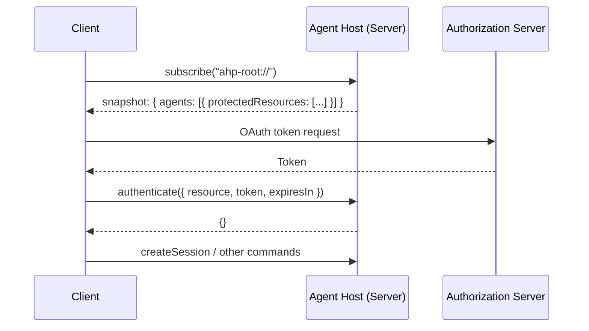

# Authentication

AHP uses [RFC 9728](https://datatracker.ietf.org/doc/html/rfc9728) (OAuth 2.0 Protected Resource Metadata) semantics for authentication discovery, and [RFC 6750](https://datatracker.ietf.org/doc/html/rfc6750) (Bearer Token Usage) semantics for token delivery. Communication is JSON-RPC, not HTTP, but the vocabulary and flow mirror the HTTP standards. A [registered model source](#model-source-credentials) takes an opaque secret, such as an API key, instead of a Bearer token.

## Overview

Each agent declares the **protected resources** it requires authentication for via the `protectedResources` field on [`AgentInfo`](/reference/root#agentinfo) in root state. Clients discover these requirements by subscribing to `ahp-root://`, obtain tokens from the declared authorization servers using standard OAuth 2.0 flows, and push them to the server via the [`authenticate`](/reference/common#authenticate) command.



## Discovery

Authentication requirements are declared **per-agent** on [`AgentInfo.protectedResources`](/reference/root#agentinfo). Each entry is an [`ProtectedResourceMetadata`](/reference/common#protectedresourcemetadata) object following the [RFC 9728](https://datatracker.ietf.org/doc/html/rfc9728) shape:

```json
{
  "agents": [
    {
      "provider": "copilot",
      "displayName": "GitHub Copilot",
      "description": "AI pair programmer",
      "models": [...],
      "protectedResources": [
        {
          "resource": "https://api.github.com",
          "resource_name": "GitHub Copilot",
          "authorization_servers": ["https://github.com/login/oauth"],
          "scopes_supported": ["read:user", "user:email"]
        }
      ]
    }
  ]
}
```

Clients receive this metadata automatically via the root state snapshot (when subscribing to `ahp-root://`) and via `root/agentsChanged` actions when the agent list changes.

An agent with no `protectedResources` (or an empty array) does not require authentication.

### Required vs. optional authentication

Each protected resource entry has a `required` field (defaults to `true`) that controls whether the agent can be used without a token:

- **`required: true`** (default) — the agent cannot function without authentication. The server SHOULD return `AuthRequired` (`-32007`) if the client attempts to use the agent unauthenticated.
- **`required: false`** — the agent works without authentication but MAY offer enhanced capabilities (e.g. higher rate limits, personalized results) when a token is provided.

Clients SHOULD treat an absent `required` field the same as `true`.

```json
{
  "protectedResources": [
    {
      "resource": "https://api.example.com",
      "resource_name": "Example API",
      "authorization_servers": ["https://login.example.com"],
      "required": false
    }
  ]
}
```

Clients MAY use the `required` field to decide whether to prompt users for authentication up front or defer it until the user explicitly requests a feature that benefits from auth.

### Why per-agent metadata?

Different agents MAY require authentication with different providers. For example, one agent might require a GitHub token while another requires an Azure AD token. Declaring requirements per-agent rather than server-wide allows:

- A single server to host agents from different providers with different auth requirements
- Clients to selectively authenticate only for agents they intend to use
- Auth requirements to change as agents are added or removed

## Token Delivery

Clients push Bearer tokens to the server using the [`authenticate`](/reference/common#authenticate) command. The `resource` field MUST match a `resource` value the server has itself advertised — either statically via the agent's `protectedResources` metadata, or dynamically via a live MCP authentication challenge (`McpServerAuthRequiredState.resource` or, for a single blocked tool call, `ToolCallAuthRequiredState.auth.resource` — see [MCP Servers](/guide/mcp#authentication)) or a registered model source's `ModelSourceRegistration.credentialResource.resource`, which stays available while the source is ready for rotation and revocation (see [Model source credentials](#model-source-credentials)):

```jsonc
// Client → Server
{
  "jsonrpc": "2.0",
  "id": 3,
  "method": "authenticate",
  "params": {
    "channel": "ahp-root://",
    "resource": "https://api.github.com",
    "token": "gho_xxxxxxxxxxxx",
    "expiresIn": 3540,
    "scopes": ["read:user", "user:email"]
  }
}

// Server → Client (success)
{
  "jsonrpc": "2.0",
  "id": 3,
  "result": {}
}
```

`expiresIn` is optional and corresponds to the `expires_in` field in an OAuth 2.0 token response, as defined by [RFC 6749 section 5.1](https://datatracker.ietf.org/doc/html/rfc6749#section-5.1). It is the access token's remaining lifetime in seconds when the client sends the `authenticate` request. When supplied, it MUST be a positive integer.

If the client retained the original token response, it MUST subtract elapsed time from the original `expires_in` value before forwarding it. The client MUST omit `expiresIn` when the authorization server did not supply an expiry or the expiry is otherwise unknown. An empty `token` revokes authentication for the resource, limited to `target` when supplied; `expiresIn` is irrelevant and SHOULD be omitted in that request.

`scopes` is optional and lets the client tell the server which OAuth scopes the pushed token actually grants — useful when resolving a `requiredScopes` challenge (from a live `McpServerAuthRequiredState` or `ToolCallAuthRequiredState.auth`) without the server needing to decode an opaque token.

`target` is an optional, extensible discriminated union identifying the token's consumer. Clients SHOULD include it when answering a challenge from a specific MCP server (`McpServerAuthRequiredState` or `ToolCallAuthRequiredState`), MUST include it when delivering a registered model source's credential, and omit it for provider-level resources (`AgentInfo.protectedResources` or `AuthRequired` `-32007` error data). The currently defined variants are `mcpServer` and [`modelSource`](#model-source-credentials):

```jsonc
// MCP token delivery (the command still uses the root channel)
{
  "jsonrpc": "2.0",
  "id": 4,
  "method": "authenticate",
  "params": {
    "channel": "ahp-root://",
    "resource": "https://mcp.example.com",
    "token": "access_token",
    "scopes": ["read"],
    "target": {
      "kind": "mcpServer",
      "session": "ahp-session:/session-1",
      "customizationId": "mcp-server-1"
    }
  }
}
```

`session` is the URI of the session whose `SessionState.customizations` contains the MCP server, either as a top-level entry or a child customization. `customizationId` is that server's session-unique `McpServerCustomization.id`. Clients only echo these host-published identifiers: `McpServerAuthRequiredState` lives on the customization, and `ToolCallAuthRequiredState.contributor.customizationId` identifies the same customization.

When `target.kind` is `mcpServer`, the host MUST apply the token only to that MCP server in that session — never to sibling servers, other sessions, or agent-level resources — even when they share `resource` and scopes. `resource` MUST still equal the targeted server's advertised `McpAuthRequirement.resource.resource`. If the session or customization is unknown, or the customization is not an MCP server, the host MUST reject the request with `InvalidParams` (`-32602`).

Without `target`, hosts retain resource/scope matching for backwards compatibility; a token may satisfy every matching pending challenge, except a model source's. The host rejects an untargeted `resource` that matches only model source challenges with `InvalidParams` (`-32602`). Older hosts ignore the unknown field and retain this untargeted behavior, so isolation is not guaranteed with older hosts. No capability or protocol version bump is required.

If the token is invalid or the resource is unrecognized, the server MUST return a JSON-RPC error (e.g. `AuthRequired` `-32007` or `InvalidParams` `-32602`).

### Model source credentials

A client can [register a model source](/specification/root-channel#model-source-registry), such as an endpoint configured with the user's own API key, with the host. While the source takes a credential, the registration carries host-reported credential fields in every state:

- `credentialResource`: RFC 9728 metadata for the endpoint the credential is for;
- `credentialOrigins`: every origin the host sends the credential to;
- `credentialNonce`: the registration's current generation;
- `credentialId`: the client-supplied ID of the key the host most recently accepted.

When the source needs a credential, the host also sets the registration's state to `ModelSourceAuthRequiredState`, with a `reason`. A client answers with a `modelSource` target that names the registration, echoes its current `credentialNonce`, and names the key with a non-secret `credentialId`:

```jsonc
// Model source credential delivery
{
  "jsonrpc": "2.0",
  "id": 5,
  "method": "authenticate",
  "params": {
    "channel": "ahp-root://",
    "resource": "https://api.example.com/v1",
    "token": "<secret>",
    "target": {
      "kind": "modelSource",
      "modelSourceId": "2f6c0e1a-model-source",
      "credentialNonce": "9b41d7",
      "credentialId": "keychain-5c2a"
    }
  }
}
```

The `token` is an opaque secret rather than an RFC 6750 Bearer token. The agent applies it as the registration's definition specifies, for example as an `Authorization: Bearer` or `x-api-key` header. A source that accepts OAuth access tokens, such as Microsoft Entra ID tokens, advertises `authorization_servers` and `scopes_supported`, and the client sends `expiresIn` with each short-lived token. A source that takes a user-supplied secret omits them, and the client omits `scopes`. `credentialResource.resource_name` labels the prompt, for example "OpenRouter API key".

`credentialResource.resource` is the endpoint URL as the definition names it, and the value the client passes as `resource`. It may use any scheme the agent supports, such as `http://localhost:11434/v1` for a local server. Unlike other protected resources, it doesn't need to be an `https` URL: the client only echoes it in `authenticate`, and nothing fetches it. Where the host actually sends the credential is governed by `credentialOrigins` and the egress rules below.

`credentialId` is chosen by the client, for example a hash of where it stores the key. It MUST NOT be derived from the secret, because every client can read it. Clients SHOULD include it when they deliver a credential, and omit it when they revoke one. It lets a client that reloads, or one on another device, tell whether the host holds its current key.

When `target.kind` is `modelSource`, the host:

- MUST apply the credential only to that registration, never to other registrations, MCP servers, or agent-level resources, even when they share `resource`;
- MUST require `resource` to equal the registration's current `credentialResource.resource`;
- MUST reject an unknown `modelSourceId` with `InvalidParams` (`-32602`);
- MUST reject a `credentialNonce` other than the one it most recently issued for that registration with `Conflict` (`-32011`). The client re-reads root state and, if the source still needs a credential, sends it again with the current nonce;
- MUST publish the target's `credentialId` as the registration's `credentialId` when it accepts a credential;
- MUST treat an empty `token` as revocation: it stops using the credential at once, drops it, and reports `authRequired` with `reason: revoked`.

Any client may deliver or revoke a registration's credential, as any client may answer an MCP server's challenge. A host whose `principalPolicy` is `isolated` rejects a credential for another principal's registration with `PermissionDenied` (`-32009`).

`credentialNonce` fences every credential change, and works as the registration's generation. The host issues a new nonce whenever a registration is added, including one registered again under a removed `id`, and whenever its `provider`, `format`, or `definition` changes, whether or not it held a credential. It also issues one whenever it installs or drops a credential: on delivery, rotation, expiry, rejection, and revocation. It never reuses a nonce for the same `id`. An `authenticate` built before any of those changes is stale, so:

- a key meant for an old definition never reaches a new one, even when the endpoint didn't change;
- a rotation that crosses a revocation can't undo the revocation;
- when two clients answer the same `authRequired`, the first wins, and the second gets `Conflict`, re-reads state, and finds the source ready.

The host tags every agent operation on the registration with the current nonce and discards any result, success or failure, that carries an older one. A late failure can't drop a key that has since replaced it, and a late success can't mark a changed or re-registered source `ready`, even after an edit that changes the definition back.

#### Reasons

An `authRequired` state's `reason` is a `ModelSourceAuthRequiredReason`, specific to model sources. The shared `AuthRequiredReason` folds rejection and revocation into `expired`, so a client that renews automatically could undo a user's revocation.

| `reason` | Meaning | What a client may send |
| --- | --- | --- |
| `required` | The host holds no credential yet. | Its key. |
| `expired` | The credential's lifetime or lease lapsed. | A renewed credential: a fresh token, or the same static key with a new lease. |
| `rejected` | The endpoint refused the credential. `credentialId` still names it. | Only a key whose `credentialId` differs. Otherwise it asks the user for a new one. |
| `revoked` | A client revoked the credential. | Nothing, until a user asks. |

`expiresIn` keeps its meaning for short-lived tokens. With a static key, it's a lease: the host drops the key when the lease elapses and reports `expired`, and a client renews the lease by sending the key again. An API key without a lease omits `expiresIn`.

#### Delivering

Clients MUST NOT cache a model source credential they delivered, or replay one, for example after a reconnect. A client delivers a credential only in answer to the registration's current state, reading it from its own secure storage or token provider each time:

- when the state is `authRequired`, as the table above allows;
- when the state is `starting` or `ready`, and the registration's `credentialId` names a key this client has since replaced, for example one it delivered before the user changed it. A client whose key simply differs leaves the host's credential alone, so two devices with different working keys don't replace each other's in turn;
- when a lease or token it delivered is about to expire.

Clients SHOULD NOT prompt the user for a key they don't have. A client MUST NOT send a stored secret unless the registration's `provider`, `format`, and `definition` match its own copy, and every origin in `credentialOrigins` is one its own copy of the definition sends the key to. `credentialNonce` stops a delayed reply, but not a device whose copy of the definition is out of date or a registration another client has changed.

#### Handling and egress

The host holds the credential in memory only and never persists it. It never places the credential in state, actions, notifications, the registration's `definition`, `_meta`, or credential fields, `ErrorInfo`, environment variables, command lines, logs, telemetry, or error messages, and never exposes it to the model, tools, terminals, or hooks. The host SHOULD also redact it from tool output before storing that output or sending it to the model. That's best effort: the same secret can also live where the agent can read it, such as a `.env` file, and a host can only redact values it knows. The host writes `ModelSourceAuthRequirement.description` and `ErrorInfo` itself, and SHOULD NOT copy upstream response bodies or headers into them: an endpoint's error text can echo part of a key, and every client can read root state.

The host attaches the credential only to that source's requests, as its definition specifies, and only to origins in `credentialOrigins`, never to another origin, including on redirect. It drops the credential when the registration is removed, when its `provider`, `format`, or `definition` changes, when it's revoked, when its lease lapses, and when the host restarts.

Endpoints in a definition, including loopback and private addresses, are resolved and reached from the host machine: `localhost` in a source registered with a remote host is that host, not the client's machine. Hosts SHOULD apply an egress policy to registered endpoints: deny link-local and cloud metadata addresses, and require `https` for any credentialed endpoint that isn't a loopback address, unless the host has opted in to plain `http`.

#### Turns

When a turn can't use its source, because the credential is missing, expired, rejected, or revoked, or because the source was withdrawn or removed, the host ends the turn with `chat/error`. The error part's `error.errorType` is `modelSourceUnavailable`, and `resumable` is `true`. A client tells why from the registration of the turn's model: its `state`, or its absence. Once the source is ready again, a client can continue the turn with `chat/turnResume`, and the host checks the turn's selection again first. The host never switches the turn to a different model.

When the last contributing client leaves a `contributingClient`-retained source, turns already running on it finish, and no new ones start. When a client's withdrawal leaves a source with no contributors, when any client removes it, or when a client revokes its credential, the host stops using the credential immediately and ends every running turn that uses it with the `modelSourceUnavailable` error.

### Why keyed by `resource` and optional `target`?

The RFC 9728 `resource` field identifies the protected resource, but not necessarily its consumer: different MCP servers can share a resource and scopes while using distinct OAuth clients or accounts. `target` adds the session URI and customization ID needed to distinguish these consumers, even when server names repeat across sessions or manifests. Provider-level authentication continues to omit `target` and remains keyed by `resource` and scopes.

The `target.kind` discriminant is extensible so new consumers, such as registered model sources or [host-owned authentication proposed in PR #404](https://github.com/microsoft/agent-host-protocol/pull/404), can add variants rather than new fields to `authenticate`.

### Account selection hints

Clients MAY include `accountId` alongside the token to identify their selected account. Hosts can compare `accountId` values to detect when the underlying account has changed. When present, `accountId` MUST be a nonempty string, and hosts MUST treat it as opaque.

```jsonc
{
  "jsonrpc": "2.0",
  "id": 6,
  "method": "authenticate",
  "params": {
    "channel": "ahp-root://",
    "resource": "https://api.example.com",
    "token": "access_token",
    "accountId": "client-selection-7"
  }
}
```

## Error Handling

### `AuthRequired` Error Code

When a command fails because the client has not authenticated for a required protected resource, the server SHOULD return error code `-32007` (`AuthRequired`). This error MAY be returned from **any** command — not just `authenticate`.

The `data` field of the JSON-RPC error MUST be an `AuthRequiredErrorData` object (`{ resources: ProtectedResourceMetadata[] }`) describing the resources that require authentication. This allows clients to handle authentication programmatically:

```jsonc
// Client → Server
{
  "jsonrpc": "2.0",
  "id": 5,
  "method": "createSession",
  "params": { "channel": "ahp-session:/<uuid>", "provider": "copilot" }
}

// Server → Client (auth required)
{
  "jsonrpc": "2.0",
  "id": 5,
  "error": {
    "code": -32007,
    "message": "Authentication required for GitHub Copilot",
    "data": {
      "resources": [
        {
          "resource": "https://api.github.com",
          "resource_name": "GitHub Copilot",
          "authorization_servers": ["https://github.com/login/oauth"],
          "scopes_supported": ["read:user", "user:email"]
        }
      ]
    }
  }
}
```

Clients receiving an `AuthRequired` error SHOULD:

1. Parse the `data` field to discover the required resources
2. Obtain tokens from the declared authorization servers
3. Push tokens via `authenticate`
4. Retry the original command

## Auth Expiry Notification

The server MAY send an [`auth/required`](/reference/common#authrequired) notification when a previously valid token expires or is revoked, or when new authentication requirements appear:

```json
{
  "jsonrpc": "2.0",
  "method": "auth/required",
  "params": {
    "channel": "ahp-root://",
    "resource": {
      "resource": "https://api.github.com",
      "resource_name": "GitHub Copilot",
      "authorization_servers": ["https://github.com/login/oauth"],
      "scopes_supported": ["read:user", "user:email"]
    },
    "reason": "expired"
  }
}
```

The `resource` field carries the complete [`ProtectedResourceMetadata`](/reference/common#protectedresourcemetadata) object for the resource that requires authentication. The `reason` field indicates why authentication is required:

| Value | Description |
|---|---|
| `required` | The client has not yet authenticated for the resource |
| `expired` | A previously valid token has expired or been revoked; the client must acquire or renew the credential |

When `reason` is `expired`, the client MUST acquire a new credential or renew the existing credential before calling `authenticate` again. It MUST NOT blindly replay the challenged token.

Like all protocol notifications, `auth/required` is ephemeral and is **not** replayed on reconnection. Clients SHOULD re-check authentication requirements after reconnecting.

## Design Decisions

### Why RFC 9728 instead of a custom type?

Using the standard OAuth 2.0 Protected Resource Metadata format means:

- Clients can resolve tokens using the same code path as other OAuth-based protocols (e.g. MCP)
- Dynamic auth providers (for enterprise IdPs) work without hardcoded knowledge of specific providers
- The `authorization_servers` field enables automatic provider matching in runtimes that support it

### Why `authenticate` instead of including tokens in `initialize`?

- Authentication is per-resource, not per-connection
- Clients may authenticate for multiple resources independently
- Tokens can be refreshed or rotated without re-initializing the connection
- Not all clients need to authenticate (some agents may not require auth)

### Why `expiresIn` instead of `expiresAt`?

`expiresIn` follows the OAuth token endpoint's existing `expires_in` vocabulary and reports the lifetime relative to the `authenticate` request. A relative lifetime does not require the client and host clocks to be synchronized.

### Why not store auth status in root state?

Root state is global and visible to all subscribed clients. Authentication status is per-connection (each client authenticates independently), so it is kept imperative via commands and notifications rather than polluting the shared state tree.
