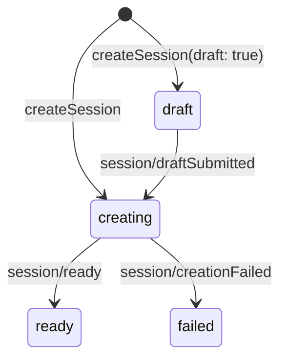

# Session Channel

<StabilityIndex level="2" />

A session channel carries session-level state and acts as the coordination scope for one or more chats. The session tracks lifecycle, customizations, per-session configuration, changesets, and the catalog of chats that belong to the session. The per-conversation state — turns, streaming responses, tool calls, pending messages, and input requests — lives on the [chat channel](./chat-channel).

## URI

```
ahp-session:/<uuid>
```

The path is a server-unique identifier (typically a UUID) chosen by the client at creation time. The session's provider (e.g. `"copilot"`) is **not** encoded in the URI scheme — it is carried on [`SessionSummary.provider`](/reference/session#sessionsummary). This decoupling lets the same scheme address sessions backed by any agent.

Multiple session channels may be active simultaneously. Clients subscribe to each one whose state they want to track.

## State

Subscribers receive a [`SessionState`](/reference/session#sessionstate) snapshot containing the session metadata (title, status, provider, activity, working directory, …) inlined directly, the lifecycle phase, the catalog of [`chats`](/reference/session#sessionstate) belonging to this session, the optional [`defaultChat`](/reference/session#sessionstate) routing hint, active-client state, customizations, changesets, the [`inputNeeded`](#aggregated-input-requests) aggregate, and per-session configuration. Config properties marked `chatMutable` can also be set per chat, so that settings such as tool auto-approval can differ between chats in the same session; see [Per-chat configuration](./chat-channel#per-chat-configuration). Per-conversation state (turns, streaming, tool calls, pending messages, input requests) lives on the [chat channel](./chat-channel). Refer to the [State Model guide](/guide/state-model) for a structural overview.

## Lifecycle

```
1. Client picks a session URI (e.g. ahp-session:/<new-uuid>)
2. Client sends createSession(uri, config) command
3. Client sends subscribe(uri) — MAY be batched with the command
4. Server creates session with lifecycle: 'creating', returns the snapshot
5. Server asynchronously initialises the agent backend
6. On success: server dispatches session/ready
7. On failure: server dispatches session/creationFailed
8. Server broadcasts root/sessionAdded to clients subscribed to ahp-root://
```

A session created with `draft: true` starts in `lifecycle: 'draft'` instead and
enters step 4 only when it is submitted; see [Draft sessions](#draft-sessions).



### Creation

[`createSession`](/reference/session#createsession) is a JSON-RPC request. The client picks the URI; the server allocates session state and begins backend initialisation. If the URI is already in use the server returns `SessionAlreadyExists` (`-32003`).

### Draft sessions

<StabilityIndex level="1.0" />

Draft sessions require the host to advertise
[`InitializeResult.draftSessions`](/reference/common#initializeresult).

A draft session describes a session the user intends to start, before anything
is prepared for it. It gives the in-progress composer a real session to work
against, so completions, customizations, models, and config pickers behave as
they will after the session starts, and it is shared state, so a draft started
on one device can be continued on another.

#### Creating a draft

A client creates a draft by sending `createSession` with `draft: true`. Clients
MUST NOT do so unless the host advertises `draftSessions`. The host:

- creates the session in `lifecycle: 'draft'` with
  [`SessionStatus.IsDraft`](/reference/session#sessionstatus) set;
- sets [`defaultChat`](/reference/session#sessionstate) to a chat that holds the
  user's unsent message in its [`draft`](./chat-channel#drafts);
- resolves [`config`](/reference/session#sessionstate) (schema and defaults) from
  the requested agent provider, working directories, and config values; and
- populates customizations, server tools, and other state that can be derived
  from the requested working directories without side effects.

The host MUST NOT perform any preparation with side effects while the session is
a draft: no clones, no worktrees or branches, and no writes to the working
directories. It MAY warm up the agent provider's runtime.

#### Editing a draft

All of a draft's inputs remain editable:

| Input | How to change it |
|---|---|
| Config values | `session/configChanged`. Every schema property is mutable while drafting; `sessionMutable` applies after submission. |
| Working directories | `session/workingDirectorySet`, `session/workingDirectoryRemoved`, and `session/workingDirectoryReplaced`. Primary-slot restrictions do not apply, and the only directory may be replaced even without `multipleWorkingDirectories`. |
| Unsent message | `chat/draftChanged` on the default chat. |
| Title | `session/titleChanged`. |

The agent provider cannot change. To switch provider, create a new draft and
carry the message over.

The host keeps the draft's config resolved. When an accepted change alters the
schema or its defaults (for example, choosing an isolated checkout adds a
base-branch property), the host dispatches
[`session/configSchemaChanged`](/reference/session#sessionconfigschemachangedaction)
with the new schema and resolved values. This replaces the client-driven
[`resolveSessionConfig`](/reference/root#resolvesessionconfig) loop. For
properties marked `enumDynamic`, clients send
[`sessionConfigCompletions`](/reference/root#sessionconfigcompletions) with the
draft's session URI as `channel`; the host reads the provider, directories, and
values from the draft. [`completions`](/reference/session#completions) targets
the default chat as usual.

Clients MUST NOT create additional chats on a draft, and the host MUST reject
`createChat` and `moveChat` targeting one.

#### Submitting a draft

A client submits a draft by starting a turn: it dispatches `chat/turnStarted` on
the draft's default chat. There is no separate submit action for clients.

The host first validates the draft, for example that every required config
property has a value. If the draft is invalid, the host rejects the
`chat/turnStarted`; the client rolls back its optimistic turn and the session
stays a draft. Otherwise the host dispatches
[`session/draftSubmitted`](/reference/session#sessiondraftsubmittedaction) on the
session channel, which moves the session to `creating` and clears `IsDraft`,
then echoes the turn. The host prepares the session from its final inputs
(creating any isolated checkout the config selects, which it publishes by
replacing the working directory) and dispatches `session/ready` or
`session/creationFailed`, as for any other creation. The turn waits while the
session is `creating` and begins once it is `ready`. If creation fails, the host
ends the turn with an error.

#### Visibility and cleanup

Drafts appear in the session catalogue with `IsDraft` set, so other devices can
list and resume them. Hosts MUST NOT include drafts in
[`listSessions`](/reference/root#listsessions) results or `root/sessionAdded`
notifications for clients that did not declare
[`ClientCapabilities.draftSessions`](/reference/common#clientcapabilities). Such
clients first see the session when it is submitted. Hosts MAY also defer
announcing a draft to other clients until it has content, such as a non-empty
message draft or a changed input.

Clients SHOULD dispose drafts the user abandons, such as a composer closed
without typing, with [`disposeSession`](#disposal). Hosts MAY dispose drafts that
have no content after an idle period of their choosing.

### Active session

Once a session reaches `lifecycle: 'ready'`, clients may create chats on it with [`createChat`](/reference/chat#createchat). Each chat is independently subscribable at its own `ahp-chat:/<cid>` URI; see the [Chat Channel specification](./chat-channel) for the per-chat lifecycle, turn flow, tool calls, and input request handling.

Session-scoped actions dispatched on this channel are limited to:

- Catalog mutations — `session/chatAdded`, `session/chatRemoved`, `session/chatUpdated`, `session/chatsReordered`, and `session/defaultChatChanged`.
- Session-wide configuration — active-client tracking, customizations, changesets, lifecycle transitions.

All actions dispatched on this channel travel on `ActionEnvelope`s whose `channel` is the session URI. Action payloads do NOT carry their own session URI — the channel comes from the envelope.

### Chat catalog mutations

Four discrete actions keep `SessionState.chats` in sync as chats come, go,
change, and reorder. The catalog order is host-authoritative, durable, and
independent of `defaultChat`.

| Action | Payload | Reducer behavior |
|---|---|---|
| `session/chatAdded` | `summary: ChatSummary` | Upsert by `summary.resource`. Appends when no entry has the same URI; otherwise replaces the existing entry. Mirrors `root/sessionAdded`. |
| `session/chatRemoved` | `chat: URI` | Removes the matching entry. No-op when no entry matches. If `state.defaultChat` referenced the removed URI, the reducer clears it. Mirrors `root/sessionRemoved`. |
| `session/chatUpdated` | `chat: URI, changes: Partial<ChatSummary>` | Merges the non-identity fields of `changes` onto the matching entry. No-op when no entry matches; clients SHOULD then wait for a `session/chatAdded`. `resource` (an identity field) and `provider` (which changes only when the chat moves to another session and is republished through `session/chatAdded`) MUST NOT be carried in `changes`. Mirrors `root/sessionSummaryChanged`. |
| `session/chatsReordered` | `chats: URI[]` | Replaces the catalog order from the complete authoritative URI list while preserving summaries. Invalid or incomplete orders are ignored. Emitted when [`moveChat`](./chat-channel#moving-chats) changes ordering. |

The producer of the chat's own [`ChatState`](./chat-channel#state) is responsible
for emitting matching `session/chatUpdated` actions so the catalog and the
per-chat channel stay consistent. Cross-session moves use
`session/chatRemoved` on the previous owner and `session/chatAdded` on the new
owner. Same-session moves only change the selected catalog entry's position.

When a chat's `status` changes, the producer MUST project its
exact value into the matching
[`SessionChatSummary.status`](/reference/session#sessionchatsummary) field and
publish the complete compact `SessionSummary.chats` catalog through
`root/sessionSummaryChanged`. The bitset includes the chat's activity state and
its independent `SessionStatus.IsRead` and `SessionStatus.IsArchived` flags;
clients use bitwise checks to render these states. The compact `status` field
is optional to ease adoption. When it is absent, clients MUST treat the status
as unknown, not as unread or unarchived.

When `defaultChat` is set, its matching `ChatSummary` MUST NOT advertise
`movable: true`. If changing `defaultChat` changes either the old or new
default chat's structural move eligibility, the host publishes the corresponding
`session/chatUpdated` and `chat/movableChanged` actions. Clients do not derive
eligibility from origin or presentation hierarchy; the host remains
authoritative.

`defaultChat` is an input-routing designation, not a pinned position. Other
movable chats may appear before or after it and may use it as a `moveChat`
ordering anchor. Changing `defaultChat` does not reorder the catalog.

### Chat aggregation

[`SessionSummary`](/reference/session#sessionsummary) carries session-wide identity (`resource`, `provider`, `createdAt`, `workingDirectories`) but several of its mutable fields are aggregates derived from the session's chats. Producers SHOULD apply these rules so clients that only consume the session summary (a session list, for example) still see meaningful state:

| Field | Derivation rule |
|---|---|
| `status` | Take the activity bits (`Idle` / `InProgress` / `InputNeeded` / `Error`) from the [`defaultChat`](#defaultchat) when set, else from the most recently modified chat. Promote `InputNeeded` if **any** chat needs input. Promote `Error` if **any** chat is in an error state. The orthogonal `IsRead` / `IsArchived` flags remain session-scoped and pass through unchanged. |
| `activity` | Mirror the activity string of the chat that contributes the activity bits — usually the default chat, but the chat that raised `InputNeeded` / `Error` when a non-default chat wins the promotion. |
| `modifiedAt` | The maximum of every chat's `modifiedAt`. |
| `workingDirectories` | The session-level set. Individual chats MAY restrict to a subset via [`ChatSummary.workingDirectories`](/reference/chat#chatsummary); aggregating per-chat subsets up is meaningless and SHOULD NOT be attempted. |
| `changes` | Optional roll-up. Producers MAY sum per-chat changeset stats or report the most expensive chat's stats — whichever is cheaper to compute. |

Sessions with a single chat satisfy all of the above trivially (the chat's values pass through). The rules only matter once a session carries multiple chats.

### Aggregated input requests

A chat blocks on user input (an [elicitation](/guide/elicitation)) or on a tool confirmation deep inside its turn state. Discovering those blocks would normally require subscribing to every chat channel — impractical for a mobile app or a tool-providing client that only watches the session.

[`SessionState.inputNeeded`](/reference/session#sessionstate) is a session-level roll-up of every outstanding block across all chats. The host upserts entries with `session/inputNeededSet` and removes them with `session/inputNeededRemoved` as the underlying chat-level requests appear and resolve. Whenever the list is non-empty the session's [`status`](#chat-aggregation) carries the `InputNeeded` bit.

Each entry is a [`SessionInputRequest`](/reference/session#sessioninputrequest) — a discriminated union over `kind`:

| `kind` | Carries | Respond by dispatching… |
|---|---|---|
| `chatInput` | the mirrored [`ChatInputRequest`](/reference/chat#chatinputrequest) | `chat/inputCompleted` (or `chat/inputAnswerChanged`) |
| `toolConfirmation` | a [`ToolCallConfirmationState`](/reference/chat#toolcallconfirmationstate) plus `turnId` | `chat/toolCallConfirmed` or `chat/toolCallResultConfirmed` |
| `toolClientExecution` | a [`ToolCallState`](/reference/chat#toolcallstate) in `running` status plus `turnId` and the owning `clientId` | `chat/toolCallComplete` (optionally `chat/toolCallContentChanged`) |
| `toolAuthentication` | a [`ToolCallAuthRequiredState`](/reference/chat#toolcallauthrequiredstate) plus `turnId` | *(see below)* `authenticate` |

Every entry carries the owning `chat` URI plus the identifiers (`request.id`, or `turnId` + `toolCall.toolCallId`) needed to construct the response. A client therefore answers by dispatching the ordinary `chat/*` action **to that chat's channel** — it does **not** need to have subscribed to the chat first. `inputNeeded` is a read/respond convenience surface, not a separate response protocol: the chat channel remains the source of truth and the host removes the aggregate entry once the chat-level request resolves.

`toolAuthentication` is the one exception to the "respond via `chat/*` action" pattern: the client resolves it by calling the connection-level `authenticate` command with the resource from `toolCall.auth.resource` (see [Authentication](/specification/authentication)), not by dispatching an action to the chat. The host dispatches `chat/toolCallAuthResolved` once the token is accepted and removes the `session/inputNeeded` entry at that point.

### Disposal

```jsonc
// Client → Server (request)
{
  "jsonrpc": "2.0",
  "id": 5,
  "method": "disposeSession",
  "params": { "channel": "ahp-session:/<uuid>" },
}
```

The server tears down the session backend, drops associated subscriptions, and broadcasts `root/sessionRemoved` to clients subscribed to `ahp-root://`.

## Methods and events on this channel

This section lists wire methods that are interpreted in the context of a
session URI (`ahp-session:/<uuid>`).

### Commands (`params.channel = "ahp-session:/<uuid>"`)

| Method | Kind | Purpose |
|---|---|---|
| `createSession` | request | Create a session at the chosen URI. |
| `disposeSession` | request | Dispose this session and its backend resources (cascades to every chat in the session's catalog). |

### Notifications (`params.channel = "ahp-session:/<uuid>"`)

| Method | Kind | Meaning |
|---|---|---|
| `action` | server → client notification | Session action envelope (`session/*` action payloads — catalog updates, lifecycle, customizations, changesets). |
| `dispatchAction` | client → server notification | Dispatch client actions on this session (`session/titleChanged`, `session/defaultChatChanged`, ...). |
| `unsubscribe` | client → server notification | Stop receiving messages for this session channel. |

`auth/required` may also target a session URI when auth is required for an
operation scoped to that session; see
[Authentication](/specification/authentication).

## Server Validation of Client Actions

When the server receives a client-dispatched action on this channel, it MUST validate it before applying. Invalid actions MUST be echoed back with a `rejectionReason` on the `ActionEnvelope`. The following validation rules apply:

| Action                                        | Condition                                                                                                                  | Server Behavior                                                                                     |
| --------------------------------------------- | -------------------------------------------------------------------------------------------------------------------------- | --------------------------------------------------------------------------------------------------- |
| Any action referencing a non-existent session | Channel URI not found                                                                                                      | Server MUST silently ignore the action (no echo)                                                    |
| `session/defaultChatChanged`                  | `defaultChat` URI does not match an entry in the session's chat catalog                                                    | Server MUST reject the action                                                                       |

Turn-, tool-call-, input-request-, and pending-message-level validation lives on the [Chat Channel](./chat-channel#server-validation-of-client-actions).

## Actions

Refer to the [Session Channel Reference](/reference/session#actions) for the full per-action reference. All session-scoped action envelopes carry `channel: "ahp-session:/<uuid>"`.

## Catalogue Notifications

Session catalogue events (creation, disposal, summary mutations) are emitted on the [Root Channel](/specification/root-channel#protocol-notifications), not on the session channel itself. This lets clients track the session list without subscribing to every session.
