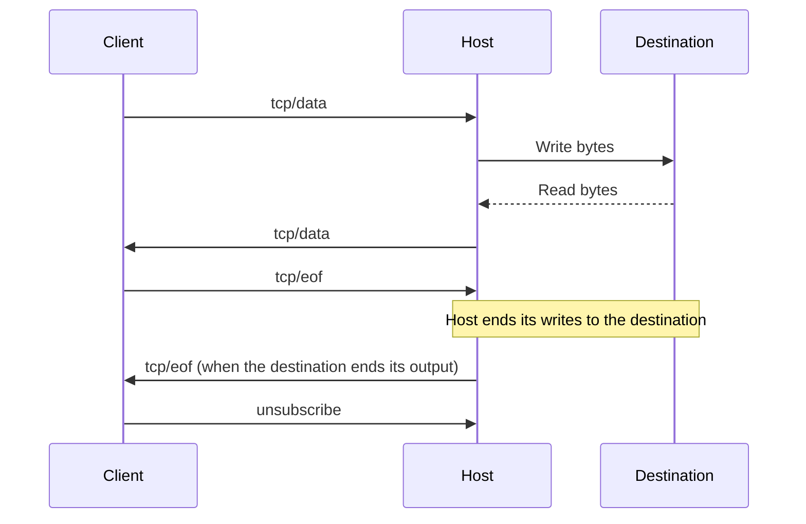

# TCP Channel

<StabilityIndex level="1.0" />

A TCP channel forwards one TCP connection that the host opens to a destination
on its own network. For example, a client can use a TCP channel to reach a
development server that runs on the same machine as the agent.

A TCP channel always uses [windowed delivery](/specification/windowed-delivery).
Its state is an `EmptyState`. Its data is sent in `tcp/data` and `tcp/eof`
notifications.

This revision defines the protocol messages. It does not define how a client or
host connects these messages to local sockets.

## Creating a Connection

A host that supports TCP channels includes `tcpConnections` in the `initialize`
result:

```json
{ "tcpConnections": {} }
```

A client MUST NOT send `createTcpConnection` unless this member is present.

The client chooses a URI for the new channel and sends `createTcpConnection`:

```json
{
  "jsonrpc": "2.0",
  "id": 12,
  "method": "createTcpConnection",
  "params": {
    "channel": "ahp-tcp:/t1",
    "host": "localhost",
    "port": 3000
  }
}
```

| Member | Meaning |
|---|---|
| `channel` | The client-chosen URI for the new channel. It MUST be an `ahp-tcp:` URI that is not already in use. |
| `host` | A DNS name or IP address, resolved on the host's network. It is not a URL. |
| `port` | The destination port, from 1 to 65535 |

The host checks that the client is allowed to connect to the destination, then
opens the connection. On success, the result is `null`. On failure, the host
returns one of these errors:

| Error | Cause |
|---|---|
| `InvalidParams` | The request is not valid, for example because `port` is 0. |
| `PermissionDenied` | The client is not allowed to connect to the destination. |
| `AlreadyExists` | The channel URI is already in use. The host MUST NOT replace the existing connection. |
| `TcpConnectionOpenFailed` (`-32012`) | The host could not open the connection. |

The host SHOULD log the detailed cause of a failure locally, rather than return
system error text to the client.

`createTcpConnection` does not subscribe to the channel. Until the client
subscribes, the host MUST NOT send data for the channel. It stops reading from
the destination, or limits how much destination data it buffers. If the client
does not subscribe within a time limit that the host chooses, the host closes
the connection. The client can also close a connection that it has not
subscribed to by sending `unsubscribe` for the channel.

## Subscribing

The client subscribes to the channel with windowed delivery:

```jsonc
// Client to server
{
  "jsonrpc": "2.0",
  "id": 13,
  "method": "subscribe",
  "params": {
    "channel": "ahp-tcp:/t1",
    "flowControl": {
      "receive": { "windowBytes": 262144, "maximumFrameBytes": 16384 }
    }
  }
}

// Server to client
{
  "jsonrpc": "2.0",
  "id": 13,
  "result": {
    "flowControl": {
      "clientReceive": { "windowBytes": 262144, "maximumFrameBytes": 16384 },
      "hostReceive": { "windowBytes": 131072, "maximumFrameBytes": 16384 }
    }
  }
}
```

A `subscribe` request for a TCP channel MUST include `flowControl`. The host
MUST accept windowed delivery or return an error; it MUST NOT use ordinary
delivery for a TCP channel. For the same reason, a client MUST NOT list a TCP
channel in `initialSubscriptions`, which uses ordinary delivery.

As on every windowed subscription, the server's first data message is a
`channel/snapshot`. For a TCP channel, its state is the empty object:

```json
{
  "jsonrpc": "2.0",
  "method": "channel/snapshot",
  "params": {
    "channel": "ahp-tcp:/t1",
    "snapshot": { "resource": "ahp-tcp:/t1", "state": {}, "fromSeq": 40 }
  }
}
```

Only the client that created the connection can subscribe to it, and only on
the same AHP connection. A host MUST reject a `subscribe` from any other client
or connection. Knowing the channel URI or the client ID does not give access.

## Sending Data

| Method | Direction | Purpose | Counts against the window |
|---|---|---|---|
| `tcp/data` | Either | Sends bytes in the sender's direction | Yes |
| `tcp/eof` | Either | Ends the sender's direction, like a TCP FIN | Yes |
| `tcp/reset` | Either | Aborts the connection in both directions, like a TCP RST | No |

`tcp/data` from the client carries bytes for the destination. `tcp/data` from
the host carries bytes from the destination. For example, the host sends the 5
bytes `Hello` from the destination as:

```json
{
  "jsonrpc": "2.0",
  "method": "tcp/data",
  "params": { "channel": "ahp-tcp:/t1", "data": "SGVsbG8=" }
}
```

`data` MUST be non-empty, padded RFC 4648 base64, without whitespace. The
receiver writes the decoded bytes in the order received. The boundaries between
`tcp/data` notifications have no meaning, so a sender can divide or combine
bytes across notifications as it chooses. It MUST NOT drop, duplicate, or
reorder bytes.

The window counts the size of each notification as sent, like any other data
message, not the number of bytes in `data`. The message above is 180 bytes. To
keep each message within `maximumFrameBytes`, a sender SHOULD send large
amounts of data as several `tcp/data` notifications, rather than one
notification in fragments.

`tcp/eof` ends the sender's direction after the data that it has already sent.
The other direction can continue. The sender MUST NOT send `tcp/data` after
`tcp/eof`.

`tcp/eof` counts against the window, so a sender may have to wait for credit
before it can send it. A receiver MUST therefore release `tcp/data` as it writes
the bytes, and not wait for `tcp/eof` before releasing them. Otherwise neither
peer can make progress.



## Flow Control

A receiver releases a `tcp/data` notification with `channel/credit` when it has
written the bytes to its own connection, or to a buffer whose size it limits.
When the window is full, the host stops reading from the destination, and the
client stops reading from its local source. TCP flow control then slows down
the other end of each connection.

Releasing a notification does not mean that the destination has received or
processed the bytes.

## Ending a Connection

To close a connection normally, each peer sends `tcp/eof` when its direction
ends. After both directions have ended, the client sends `unsubscribe`. The host
writes the data that it has already accepted, then closes the destination
connection. The host MUST limit how long it waits to write that data. If the
destination does not accept it in time, the host aborts the destination
connection.

If the client sends `unsubscribe` before both directions have ended, the host
aborts the destination connection, as if it had received `tcp/reset`.

Either peer sends `tcp/reset` to abort the connection:

```json
{
  "jsonrpc": "2.0",
  "method": "tcp/reset",
  "params": { "channel": "ahp-tcp:/t1" }
}
```

The host sends `tcp/reset` when the destination connection fails or is reset,
or when the client sends invalid data, such as `tcp/data` that is not valid
base64 or that follows `tcp/eof`. The client sends `tcp/reset` to abort the
connection without waiting for buffered data to be written.

When a peer sends or receives `tcp/reset`, it discards data that it has not yet
sent or written, and closes its own side of the connection. Neither peer sends
more data on the channel. The client then sends `unsubscribe`.

`tcp/reset` does not count against the window, so a peer can send it when the
window is full.

## Connection Loss

A TCP channel does not survive the loss of the AHP connection, and is never
resumed automatically. When the AHP connection closes:

- The host closes every TCP connection that was created on it, and cancels any
  `createTcpConnection` request that is still in progress.
- The client closes its own connection for each TCP channel.
- Neither peer sends data from the old connection again.

A client MUST NOT include TCP channels in the `subscriptions` or `windows` of a
`reconnect` request. If it does, the server lists them in `missing` and leaves
them out of `windows`.

To connect again, the client sends `createTcpConnection` with a new channel URI,
then subscribes to it. This opens a new connection to the destination.

## Security

A TCP channel is private to the client that created it. It does not appear in
the root state or in any other list of channels, and it is not part of a
session.

The host opens the connection from its own network. DNS names, `localhost`, and
routes refer to the host's machine and network, not the client's, and not
necessarily the agent's sandbox. A host MUST:

- Apply its own policy for which destinations a client can connect to, and
  check the resolved address, not only the name in `host`.
- Limit the number of connections for each client.
- Limit the time for opening a connection, the time that a created connection
  can wait for a subscription, and the time to write remaining data when a
  connection is closed.
