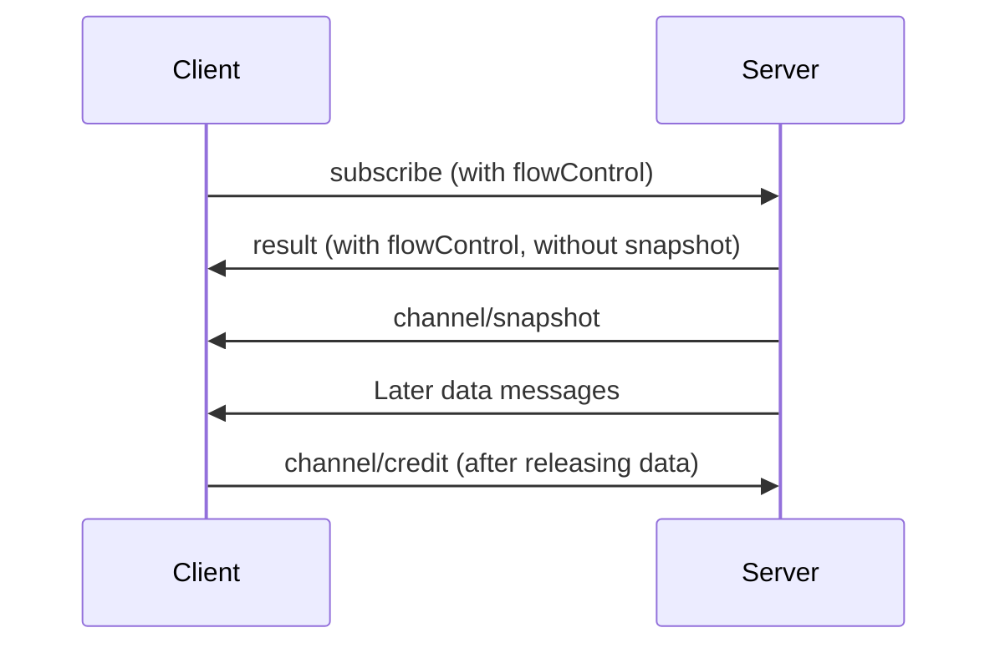
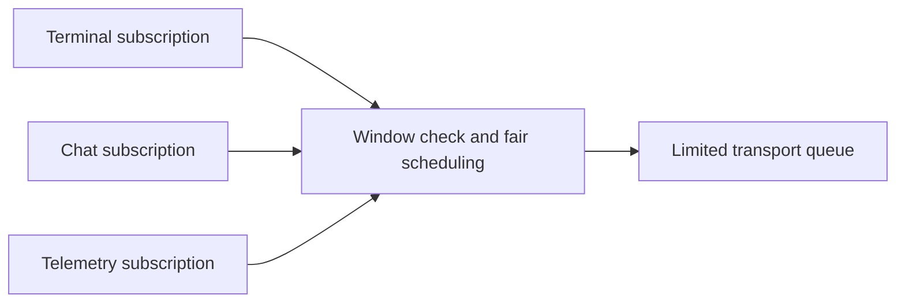

# Windowed Delivery

<StabilityIndex level="1.0" />

Windowed delivery is an optional mode for one subscription. Each subscription
has a window: a target for the amount of data that the sender has sent but the
receiver has not yet released with credit. When the window is full, the sender
waits for credit before it sends more data. This lets a sender slow down the
source of the data, such as a terminal process, when the receiver falls behind.

The window is a soft target. A sender can go slightly past it with its last
message or fragment. Each JSON-RPC data message also has a hard size limit. Large
messages are sent in fragments, and each fragment counts against the window.
Fragments also let subscriptions take turns, so that one busy subscription does
not hold up the whole connection.

A subscription uses windowed delivery only if the client offers it in
`subscribe` and the server accepts the offer. Otherwise the subscription uses
ordinary delivery, as described in
[Channels and Subscriptions](/specification/subscriptions).

This page uses these terms:

- **Sender** and **receiver** refer to one direction of a subscription. Both the
  client and the server can be a sender.
- A **control message** is `channel/credit`, `unsubscribe`, or a control
  message that a channel defines, such as `tcp/reset`. Control messages do not
  count against the window.
- A **data message** is any other notification for the subscription, including
  `channel/frame` fragments. Examples are `action`, `channel/snapshot`,
  `dispatchAction`, and `auth/required`. Data messages
  count against the window.

Requests and responses, such as `resourceRead`, are not part of a subscription
and are not counted.

## Negotiation

The client offers windowed delivery by including `flowControl.receive` in
`subscribe`. These values are the largest limits that the client can accept for
data that it receives:

| Limit | Meaning |
|---|---|
| `windowBytes` | The target amount of outstanding data. When outstanding data reaches this value, the sender waits for credit. This is a soft target. |
| `maximumFrameBytes` | The largest JSON-RPC data message, including a `channel/frame` notification, that can be sent. This is a hard limit, and MUST be at least 1024. |

All sizes are measured as described in [Measuring Size](#measuring-size).

The server accepts by returning `flowControl` in the result. The result contains
two sets of limits:

- `clientReceive` applies to data that the server sends to the client.
- `hostReceive` applies to data that the client sends to the server.

The server MAY set each `clientReceive` value lower than the client offered. It
MUST NOT set any value higher than the client offered. `maximumFrameBytes` MUST
be at least 1024 in both sets of limits. A server MUST decline windowed delivery
if, within these limits, it cannot send a `channel/frame` fragment that carries
at least one character, for example because the channel URI is very long.

In this example, the server accepts small limits so that the later examples are
easy to follow:

```jsonc
// Client to server
{
  "jsonrpc": "2.0",
  "id": 10,
  "method": "subscribe",
  "params": {
    "channel": "ahp-terminal:/t1",
    "flowControl": {
      "receive": {
        "windowBytes": 262144,
        "maximumFrameBytes": 16384
      }
    }
  }
}

// Server to client
{
  "jsonrpc": "2.0",
  "id": 10,
  "result": {
    "flowControl": {
      "clientReceive": {
        "windowBytes": 512,
        "maximumFrameBytes": 1024
      },
      "hostReceive": {
        "windowBytes": 512,
        "maximumFrameBytes": 1024
      }
    }
  }
}
```

A server that does not support windowed delivery, or that declines the offer,
omits `flowControl` and returns an ordinary result. The subscription then uses
ordinary delivery. Neither peer can send `channel/frame` or other windowed
delivery messages for the subscription unless the server has accepted.

When the server accepts:

- The result MUST NOT contain `snapshot`. The snapshot is sent as a data message
  instead.
- All counters for both directions start at zero. If the client was already
  subscribed with windowed delivery, the counters instead continue from their
  current values, and only the limits change.
- Both peers MUST apply the limits and counters in this specification to every
  data message on the subscription.

The limits apply to one subscription. Credit for one subscription never allows
data to be sent on another subscription. For example, if two clients view the
same terminal, each client's subscription has its own window. The server needs
a separate policy for a slow client so that it does not block the other client
or the terminal process.

## Initial Data

The client MUST be ready to receive and process data messages as soon as it
receives the `subscribe` result. Initial data can be larger than the window,
and the server cannot finish sending it until the client returns credit.

The first data message that the server sends on a windowed subscription MUST
be a `channel/snapshot` notification. If the snapshot is sent in fragments, this
applies to the joined message. Every data message after the snapshot is a
change to that state, or new data for the channel.

The server MUST send the `subscribe` result before any data message or fragment
for the subscription. The client can send data messages, such as
`dispatchAction`, as soon as it receives the result; it does not need to wait
for the snapshot.



The snapshot's `snapshot.resource` MUST be the subscribed channel URI. For
example:

```json
{
  "jsonrpc": "2.0",
  "method": "channel/snapshot",
  "params": {
    "channel": "ahp-terminal:/t1",
    "snapshot": {
      "resource": "ahp-terminal:/t1",
      "state": {
        "title": "Shell",
        "content": [],
        "lifecycle": { "status": "running" },
        "claim": { "kind": "client", "clientId": "client-1" }
      },
      "fromSeq": 5
    }
  }
}
```

This message is 520 bytes when serialized without whitespace, so it fits within
`maximumFrameBytes` and is sent as shown. It also counts 520 bytes against the
window.

After processing the snapshot, the client sends credit for it:

```json
{
  "jsonrpc": "2.0",
  "method": "channel/credit",
  "params": { "channel": "ahp-terminal:/t1", "consumedBytes": 520 }
}
```

The snapshot is larger than the 512-byte window. This is allowed because the
window was empty when the server sent it, and the snapshot fits within
`maximumFrameBytes`; see [Window and Credit](#window-and-credit). The server
cannot send more data until it receives credit.

A channel whose state has no fields, such as a telemetry channel, also starts
with a `channel/snapshot`. Its `state` is an empty object, and `fromSeq` is the
server's current `serverSeq`.

## Sending Data Messages

A data message on a windowed subscription has the same form as on an ordinary
subscription. For example, terminal output is an ordinary `action`
notification. This message is 284 bytes:

```json
{
  "jsonrpc": "2.0",
  "method": "action",
  "params": {
    "channel": "ahp-terminal:/t1",
    "action": { "type": "terminal/data", "data": "Hello\r\n" },
    "serverSeq": 6
  }
}
```

The message still counts against the window. A receiver MUST NOT treat a data
message as uncounted because it is not wrapped in `channel/frame`.

Each JSON-RPC data message sent, including a `channel/frame` notification, MUST
NOT exceed `maximumFrameBytes`. If a data message is larger than
`maximumFrameBytes`, the sender MUST do one of the following:

- Split the content into several smaller data messages that are each valid on
  their own. For example, send long terminal output as several `terminal/data`
  actions, in order.
- Send the message in fragments, as described in [Fragments](#fragments).

A data message that fits within `maximumFrameBytes` can be sent whole, even if
it is larger than the remaining credit; see [Window and Credit](#window-and-credit).
A sender can also send it in fragments, so that it does not hold up other
subscriptions.

## Fragments

Fragments have two purposes:

- They carry a data message that is larger than `maximumFrameBytes`.
- They let subscriptions share the connection. A large message sent whole may
  hold up every other subscription until it has been sent. Sent in fragments, it
  takes turns with other subscriptions.

A sender divides a data message into fragments by serializing it to JSON text,
dividing the text into pieces, and sending each piece in a `channel/frame`
notification:

| Member | Meaning |
|---|---|
| `channel` | The subscription's channel URI |
| `data` | The next piece of the serialized message |
| `final` | `true` on the last fragment. Absent or `false` on other fragments. |

For example, the 284-byte `action` message above can be sent as two fragments:

```jsonc
// Server to client: first fragment
{
  "jsonrpc": "2.0",
  "method": "channel/frame",
  "params": {
    "channel": "ahp-terminal:/t1",
    "data": "{\"jsonrpc\":\"2.0\",\"method\":\"action\",\"params\":{\"channel\":\"ahp-terminal:/t1\","
  }
}

// Server to client: last fragment
{
  "jsonrpc": "2.0",
  "method": "channel/frame",
  "params": {
    "channel": "ahp-terminal:/t1",
    "data": "\"action\":{\"type\":\"terminal/data\",\"data\":\"Hello\\r\\n\"},\"serverSeq\":6}}",
    "final": true
  }
}
```

The receiver joins the `data` strings in the order received. When it receives
the fragment with `final: true`, it parses the joined text as one JSON-RPC
notification and processes it in the same way as a message received without
fragments. The receiver MUST NOT process a message before it has the final
fragment.

Each fragment counts against the window when it is sent. If the window becomes
full partway through a message, the sender waits for credit before it sends the
next fragment. See [Window and Credit](#window-and-credit).

Each `data` value is a JSON string that contains JSON text, so it has two levels
of escaping. In the last fragment, `\\r\\n` decodes to the text `\r\n`. When the
receiver parses the joined message, `\r\n` decodes to a carriage return and a
line feed.

The following rules apply to fragments:

1. `data` MUST NOT be empty.
2. A fragment MUST NOT divide a UTF-16 surrogate pair.
3. The `channel` inside the joined message MUST be the same as the `channel` of
   the fragments.
4. For each subscription and direction, only one fragmented message can be in
   progress. After the first fragment of a message, the sender MUST NOT send
   another data message for that subscription and direction until it has sent
   the final fragment. The sender can send messages for other subscriptions, and
   control messages, between fragments.
5. Control messages MUST NOT be sent in fragments. Requests and responses MUST
   NOT be sent in `channel/frame`.
6. Fragments do not have message IDs or offsets. The transport delivers them in
   order.

A sender chooses the size of each fragment, up to `maximumFrameBytes`. Smaller
fragments let subscriptions take turns more often, but each fragment adds its
`channel/frame` envelope to the data sent. When the remaining credit is smaller
than `maximumFrameBytes`, a sender SHOULD make the next fragment about the size
of the remaining credit, so that it fills the window without going far past it.
The fragment does not need to match the remaining credit exactly. When the
remaining credit is smaller than a `channel/frame` envelope, the fragment goes
slightly past the window.

## Measuring Size

All sizes, limits, and counters use **UTF-16 bytes**: two bytes for each UTF-16
code unit of the JSON text. This is true for every transport, including
transports that send UTF-8.

| Text | UTF-16 bytes | UTF-8 bytes, for comparison |
|---|---:|---:|
| `A` | 2 | 1 |
| `é` | 2 | 2 |
| `😀` | 4 | 4 |

In JavaScript, the size of a string is `text.length * 2`. Implementations in
other languages MUST count UTF-16 code units, not characters or UTF-8 bytes.

The size of a message is the size of its complete JSON-RPC text, as sent and as
received. For a fragment, this includes the `channel/frame` envelope and the
escape characters that JSON adds to `data`. The same size is used for the
window, for credit, and for `maximumFrameBytes`.

| Message | Size |
|---|---:|
| `channel/snapshot` example | 520 |
| `action` example, sent whole | 284 |
| `action` example, first fragment | 360 |
| `action` example, last fragment | 374 |

Sent as two fragments, the `action` uses 734 bytes of the window instead of 284,
because the fragment envelopes and escape characters count. This is the real
amount of data sent, so it is the amount the window counts.

A receiver MUST measure the text it received. It MUST NOT parse a message and
serialize it again to compute the size, because whitespace, member order, and
escape sequences can change.

## Window and Credit

For each direction of a subscription, the sender keeps two totals:

- **Sent bytes**: the total size of all data messages and fragments that it
  has sent.
- **Consumed bytes**: the highest `consumedBytes` value it has received in
  `channel/credit`.

The difference is the **outstanding** data:

```text
outstanding = sent bytes - consumed bytes
```

The sender MUST NOT send a data message or fragment while outstanding data is
equal to or greater than `windowBytes`. It adds the size of each data message
or fragment to sent bytes when it sends it.

The window is a soft target. A sender does not know the exact size of a message
until it serializes it, and it does not need to try different sizes to fit the
remaining credit exactly. The last message or fragment that a sender sends
before the window is full can go past the window. For example, if 500 bytes of
a 512-byte window are outstanding, the sender can still send a 284-byte action
whole. Because every message and fragment is
at most `maximumFrameBytes`, outstanding data is always less than
`windowBytes + maximumFrameBytes`.

A sender SHOULD send large messages in fragments, so that it does not go far
past the window. For example, with a 64 KiB window and 16 KiB
`maximumFrameBytes`, a 100 KiB tool-call action is sent as a series of
fragments of up to 16 KiB. After about 64 KiB, the window is full, and the
sender waits for credit before it sends the next fragment. While it waits,
other subscriptions can still send data.

The receiver tells the sender how much data it has released by sending
`channel/credit`. The `consumedBytes` value is the total size of all data
messages and fragments that the receiver has released since the subscription
started. It is a total, not an increment.

Continuing the example, the client receives the 284-byte `action` after the
520-byte snapshot. After it processes the action, it sends:

```json
{
  "jsonrpc": "2.0",
  "method": "channel/credit",
  "params": { "channel": "ahp-terminal:/t1", "consumedBytes": 804 }
}
```

| Message | Size | `consumedBytes` after release |
|---|---:|---:|
| `channel/snapshot` | 520 | 520 |
| `action` | 284 | 804 |

The credit for the action is 284 bytes, not the 14 bytes of terminal text in
the action. Had the server sent the action as the two fragments shown in
[Fragments](#fragments), the credit for it would be 734 bytes, and
`consumedBytes` would be 1254.

The receiver decides when to send credit. For example:

- A state action can be released when the receiver has applied it to the
  channel state, or has rejected it. Credit does not mean that the action
  succeeded.
- Stream data, such as terminal output written to a local buffer, can be
  released when that buffer has released the data.

When outstanding data reaches `windowBytes`, the sender stops. The receiver
MUST send credit as soon as it is ready to receive more data. If it does not,
the sender waits indefinitely. A receiver that sends credit as soon as data
arrives does not slow the sender down.

A receiver can release fragments at any time while it receives a message. It
MUST NOT wait for all fragments of a message to arrive before releasing any of
them. The sender stops when the window is full, so a message larger than the
window would never be completed.

`consumedBytes` can be any value up to sent bytes; it does not need to match
the end of a message or fragment. A sender ignores a value that is less than or
equal to the previous value.

This specification does not define what happens when a peer breaks these rules:
for example, when `consumedBytes` is greater than sent bytes, when a sender
sends while outstanding data is at or above `windowBytes`, or when a message is
larger than `maximumFrameBytes`. Going past the window with the last message or
fragment is not a violation. An implementation that detects a violation can log
it or close the connection.

The server MUST share the connection fairly among subscriptions, and MUST limit
the size of its outgoing transport queue.



For data sent from the client to the server, the same rules apply with the
roles reversed: the client checks the `hostReceive` limits, and the server sends
`channel/credit`.

## Control Messages

| Method | Direction | Purpose |
|---|---|---|
| `channel/credit` | Either | Reports the total size of data messages and fragments that the receiver has released |
| `unsubscribe` | Client to server | Ends the subscription |

A channel can define its own control messages. For example, the
[TCP channel](/specification/tcp-channel) defines `tcp/reset`, which aborts a
connection.

The protocol types mark every control message with the `@windowExempt`
annotation, and the reference pages show "Counts against the window: No" for
them. Each generated client includes the same list, for example
`WINDOW_EXEMPT_METHODS` and `countsAgainstWindow` in TypeScript.

Both peers must agree on which messages are control messages; otherwise their
counters differ. A peer MUST NOT send a control message that the negotiated
protocol version does not include. A peer counts a notification whose method it
does not recognize as a data message.

Control messages do not count against the window, and a peer can send them
when the window is full. Implementations MUST limit the size, rate, and queue
of control messages separately.

There is no general message for ending a subscription because of an error. A
channel that needs one defines its own control message, such as `tcp/reset`.

## When the Window Is Full

When a sender has more data than the window allows, it MUST NOT queue an
unlimited amount of it. What it does instead depends on the channel. For
example:

- A terminal can stop reading process output until credit arrives.
- A [TCP channel](/specification/tcp-channel) can stop reading from its socket.
- A chat can combine pending `chat/delta` actions for the same response part
  into one action.

Windowed delivery does not by itself allow a sender to combine or drop data. A
sender can do so only when the channel and the subscription's
[delivery preferences](/specification/subscriptions#delivery-preferences) allow
it.

## Reconnection

When the connection closes, neither peer can know which data and credit the
other received before it closed. Windowed subscriptions therefore do not carry
their counters across a reconnection. A kept subscription starts its counters
at zero on the new connection and negotiates its limits again, in the same way
as `subscribe`.

For each windowed subscription that it wants to keep, the client adds an item
to `windows.items` in the `reconnect` request:

| Member | Meaning |
|---|---|
| `channel` | The subscription's channel URI. This URI MUST also be in `subscriptions`. Each channel can appear only once. |
| `flowControl.receive` | The limits that the client offers for the new connection, as in `subscribe` |
| `lastAppliedServerSeq` | The `serverSeq` of the last action or observed state that the client has applied or kept for processing on this channel. Required for replay. |

The server includes `windows` in the `reconnect` result only if the request
contained `windows`. The result contains only channels from the request. Each
item contains:

| Member | Meaning |
|---|---|
| `channel` | The subscription's channel URI |
| `flowControl` | The limits that the server accepted for the new connection, as in a `subscribe` result. The server MAY lower the limits that the client offered, and MUST NOT raise them. |
| `recovery` | How the server resumes sending data: `snapshot`, `replay`, or `live` |

If a channel from the request is not in the result, the subscription was not
kept. The client discards its old subscription and, for a byte stream, closes
the stream. The client does this for every reason that a subscription is not
kept, such as a permissions change or missing server data. The server SHOULD log
the reason locally.

For each kept subscription:

- Both peers discard partial fragmented messages from the old connection.
- All counters start at zero on the new connection. Credit counts only data
  received on the new connection. A client that still holds data from the old
  connection keeps it, but never sends credit for it.
- Neither peer sends data messages or credit for the subscription before the
  server sends the `reconnect` result.

A client that still holds a lot of unread data from the old connection can offer
a smaller window, and send `subscribe` later to increase it.

Windowed subscriptions are not included in the `actions` or `snapshots` of the
`reconnect` result. Each one recovers through its own data messages, using its
`recovery` value:

| `recovery` | Server behavior | Client behavior |
|---|---|---|
| `snapshot` | Sends a new `channel/snapshot` | Replaces its state for the channel |
| `replay` | Sends again each action with a `serverSeq` greater than `lastAppliedServerSeq` | Continues with the same state |
| `live` | Sends only data created after reconnection | Continues from the current point |

With `snapshot` recovery, the new `channel/snapshot` MUST be the first data
message that the server sends after the `reconnect` result. With `live`
recovery, every data message after the `reconnect` result is new data.

Sequence numbers decide what is sent again. Data messages without a sequence
number, such as telemetry batches, are not sent again. The client knows which of
its `dispatchAction` notifications the server received from their echoes, which
carry `origin.clientSeq`; see [Write-Ahead Reconciliation](/guide/reconciliation).

The client ID and channel URI identify a windowed subscription. A client has at
most one subscription for each channel, so the protocol has no subscription IDs.
The old connection MUST be closed before the new connection is used. Both peers
MUST ignore delayed events from the old connection. If the result of
`reconnect` is lost, the client sends `reconnect` again for the same
subscriptions.

The time allowed for reconnection MUST be limited. A byte stream cannot be
recovered if a peer restarts or loses its buffers.

### Example

The connection closes after the client has received the 284-byte terminal
output in the earlier example, but before it has released the output or sent
credit for it. The client also had a windowed subscription to
`ahp-terminal:/t2`, which the server cannot keep.

```jsonc
// Client to server
{
  "jsonrpc": "2.0",
  "id": 11,
  "method": "reconnect",
  "params": {
    "channel": "ahp-root://",
    "clientId": "client-1",
    "lastSeenServerSeq": 6,
    "subscriptions": ["ahp-terminal:/t1", "ahp-terminal:/t2"],
    "windows": {
      "items": [
        {
          "channel": "ahp-terminal:/t1",
          "flowControl": {
            "receive": { "windowBytes": 262144, "maximumFrameBytes": 16384 }
          },
          "lastAppliedServerSeq": 6
        },
        {
          "channel": "ahp-terminal:/t2",
          "flowControl": {
            "receive": { "windowBytes": 262144, "maximumFrameBytes": 16384 }
          },
          "lastAppliedServerSeq": 0
        }
      ]
    }
  }
}

// Server to client
{
  "jsonrpc": "2.0",
  "id": 11,
  "result": {
    "type": "replay",
    "actions": [],
    "missing": ["ahp-terminal:/t2"],
    "windows": {
      "items": [
        {
          "channel": "ahp-terminal:/t1",
          "flowControl": {
            "clientReceive": {
              "windowBytes": 512,
              "maximumFrameBytes": 1024
            },
            "hostReceive": {
              "windowBytes": 512,
              "maximumFrameBytes": 1024
            }
          },
          "recovery": "replay"
        }
      ]
    }
  }
}
```

For `ahp-terminal:/t1`:

- The server accepts the same limits as before, and both peers start their
  counters at zero.
- The client keeps its state and the 284 bytes of unread output. When it
  releases the output, it does not send credit for it, because it received the
  output on the old connection.
- The server does not send the output again, because its `serverSeq` (6) is
  not greater than `lastAppliedServerSeq`. The next data message on the
  subscription is new data.

`ahp-terminal:/t2` is not in `windows.items`, so the client discards that
subscription.

## Limitations

Windowed delivery does not define whether a channel can lose data. Each channel
defines that. For example, a channel that carries a TCP connection cannot lose
data, a terminal channel can recover with a new snapshot, and a telemetry
channel can send only current data.

Windowed delivery controls how much data a sender has outstanding and limits
the size of each JSON-RPC message. It does not limit the size of a complete
message, receiver memory use, or bytes per second. It does not limit request
results, such as a large `resourceRead` result, or the snapshots in the
`initialize` result. It does not limit total memory use for a connection.
Streaming file reads would require a separate request or channel that sends the
file in parts.

## Implementation Notes

Generated client models contain the message types for windowed delivery. They
do not implement negotiation, counting, scheduling, or retained queues. A peer
MUST implement the rules on this page before it offers or accepts windowed
delivery. After acceptance, a peer MUST NOT treat data messages as uncounted
and MUST NOT change the subscription to ordinary delivery.

These message types are optional additions. Peers that do not offer windowed
delivery continue to use ordinary subscriptions. In Rust, struct literals for
`SubscribeParams` and the reconnect types must set the new optional fields
(`flow_control` or `windows`) to `None` for ordinary delivery;
`SubscribeParams` constructors use ordinary delivery by default.
